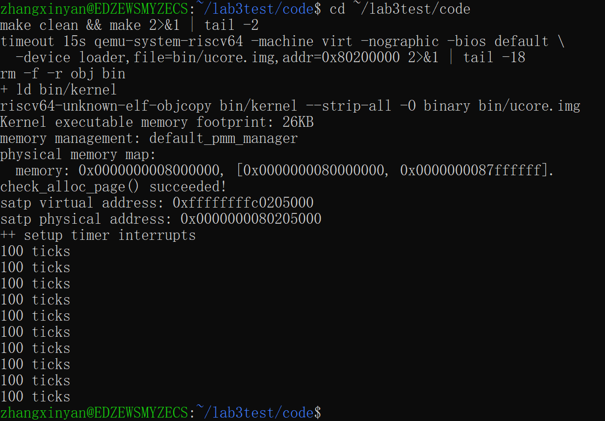
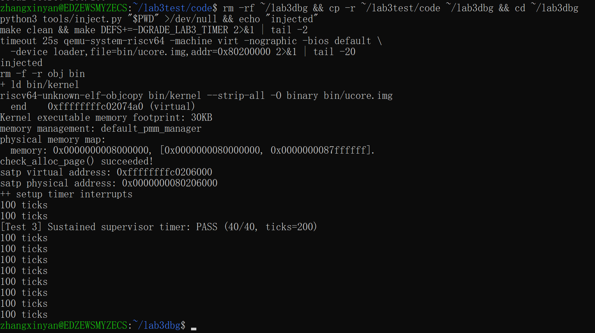
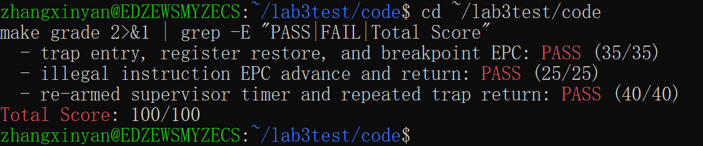

# OSlab3 实验报告

## 实验基本信息

| 项目       | 内容                                  |
| -------- | ----------------------------------- |
| **实验名称** | Lab 3: 中断与中断处理                      |
| **小组成员** | 2411570-何美璇、2410699-张欣妍、2411433-李烁菲 |
| **完成日期** | 2026-11-4                           |

### 小组分工

| 成员          | 负责的练习/模块                                    | 负责的实验报告模块                                                       |
| --------------   | ------------------------------------------- | --------------------------------------------------------------- |
| 2411433-李烁菲   | 功能模块一|实验目的，整体分析，对操作系统的理解，以及模块一的对应部分|
| 2411570-何美璇 | <font color="">功能模块二中的异常处理（exception_handler）</font> | <font color="">功能模块二（异常处理部分），六、实验总结与收获对应部分</font> |
| 2410699-张欣妍 | 功能模块二中的中断处理（interrupt_handler） | 功能模块二（中断处理部分）与 prompt.md 第 3 段 |


## 一、实验目的

1. 理解 RISC-V 架构下的中断与异常处理机制，掌握相关寄存器、指令及中断使能方式。
2. 理解 Trap frame 的作用，掌握处理器上下文的保存、恢复及 Trap 入口与返回流程。
3. 掌握中断与异常的分类和分发机制，实现时钟中断、非法指令异常和断点异常的处理。
4. 理解汇编代码与 C 语言处理函数的调用关系，掌握Trap 处理机制与内核功能的协作方式。
5. 通过编译和运行程序，验证 Trap 处理流程的正确性，加深对中断处理机制的理解。

## 二、实验环境

你们使用的 AI 工具

| 成员          | AI 编程工具          | 底层模型                | 备注  |
| ----------- | ---------------- | ------------------- | --- |
| 2411570-何美璇 | Claude Code      | Claude Sonnet 5.5   |     |
| 2410699-张欣妍 | DeepSeek Harness | DeepSeek-V4.1-Flash |     |
| 2411433-李烁菲 | claude           | claude sonnet 5     |     |

**运行环境与工具链**

| 项目 | 内容 |
| --- | --- |
| 运行环境 | WSL2 / Ubuntu 26.04 LTS |
| 交叉编译器 | `riscv64-unknown-elf-gcc` 15.1.0 |
| 交叉调试器 | `riscv64-unknown-elf-gdb` 16.3 |
| 模拟器 | `qemu-system-riscv64` 4.1.1 |
| 构建工具 | GNU Make 4.4.1 |


## 三、实验整体逻辑分析

### 3.1 本章节的逻辑主线

实验3主要围绕 RISC-V 的 Trap 处理机制展开，核心是建立从中断或异常发生到处理器恢复执行的完整流程。
整个机制由硬件支持、初始化配置和 Trap 处理三个部分组成：硬件支持部分提供时钟事件设置与中断使能接口；初始化部分设置中断入口并开启时钟中断；Trap 处理部分通过汇编代码保存处理器上下文，再由 C 语言代码识别并处理不同类型的中断与异常，最后恢复上下文并通过 `sret` 返回原执行流。通过这一机制，内核能够在不中断原有程序执行逻辑的前提下响应时钟中断，并对非法指令和断点异常进行处理。

### 3.2 功能的逐步实现

本实验依赖实验2，按照“上下文恢复—Trap 入口与返回—中断与异常处理”的顺序逐步实现内核的 Trap 处理机制。

**第一步：实现上下文恢复与 Trap 入口** 根据已有的 SAVE_ALL 和 struct trapframe，借助 AI 实现 RESTORE_ALL，确保处理器状态能够正确恢复；实现 __alltraps，将 Trap frame 作为参数传递给 C 语言函数 trap()，并通过 __trapret 和 sret 完成上下文恢复与返回。

**第二步：实现中断处理功能** 在 interrupt_handler() 中，根据 tf->cause 识别中断类型。对于时钟中断，设置下一次时钟事件、更新 ticks、按要求输出统计信息，并在达到规定条件后关闭系统；对于其他中断，根据实验要求输出提示或调用 print_trapframe(tf)。

**第三步：实现异常处理功能** 在 exception_handler() 中识别非法指令异常、断点异常及其他异常。对于前两者，输出规定信息并正确更新 tf->epc，避免重复执行异常指令；对于其他异常，调用 print_trapframe(tf) 输出上下文信息。

**第四步：整合与验证** 完成各模块后，检查上下文保存与恢复、函数调用及 Trap 返回流程的一致性，并通过编译和运行测试，验证时钟中断、异常处理及系统关机等功能是否正常。

## 四、实验内容与实现

### 功能模块一：Trap 上下文恢复与 Trap 入口功能

**负责人**：2411433-李烁菲

#### 模块功能描述

**需要实现的函数：**
```asm
    .macro RESTORE_ALL

    # 1) 先借用 s1/s2 把 sstatus、sepc 写回 CSR (此时 s1/s2 还未被恢复)
    LOAD s1, 32*REGBYTES(sp)        # 槽32: sstatus
    LOAD s2, 33*REGBYTES(sp)        # 槽33: sepc (trap() 可能已修改)
    csrw sstatus, s1
    csrw sepc, s2
 
    # 2) 恢复除 x0、x2(sp) 外的所有通用寄存器 (s1/s2 在此处被恢复为原值)
    #    x0 恒为 0, 无需恢复; badvaddr/cause 无需写回
    LOAD x1, 1*REGBYTES(sp)
    LOAD x3, 3*REGBYTES(sp)
    LOAD x4, 4*REGBYTES(sp)
    LOAD x5, 5*REGBYTES(sp)
    LOAD x6, 6*REGBYTES(sp)
    LOAD x7, 7*REGBYTES(sp)
    LOAD x8, 8*REGBYTES(sp)
    LOAD x9, 9*REGBYTES(sp)
    LOAD x10, 10*REGBYTES(sp)
    LOAD x11, 11*REGBYTES(sp)
    LOAD x12, 12*REGBYTES(sp)
    LOAD x13, 13*REGBYTES(sp)
    LOAD x14, 14*REGBYTES(sp)
    LOAD x15, 15*REGBYTES(sp)
    LOAD x16, 16*REGBYTES(sp)
    LOAD x17, 17*REGBYTES(sp)
    LOAD x18, 18*REGBYTES(sp)
    LOAD x19, 19*REGBYTES(sp)
    LOAD x20, 20*REGBYTES(sp)
    LOAD x21, 21*REGBYTES(sp)
    LOAD x22, 22*REGBYTES(sp)
    LOAD x23, 23*REGBYTES(sp)
    LOAD x24, 24*REGBYTES(sp)
    LOAD x25, 25*REGBYTES(sp)
    LOAD x26, 26*REGBYTES(sp)
    LOAD x27, 27*REGBYTES(sp)
    LOAD x28, 28*REGBYTES(sp)
    LOAD x29, 29*REGBYTES(sp)
    LOAD x30, 30*REGBYTES(sp)
    LOAD x31, 31*REGBYTES(sp)
 
    # 3) 最后恢复 sp: 值取自槽2 (陷入前的 sp), 之后不再有基于 sp 的访存
    LOAD x2, 2*REGBYTES(sp)
```

**功能说明：**

RESTORE_ALL 宏用于在异常或中断处理完成后恢复处理器现场，是 Trap 返回流程的重要组成部分。发生 Trap 时，入口代码通过 SAVE_ALL 将通用寄存器和关键状态寄存器保存到栈上构成的 Trap frame 中；处理函数 trap() 完成相应处理后，程序进入 __trapret，执行本模块实现的恢复操作。

首先，从 Trap frame 中读取偏移为 32*REGBYTES 和 33*REGBYTES 的内容，分别恢复 sstatus 和 sepc。其中，sstatus 保存处理器的状态信息，sepc 保存异常返回地址，也允许处理函数根据具体情况修改返回位置。随后，按照保存时使用的偏移依次恢复通用寄存器。由于 x0 恒为零，无需显式恢复；为避免栈指针提前改变导致后续访存位置错误，原始 sp 被安排在最后恢复。

完成现场恢复后，执行 sret 指令，由处理器根据恢复后的状态和返回地址继续执行。该实现的关键在于保证寄存器保存与恢复的偏移一致，并合理安排关键状态寄存器和栈指针的恢复顺序，保证 Trap 返回过程的正确性。


#### 最终提示词
```
[PROMPT]
任务：修改文件 kern/trap/trapentry.S，完成 Trap 上下文恢复与 Trap 入口功能模块。补全 RESTORE_ALL 宏（与已提供的 SAVE_ALL 配对，把被打断程序的执行状态从 trapframe 中完整恢复），并补全 __alltraps 中 SAVE_ALL 之后的部分（把保存好的 trapframe 地址按 RISC-V 调用约定传给 C 函数 trap()，trap() 返回后顺序进入 __trapret）。

操作要求：你必须在项目中修改实际文件，而不是仅展示代码。保留文件中的所有现有代码，只在两处标记 "#lab3 function1 YOUR CODE"补全。不得修改 SAVE_ALL、__trapret 标签、sret 指令、struct trapframe 与 trap() 的签名。

输出要求：直接进行文件操作，以工程真实代码为准，不要引入无关功能。

[RELY]
// ---- 来自 kern/trap/trap.h ----
struct pushregs {
    uintptr_t zero, ra, sp, gp, tp, t0, t1, t2, s0, s1, a0, a1, a2, a3, a4, a5, a6, a7,
              s2, s3, s4, s5, s6, s7, s8, s9, s10, s11, t3, t4, t5, t6; 
};
struct trapframe {
    struct pushregs gpr; 
    uintptr_t status;       
    uintptr_t epc;          
    uintptr_t badvaddr;     
    uintptr_t cause;        
};
void trap(struct trapframe *tf);

// ---- 来自 kern/trap/trapentry.S 中已实现的 SAVE_ALL，其关键事实 ----
// 先 csrw sscratch, sp；再 addi sp, sp, -36*REGBYTES；之后 sp 指向 trapframe 起始地址。
//用 STORE 把 x0、x1、x3~x31 存到各自编号对应的槽（k*REGBYTES(sp)）；x2 不在此时保存。
//通过 csrrw s0, sscratch, x0 取回陷入前的 sp，随后存入槽 2（2*REGBYTES(sp)），并把 sscratch 清 0。因此槽 2 中保存的是"陷入前的 sp"，不是当前 sp。
// s1、s2、s3、s4 被用来读取 sstatus、sepc、sbadaddr、scause，并分别存入槽 32~35。
// 执行完 SAVE_ALL 后，当前 sp 指向 trapframe 起始地址。

// ---- 可用宏与约定 ----
// STORE / LOAD / REGBYTES 来自 <riscv.h>
// RISC-V 调用约定：第一个参数通过 a0 传递
// 特权指令 sret：从 sepc 返回，并按 sstatus 恢复特权级与中断使能

[GUARANTEE]
1.必须实现或补全的部分：
- RESTORE_ALL 宏体
- __alltraps 中 SAVE_ALL 之后到 __trapret 标签之前的代码
2.不允许修改：SAVE_ALL、__trapret、sret、struct trapframe、trap() 签名。
3.你可以根据需要添加：内部使用的注释。

[SPECIFICATION]
## RESTORE_ALL
Pre-Condition:
- 当前 sp 指向一个由 SAVE_ALL 保存的、完整且未被破坏的 trapframe 起始地址。
- 槽 2 保存的是陷入前的 sp 值；槽 32、33 分别保存 sstatus 与 sepc。

Post-Condition:
- sstatus 与 sepc 被写回为 trapframe 中保存的值（允许 trap() 通过修改 tf 来改变返回点与状态）。
- 除 x0 外的所有通用寄存器（含 sp）恢复为 trapframe 中对应槽的值；其中 sp 恢复为陷入前的 sp，
  即与 Trap 发生前的内核栈位置完全一致。
- 宏执行完毕后，下一条要执行的指令是 sret，且此后不再对 sp 做任何增减。
- badvaddr、cause 不需要写回任何寄存器；sscratch 保持为 0。

Case 1（trap() 未修改 tf）:
- 恢复后的寄存器、sstatus、sepc 与 SAVE_ALL 保存时一致，sret 回到被打断的位置。

Case 2（trap() 修改了 tf->epc 或 tf->status，如异常处理跳过指令）:
- 恢复使用的是 tf 当前内容，而不是 Trap 发生时的旧值，sret 回到被修改后的 epc。

Requirements:
- 写回 CSR 时需要借用通用寄存器，借用的寄存器自身也必须在最后被恢复为保存值，
  因此必须在恢复这些寄存器之前先读出槽 32、33 并写入 CSR。
- x2(sp) 必须是最后一个被恢复的寄存器，且其值来自槽 2，不能通过 addi 推算。
- 不得对 trapframe 内存的内容做修改。

## __alltraps
Pre-Condition:
- 由 stvec 指向并因 Trap 进入；SAVE_ALL 已执行完毕，sp 指向完整 trapframe。

Post-Condition:
- 以当前 trapframe 地址作为唯一参数调用 trap()，参数按 RISC-V 调用约定传递。
- trap() 返回后，sp 与调用前相同（调用前后栈平衡），控制流顺序进入 __trapret，由 RESTORE_ALL 与 sret 完成返回。
Case 1（Trap 为中断）/ Case 2（Trap 为异常）:
- 两类 Trap 走同一入口路径，区分工作由 trap() 内部完成，__alltraps 中不做区分。

Requirements:
- 不得在 __alltraps 末尾添加 ret 或到 __trapret 的跳转以外的额外控制流；
  __trapret 标签需保持紧跟在 __alltraps 之后。
- 不得在调用 trap() 前后破坏 trapframe 中任何槽位。

```


#### 实现迭代过程

本模块的实现经历了 1 次迭代，过程如下：

##### 第一次迭代

**遇到的问题：**

根据第一版提示词写出的代码有以下问题：

1.sp 恢复过早: 把 x2 当普通寄存器放进 x0~x31 的恢复序列,sp 在中途就变成陷入前的值,后面的 LOAD 都以它为基址,访存全部错位。

2.漏写 sepc: 只写回了 sstatus,sret 会跳到错误的地址。

3.多写 scause: 错误地执行了 csrw scause,它不需要也不应该写回。


**问题解决策略：**

[RELY] 补全了 SAVE_ALL 的行为事实：槽位布局、槽 2 存陷入前的 sp、s 寄存器作临时寄存器。


##### **最终结果：**


### 功能模块二：中断与异常处理功能

**负责人：** <font color="">2411570-何美璇（exception_handler 异常处理部分 ）</font>

#### 模块功能描述

**需要实现的函数：**

```c
// 2411570 实现：异常处理
void exception_handler(struct trapframe *tf) {
    switch (tf->cause) {
        case CAUSE_ILLEGAL_INSTRUCTION:
            cprintf("Illegal instruction at 0x%08x\n", tf->epc);
            // epc 保存的是出错指令本身，需要越过它，否则 sret 后会再次触发同一个异常
            tf->epc += insn_length(tf->epc);
            break;
        case CAUSE_BREAKPOINT:
            cprintf("Breakpoint at 0x%08x\n", tf->epc);
            // ebreak 可能被汇编成 2 字节的 c.ebreak，所以不能固定加 4
            tf->epc += insn_length(tf->epc);
            break;
        default:
            // 其他异常不处理，输出完整现场。不读取 epc 指向的内存，也不修改 epc
            print_trapframe(tf);
            break;
    }
}


static inline void trap_dispatch(struct trapframe *tf) {
    if ((intptr_t)tf->cause < 0) {
        // interrupts
        interrupt_handler(tf);
    } else {
        // exceptions
        exception_handler(tf);
    }
}

```

**功能说明：**

<font color="">exception_handler 负责处理 Trap 原因是异常的情况。trap_dispatch 在 tf->cause 最高位为 0 时调用它，它根据 tf->cause 判断异常类型并分别处理。处理结束后，trapentry.S 会用 trapframe 中的内容恢复现场并执行 sret，因此 tf->epc 的取值决定了返回后从哪条指令继续执行。</font>

<font color="">对于非法指令异常和断点异常，函数先输出包含 "Illegal instruction at" 或 "Breakpoint at" 的提示信息，并带出触发异常的指令地址，然后更新 tf->epc。对这类同步异常，硬件保存的 sepc 是触发异常的那条指令本身，如果不修改，sret 返回后会再次执行同一条指令，并再次触发异常，形成死循环。所以需要把 tf->epc 加上这条指令的长度，使返回地址指向下一条指令。</font>

<font color="">指令长度不能固定为 4 字节。RISC-V 指令的最低两位为 11 时是 4 字节指令，否则是 2 字节的压缩指令。工程可能启用压缩指令，断点指令 ebreak 就可能被汇编成 2 字节的 c.ebreak，所以需要根据触发异常的那条指令自身的编码判断长度，再更新 tf->epc。</font>

<font color="">对于其他异常，函数不做特殊处理，只调用 print_trapframe 输出完整的 trapframe，不修改 tf->epc。这个分支也不能读取 tf->epc 指向的内存，因为测试会用 epc 为 0 的手工构造的 trapframe 调用该函数，读取该地址会导致错误。除 tf->epc 外，函数不修改 trapframe 中的其他字段，保证返回后寄存器能够原样恢复。</font>

#### 最终提示词

以下是经过迭代优化后，最终成功实现该功能的提示词：

````
[PROMPT]
**任务**：修改文件 kern/trap/trap.c，在标有 "//lab3 function2" 的位置，实现内核在 S 模式下的同步异常处理功能（exception_handler）：当 trap 的原因是异常而不是中断时，由它根据异常类型输出提示信息，并保证处理返回后程序能够继续向下执行而不是反复触发同一个异常。本任务只负责异常处理，不负责中断处理（interrupt_handler 由其他成员实现）、不负责 trap_dispatch 的分发逻辑、不负责 kern/trap/trapentry.S 中现场的保存与恢复。

**操作要求**：你必须在项目中修改实际文件，而不是仅展示代码。保留文件中的现有代码，不修改 trap.c 中 exception_handler 以外的已有函数（包括 print_trapframe、trap_dispatch、trap、idt_init 等），只在标记位置补全。可以添加辅助函数和内部使用的宏。

**输出要求**：直接进行文件操作，使用下面 [RELY]、[GUARANTEE]、[SPECIFICATION] 中的信息，以工程真实代码为准，不要引入无关功能。

[RELY]
// 异常原因编号（libs/riscv.h）
#define CAUSE_ILLEGAL_INSTRUCTION 0x2   // 非法指令异常
#define CAUSE_BREAKPOINT          0x3   // 断点异常

// 数据结构（kern/trap/trap.h），所有字段类型均为 uintptr_t
struct trapframe {
    struct pushregs gpr;   // 32 个通用寄存器
    uintptr_t status;      // sstatus
    uintptr_t epc;         // sepc，触发异常的那条指令的地址
    uintptr_t badvaddr;    // stval
    uintptr_t cause;       // scause，异常时最高位为 0，低位是异常编号
};

// 可用函数
void print_trapframe(struct trapframe *tf);   // kern/trap/trap.c，已实现，输出完整 trapframe，其中包含 "cause" 一行
int cprintf(const char *fmt, ...);            // 格式化输出，现有代码中用 "0x%08x" 输出 tf 中的地址

// 调用关系（kern/trap/trap.c）
// trap_dispatch() 在 tf->cause 最高位为 0 时调用 exception_handler(tf)。
// exception_handler 返回后，trapentry.S 会用 tf 中的内容恢复现场并执行 sret，
// 因此 tf->epc 的值决定处理结束后从哪条指令继续执行。
// RISC-V 对非法指令、断点等同步异常，保存的 epc 都是触发异常的那条指令本身，硬件不会自动指向下一条。

// 指令编码事实
// RISC-V 指令的最低两位为 11 时是 4 字节指令，否则是 2 字节压缩指令。
// 工程可能启用压缩指令，因此 ebreak 这类指令的长度不一定是 4 字节。

[GUARANTEE]
必须实现的接口：
```c
void exception_handler(struct trapframe *tf);   // 必须具有外部链接，不能声明为 static
```
该函数必须定义在 trap_dispatch 之前，使 trap_dispatch 能正常调用。测试代码在其他源文件中通过 extern 引用它，所以不能改函数名、参数和返回值类型。

你可以根据需要添加：
- 辅助函数（建议设为 static，只在 trap.c 内部使用）
- 内部使用的宏定义

[SPECIFICATION]
## exception_handler
**Pre-Condition**:
- 由 trap_dispatch 在异常（cause 最高位为 0）时调用，tf 非空，指向 trapentry.S 保存好的有效 trapframe。
- 对于非法指令和断点异常，tf->epc 是触发异常的那条指令的地址，该地址在内核中可读。
- 也可能被测试代码用一个手工构造的 trapframe 调用，其 epc 不一定指向有效内存。

**Post-Condition**:
- 返回后，除 tf->epc 之外，tf 中的其他字段（包括所有通用寄存器）保持调用前的值不变。
- 函数返回后不会再次触发同一个异常；对于已识别的异常类型，返回后程序从触发异常的指令的下一条指令继续执行。
- 函数本身不 panic、不死循环，调用后系统可以继续运行。

  **Case 1**（cause 是非法指令异常）:
  - 输出包含 "Illegal instruction at" 字样的提示信息，并带出触发异常的指令地址；将 tf->epc 更新为下一条指令的地址，下一条指令的位置由触发异常那条指令自身的编码长度决定。

  **Case 2**（cause 是断点异常）:
  - 输出包含 "Breakpoint at" 字样的提示信息，并带出触发断点的指令地址；将 tf->epc 更新为下一条指令的地址，下一条指令的位置由触发断点的那条指令自身的编码长度决定。

  **Case 3**（其他任何异常类型）:
  - 不识别的异常不做特殊处理：调用 print_trapframe 输出完整现场，不修改 tf->epc，不访问 tf->epc 指向的内存，函数正常返回。

**Requirements**:
- 更新 epc 时不得假定指令长度固定为 4 字节，2 字节和 4 字节的指令都必须能正确越过。
- Case 3 中不得读取 tf->epc 所指的内存，因为测试会传入 epc 为 0 的手工 trapframe。
- 输出的提示信息格式需保证评分脚本能匹配到 "Illegal instruction at" 和 "Breakpoint at"，Case 3 的输出需包含 print_trapframe 打印的 "cause    0x%08x" 一行。
````

#### 实现迭代过程

<font color="">本模块的实现经历了 1 次迭代，过程如下：</font>

##### 第一次迭代

**遇到的问题：**

1. <font color="">没有说明 RISC-V 指令长度不一定是 4 字节，AI 把更新 tf->epc 的增量按固定 4 字节处理。实际 ebreak 被汇编成 2 字节的压缩指令，加 4 后落在下一条 4 字节 li 指令的中间，被 CPU 当成另一条压缩指令执行，该 li 被整条跳过，寄存器被改写。串口未报错，但随后 Test 1 的寄存器现场比对失败，输出 [Test 1] Trap entry and breakpoint return: FAIL (register context)</font>
2. <font color="">没有限制 Case 3 兜底分支不能读取 tf->epc 指向的内存。传入 epc = 0 的手工 trapframe 时，兜底分支为判断指令长度去读 0 号页，触发 load page fault；该嵌套异常又落回同一兜底分支，越过出错指令后返回，缺页被吞掉。指令长度取自未初始化残值，tf->epc 也被改成不在指令边界上的值。</font>

**问题解决策略：**

<font color="">针对这两处遗漏，对提示词做了以下补充：</font>

1. <font color="">在 [RELY] 中增加"指令编码事实"，说明最低两位为 11 是 4 字节指令，否则是 2 字节压缩指令，工程可能启用压缩指令。</font>
2. <font color="">在 [SPECIFICATION] 的 Case 1 和 Case 2 中，把 tf->epc 的更新目标改为"下一条指令的地址，位置由触发异常那条指令自身的编码长度决定"，并在 Requirements 中明确"不得假定指令长度固定为 4 字节"。</font>
3. <font color="">在 Case 3 中明确"不修改 tf->epc，不访问 tf->epc 指向的内存"，在 Pre-Condition 中说明函数可能被手工构造的 trapframe 调用，并在 Requirements 中写明原因。</font>

**最终结果：**

<font color="">补充约束后，生成的代码根据指令自身的编码长度更新 tf->epc，非法指令异常和断点异常处理后能够正常越过触发异常的指令；其他异常只调用 print_trapframe 输出现场，不访问 epc 指向的内存。</font>

**关键改进点总结：**

<font color="">1. 指令长度由编码决定，不能写死为 4 字节。</font>

<font color="">2. 兜底分支不读取 epc 指向的内存，不修改 epc。</font>


### 功能模块二：中断处理功能（interrupt_handler）

**负责人：** 2410699-张欣妍

#### 模块功能描述

**需要实现的函数：**

```c
// 成员C 实现：中断处理
void interrupt_handler(struct trapframe *tf) {
    // scause 的最高位为 1 表示中断，低 63 位才是原因编码。
    // 必须先剥掉最高位，否则真实的中断值 0x8000000000000005 无法与 IRQ_S_TIMER 匹配。
    intptr_t cause = (intptr_t)((tf->cause << 1) >> 1);

    static int printed = 0;  // 已打印的 "100 ticks" 行数

    switch (cause) {
        case IRQ_S_TIMER:
            // OpenSBI 一次只能设定一个时钟事件，必须每拍重新续期，否则只会收到一次中断
            clock_set_next_event();
            ticks++;
            if (ticks % TICK_NUM == 0) {
                print_ticks();
                // 按打印次数判定关机点，保证 ticks=200 的统计信息能先打印出来
                if (++printed == SHUTDOWN_AFTER) {
                    sbi_shutdown();
                }
            }
            break;
        case IRQ_S_SOFT:
            cprintf("Supervisor software interrupt\n");
            break;
        default:
            // 未知中断只做提示；print_trapframe 是异常的兜底手段，不能在这里用
            cprintf("Unknown interrupt: cause %d\n", (int)cause);
            break;
    }
}
```

**功能说明：**

`interrupt_handler()` 负责处理 Trap 原因为中断的情况，由 `trap_dispatch()` 在 `tf->cause` 最高位为 1 时调用，是中断处理路径上唯一的业务入口。它处理完成后直接返回，由 `trapentry.S` 中的 `__trapret` 恢复现场并执行 `sret`，因此本函数的职责只有“分类”和“分类对应的处理”，不涉及现场保存与恢复。

该模块要处理的核心问题是中断类型的识别。RISC-V 的 `scause` 用一个寄存器同时编码“是否为中断”和“中断原因”：最高位是中断标志，低 63 位才是原因编号。真实时钟中断的取值是 `0x8000000000000005`，而不是 `5`。因此函数进入后首先要把最高位剥离，得到纯原因编号再做分类；如果直接对 `tf->cause` 做分支判断，任何 `case` 都不会命中，所有中断都会落进兜底分支。剥离之后，函数按三类情形分别处理。

第一类是时钟中断（`IRQ_S_TIMER`），也是本模块唯一需要“产生副作用”的分支。它需要完成四件事：调用 `clock_set_next_event()` 续设下一次时钟事件、`ticks` 自增、在 `ticks` 达到 `TICK_NUM` 的整数倍时调用已有的 `print_ticks()` 输出统计信息、累计输出次数达到 `SHUTDOWN_AFTER` 后调用 `sbi_shutdown()` 关闭系统。其中“续设”不能省略：OpenSBI 提供的 `sbi_set_timer` 一次只能设定一个未来的触发时刻，并不能设定周期中断，如果只在初始化时设定一次，系统只会收到一次时钟中断，表现为没有任何 `100 ticks` 输出。

第二类是 S 态软件中断（`IRQ_S_SOFT`），只需输出规定的一行提示信息，用于验证中断分类是否正确。第三类是其他未识别的中断原因，输出带原因编号的提示信息作为兜底。这里有一个需要权衡的细节：指导书把 `print_trapframe()` 作为未知类型的兜底手段，但评分脚本按固定字符串匹配输出，中断分支要求的是 `Unknown interrupt: cause <编号>`；`print_trapframe()` 打印的是 `cause    0x%08x` 这种现场格式，两者职责不同，因此未知中断分支只做提示，`print_trapframe()` 留给异常处理使用。

还有一点与异常处理正好相反：本函数不修改 `tf->epc`。中断是异步事件，`sepc` 保存的就是被打断的那条指令的地址，原样返回才能继续执行；而非法指令、断点这类同步异常必须把 `epc` 推到下一条指令，否则会反复触发同一个异常。

#### 最终提示词

以下是经过迭代优化后，最终成功实现该功能的提示词：

````markdown
[PROMPT]
**任务**：修改文件 kern/trap/trap.c，在标有 `//lab3 function2` 的位置实现中断处理函数 interrupt_handler：当 trap 的原因是中断而不是异常时，由它根据中断类型完成处理——时钟中断需要续设下一次时钟事件、累加 ticks、按周期输出统计信息并在达到规定次数后关闭系统；软件中断与未知中断只输出规定的提示信息。本任务只负责中断处理，不负责异常处理（exception_handler 已由其他成员实现）、不负责 trap_dispatch 的分发逻辑、不负责 trapentry.S 中现场的保存与恢复。

**操作要求**：你必须在项目中修改实际文件，而不是仅展示代码。保留文件中的现有代码，不修改 trap.c 中 interrupt_handler 以外的任何函数（包括 print_ticks、print_trapframe、trap_dispatch、trap、idt_init、exception_handler、insn_length）。可以添加内部使用的宏和 static 辅助变量。需要为新用到的接口补充对应的 #include。

**输出要求**：直接进行文件操作，使用下面 [RELY]、[GUARANTEE]、[SPECIFICATION] 中的信息，以工程真实代码为准，不要引入无关功能。

[RELY]
// 中断原因编号（libs/riscv.h）
#define IRQ_S_SOFT   1   // S 态软件中断
#define IRQ_S_TIMER  5   // S 态时钟中断

// scause 位域事实（RISC-V 特权级规范）
// scause 的最高位（bit63）为 1 表示中断，为 0 表示异常；低 63 位才是具体原因编码。
// 因此真实时钟中断的取值是 0x8000000000000005，而不是 5。
// trap_dispatch 用 (intptr_t)tf->cause < 0 判断“是中断”，但进入本函数后仍需自行剥离最高位。

// 数据结构（kern/trap/trap.h），所有字段类型均为 uintptr_t
struct trapframe {
    struct pushregs gpr;   // 32 个通用寄存器
    uintptr_t status;      // sstatus
    uintptr_t epc;         // sepc
    uintptr_t badvaddr;    // stval
    uintptr_t cause;       // scause
};

// 可用接口
void clock_set_next_event(void);        // kern/driver/clock.c：设定“当前时间 + timebase”后的下一个时钟事件
extern volatile size_t ticks;           // kern/driver/clock.h：时钟中断计数
static void print_ticks(void);          // kern/trap/trap.c 已实现：输出 “%d ticks”，TICK_NUM 为 100
void sbi_shutdown(void);                // libs/sbi.h：关闭系统
int cprintf(const char *fmt, ...);      // kern/libs/stdio.c：格式化输出
#define TICK_NUM 100                    // kern/trap/trap.c 已定义

// 时钟硬件事实
// OpenSBI 的 sbi_set_timer 一次只能设定一个未来的触发时刻，不能设定“周期中断”，
// 因此每收到一次时钟中断都必须重新设定下一次，否则只会收到一次中断。

// 调用关系
// trap_dispatch() 在 tf->cause 最高位为 1 时调用 interrupt_handler(tf)。
// 本函数返回后，trapentry.S 用 tf 中的内容恢复现场并 sret，返回到 tf->epc 指向的指令。
// 中断是异步事件，tf->epc 保存的是被打断的那条指令的地址。

[GUARANTEE]
必须实现的接口：
```c
void interrupt_handler(struct trapframe *tf);   // 必须具有外部链接，不能声明为 static
```
该函数必须定义在 trap_dispatch 之前，使 trap_dispatch 能正常调用。测试代码在其他源文件中通过 extern 引用它，所以不能改函数名、参数和返回值类型。

必须新增的 include 与宏：
- `#include <sbi.h>`：sbi_shutdown() 的声明来源，缺失会在 -Werror 下编译失败。
- `#define SHUTDOWN_AFTER 10`：关机前打印 “100 ticks” 的次数上限，必须大于 2。

不允许修改：
- print_ticks()、print_trapframe()、trap_dispatch()、trap()、idt_init()、exception_handler()、insn_length()、SAVE_ALL、RESTORE_ALL、__alltraps、struct trapframe。
- 不得改动 TICK_NUM 的值，不得改动 print_ticks 的输出格式。

你可以根据需要添加：内部使用的宏、static 辅助变量（例如关机计数）与注释。

[SPECIFICATION]
## interrupt_handler
**Pre-Condition**:
- 由 trap_dispatch 在中断（cause 最高位为 1）时调用，tf 非空，指向 trapentry.S 保存好的有效 trapframe。
- 也可能被测试代码用手工构造的 trapframe 直接调用，此时除 cause 外其它字段可能为 0，不可假设 epc 指向有效内存。

**Post-Condition**:
- 函数正常返回，不 panic、不死循环。
- 不修改 tf 中的任何字段（尤其 tf->epc），保证 sret 返回后被中断的指令能继续执行。
- 时钟中断处理后，下一个时钟事件已被重新设定，系统能够持续收到时钟中断。

**Case 1**（cause 是 IRQ_S_TIMER，时钟中断）:
- 调用 clock_set_next_event() 设定下一次时钟事件；
- ticks 自增 1；
- 当 ticks 是 TICK_NUM 的整数倍时调用 print_ticks()；
- 累计 print_ticks() 调用次数达到 SHUTDOWN_AFTER 时调用 sbi_shutdown()。

**Case 2**（cause 是 IRQ_S_SOFT，S 态软件中断）:
- 输出一行 “Supervisor software interrupt”，不修改 tf。

**Case 3**（其他任何中断原因）:
- 输出一行 “Unknown interrupt: cause <cause 的十进制值>”，不修改 tf，不调用 print_trapframe。

**Requirements**:
- 分支判断必须使用剥离最高位后的原因编号，禁止直接 switch (tf->cause)。
- 时钟中断必须先续设下一次事件再返回；漏掉续设会导致系统只收到一次时钟中断。
- SHUTDOWN_AFTER 必须大于 2（取 10），且按 print_ticks 被调用的次数判定，不能与 ticks 本值直接比较。
- 输出格式必须严格为 “Supervisor software interrupt” 与 “Unknown interrupt: cause %d”，评分脚本用固定字符串匹配，多一个字符都会失败。
- 未知中断分支禁止调用 print_trapframe（它是异常处理的兜底手段，会打印 “cause    0x%08x” 格式，与规定输出不符）。
````

#### 实现迭代过程

本模块的实现经历了 2 次迭代，过程如下：

##### 第一次迭代

**遇到的问题：**

1. 代码生成后首次构建失败，汇编阶段报 `Error: unknown CSR 'sbadaddr'`（`kern/trap/trapentry.S` 第 47 行，位于实验框架已经提供的 `SAVE_ALL` 宏中）。原因是当前工具链的 binutils 已经移除了 `sbadaddr` 这个旧 CSR 名（RISC-V 特权级规范 1.10 之前的叫法），只接受标准名 `stval`。这个问题与中断处理逻辑无关，但会阻塞整个内核的编译与验证。

**问题解决策略：**

1. 把 `SAVE_ALL` 中的 `csrr s3, sbadaddr` 改为 `csrr s3, stval`。两者是同一个寄存器（CSR 0x143），寄存器编号与 `struct trapframe` 的字段布局都不受影响，修改后编译通过。由于该宏属于实验框架代码、文件归属功能模块一，这一行改动已同步给对应成员确认。

##### 第二次迭代

**遇到的问题：**

1. 第一次执行 `make grade` 只得到 35/100：Test 1 通过，Test 2 与 Test 3 全部失败。从现象看像是中断处理没有生效，而这两个用例的判据（`Supervisor software interrupt`、`Unknown interrupt: cause 15`、`ticks` 的增长）恰好都只由 `interrupt_handler()` 产生。
2. 继续排查发现，原因不在代码逻辑，而在验证链路上：本地用于编译的源码副本中，`interrupt_handler()` 还是框架留下的占位空实现 `{ (void)tf; }`，实际改动没有同步到该副本，等于带着空函数去跑测试。

**问题解决策略：**

1. 先用 `grep -n "(void)tf;" kern/trap/trap.c` 确认占位实现仍然存在，再用 `diff` 对比源码目录与编译目录，确认是副本没有同步。
2. 同步后重新执行 `make clean && make grade`，三个用例全部通过，得到 `Total Score: 100/100`。由此总结出一条经验：当出现“一整类用例全部失败”时，应先确认被测试的源码就是所修改的那一份，再去怀疑逻辑本身。

**最终结果：**

经过 2 次迭代，该模块最终：
- 编译通过（`-Werror` 下无告警）。
- 所有相关测试通过：Test 2（中断部分）与 Test 3 均通过，`make grade` 得到 `Total Score: 100/100`。
- 功能符合预期：时钟中断持续触发，每 100 次输出一行统计信息，累计 10 次后关机。

**关键改进点总结：**

1. 在 `[RELY]` 中补充 `scause` 的位域事实（最高位为中断标志、低 63 位为原因编号），并在 `[SPECIFICATION]` 的 `Requirements` 中明确禁止直接用 `tf->cause` 做分支判断。
2. 把评分脚本使用的固定字符串（`Supervisor software interrupt`、`Unknown interrupt: cause %d`）写进 `Requirements`，并说明输出必须逐字匹配，避免模型自创格式或改用 `print_trapframe()` 兜底。
3. 在 `[SPECIFICATION]` 中把“达到规定次数关机”明确为 `print_ticks()` 被调用的次数达到 `SHUTDOWN_AFTER`，并规定该宏必须大于 2、取 10，使关机点后移到 `ticks=1000`，为测试留出观察窗口。

#### 验证结果

本模块的两项关键验证如下：`make qemu` 运行时，时钟中断每隔 10 ms 触发一次，每累计 100 次输出一行 `100 ticks`，连续输出 10 行后系统关机；在 `GRADE_LAB3_TIMER` 配置下，`ticks` 持续增长到 200，测试输出 `[Test 3] Sustained supervisor timer: PASS (40/40, ticks=200)`。





## 五、测试与验证

**测试截图：**

本实验在 WSL2（Ubuntu 26.04）+ `riscv64-unknown-elf-gcc` 15.1.0 + `qemu-system-riscv64` 4.1.1 环境下完成验证。测试用例与评测脚本由实验框架自带（`tools/test_lab3.c`、`tools/test_lab3_context.S`、`tools/grade.sh`、`tools/inject.py`）：`make grade` 会把测试源码注入内核副本，分别以 `GRADE_LAB3_CONTEXT`、`GRADE_LAB3_ILLEGAL`、`GRADE_LAB3_TIMER` 三个宏重新构建并运行，逐项检查串口输出。

**编译与运行（`make qemu`）：**

时钟中断每 10 ms 触发一次，`ticks` 每累计 100 次输出一行 `100 ticks`，累计 10 次（`ticks=1000`）后调用 `sbi_shutdown()` 关机。


**测试结果（`make grade`）：**

| 测试项 | 主要判据 | 得分 |
|---|---|---|
| Test 1：Trap 入口、寄存器现场恢复与断点返回 | `Breakpoint at`，以及测试所用的 26 个通用寄存器现场比对 | 35/35 |
| Test 2：非法指令越过与中断分类输出 | `Illegal instruction at`、`Supervisor software interrupt`、`Unknown interrupt: cause 15`、`cause    0x00000014` | 25/25 |
| Test 3：时钟中断持续触发与重复返回 | `100 ticks`、`ticks=200` | 40/40 |
| **合计** | | **100/100** |




## 六、实验总结与收获

### 对操作系统的理解

#### 1. 本实验知识点与 OS 原理知识点的对照


| 本实验中的知识点 | 对应的 OS 原理知识点 | 含义、关系与差异 |
|---|---|---|
| Trap 机制 | 中断与异常处理 | 都用于处理程序执行过程中的异常事件，Trap 机制进一步涉及 RISC-V 处理器的具体实现。 |
| 保存与恢复寄存器现场 | 进程上下文切换 | 都需要保存和恢复执行状态，但 Trap 现场保存主要用于异常处理后的程序恢复，不一定涉及进程切换。 |
| `sstatus`、`sepc` 等 CSR | 处理器状态管理 | 通过特殊控制状态寄存器记录异常返回地址和处理器状态，支持异常处理与返回。 |
| `sret` 指令 | 特权级切换 | 用于从监管者模式返回，恢复相应的处理器状态，与操作系统内核和用户程序之间的控制权转换有关。 |
| `scause` 与 `trap_dispatch` 按原因分发 | 中断向量与中断源识别 | 都是先判断事件的来源再交给对应的处理程序。本实验所有 Trap 共用一个入口，在软件里按 `scause` 区分，而不是为每种事件设置单独的入口。 |

#### 2. OS 原理中重要、但本实验没有对应上的知识点

1. **进程调度与上下文切换**：进程调度需要按调度策略选择下一个运行的进程，上下文切换要保存和恢复不同进程的执行环境。本实验的 Trap 现场保存只针对同一个执行流的返回，没有涉及进程之间的切换。
2. **缺页异常处理**：缺页异常要结合页表和物理内存管理，把缺失的页调入内存后重新执行出错指令。本实验的异常处理只是输出信息并跳过出错指令，没有这一步。
3. **用户程序出错后的处理**：用户程序执行非法操作时，操作系统通常会终止该进程或向它发送信号，这需要进程管理的支持。本实验只测试了非法指令和断点两种异常，没有对应的处理。
4. **系统调用流程**：本实验所有代码都运行在 S 模式，没有涉及从 U 模式经 `ecall` 陷入内核、再返回用户态的完整流程。
5. **中断嵌套与优先级**：本实验处理中断时硬件会关闭中断，没有涉及中断嵌套和不同中断的优先级。
6. **文件系统与设备管理**：本实验没有涉及文件的组织与访问，也没有实现设备驱动与外部设备中断的处理。


### AI 协作开发的经验

**成员A（李烁菲2411433）**：

在本次与AI协作编写代码的过程中，我发现 AI 生成的代码不一定完全正确。例如，最初的寄存器恢复逻辑存在提前恢复 sp、遗漏恢复 sepc 等问题。针对这些问题，我结合 RISC-V 的相关知识检查代码，并使用交叉编译工具生成目标文件，通过 objdump 反汇编检查指令顺序，从而验证代码在静态层面是否符合预期。通过本次实验，我认识到 AI 可以作为辅助的工具，而不能替代开发者自身的理解与验证。


**成员B（何美璇2411570）**：

<font color="">在本次与 AI 协作的过程中，我发现 AI 生成代码的质量很大程度上取决于提示词是否把约束写完整。第一版提示词没有写明指令长度不一定是 4 字节，也没有限制兜底分支读取 epc 指向的内存，这两处都是测试会覆盖到的情况，AI 容易按常见写法处理而忽略它们。补充这两条约束，并在规格中写明对应的测试场景后，生成结果才符合要求。通过本次实验，我认识到编写提示词时需要把边界情况和测试条件提前写清楚，不能只描述正常流程。</font>


**成员C（张欣妍 2410699）**：

在本次与 AI 协作的过程中，我体会最深的一点是：把验收条件写进提示词，比把功能描述写得更详细更有效。中断分类这一步，模型很容易把 `scause` 当成普通整数直接 `switch`，而 RISC-V 的 `scause` 最高位是中断标志，真实的时钟中断值是 `0x8000000000000005`，这样写会让所有分支都匹配不上。我是在读 `tools/grade.sh` 时发现它用固定字符串去匹配 `Supervisor software interrupt`、`Unknown interrupt: cause 15` 这类输出，才意识到输出格式和分支判定都是硬约束，于是把位域事实和这些字符串直接写进 `[RELY]` 与 `[SPECIFICATION]` 的 `Requirements`。另外，`SHUTDOWN_AFTER` 的取值也不是随手定的：它决定关机时刻，取小了会抢在测试的观察窗口之前关机。

