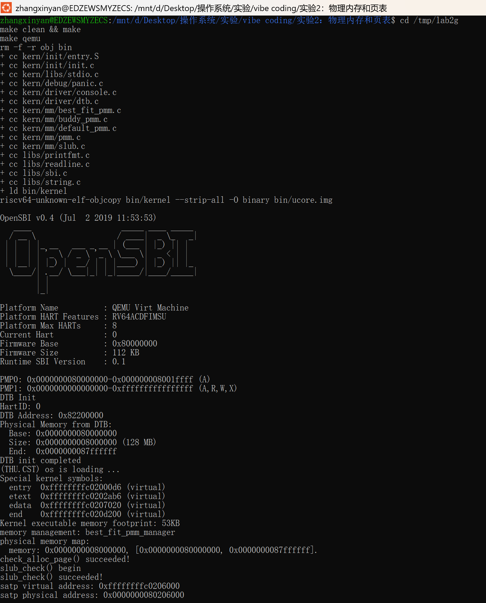
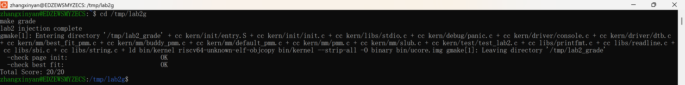
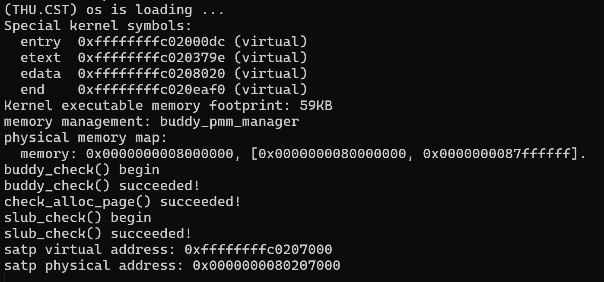

# OSlab3 实验报告

## 实验基本信息

| 项目       | 内容                                  |
| -------- | ----------------------------------- |
| **实验名称** | Lab 3: 中断与中断处理                     |
| **小组成员** | 2411570-何美璇、2410699-张欣妍、2411433-李烁菲 |
| **完成日期** | 2026-11-                            |

### 小组分工

| 成员          | 负责的练习/模块                                    | 负责的实验报告模块                                                       |
| ----------- | ------------------------------------------- | --------------------------------------------------------------- |
| 2411433-李烁菲 | 功能模块一：Trap 上下文恢复与 Trap 入口功能|              |
| 2411570-何美璇 |        | |
| 2410699-张欣妍 |  |         |

***

## 一、实验目的

本实验的主要目的是：

## 二、实验环境

你们使用的 AI 工具

| 成员          | AI 编程工具               | 底层模型              | 备注  |
| ----------- | --------------------- | ----------------- | --- |
| 2411570-何美璇 | Claude Code（终端 Agent） | Claude Sonnet 5.5 |     |
| 2410699-张欣妍 | DeepSeek Harness      | DeepSeek-V4-Flash |     |
| 2411433-李烁菲 | claude      | claude sonnet 5                  |     |

**运行环境与工具链**

| 项目 | 内容 |
| --- | --- |
| 运行环境 | WSL2 / Ubuntu 26.04 LTS（Windows 侧无交叉工具链，全部命令在 Linux 侧执行） |
| 交叉编译器 | `riscv64-unknown-elf-gcc` 15.1.0（支持 `-mcmodel=medany`，为 Makefile 所需） |
| 交叉调试器 | `riscv64-unknown-elf-gdb` 16.3 |
| 模拟器 | `qemu-system-riscv64` **4.1.1** |
| 构建工具 | GNU Make 4.4.1 |

## 三、实验整体逻辑分析

### 3.1 本章节的逻辑主线

### 3.2 功能的逐步实现

## 四、实验内容与实现

### 功能模块一：Trap 上下文恢复与 Trap 入口功能

**负责人**：2411433-李烁菲

#### 模块功能描述

**需要实现的函数：**

**功能说明：**

**最终代码实现：**

**几个关键设计点：**

#### 最终提示词

#### 实现迭代过程

本模块的实现经历了 2 次迭代，过程如下：

##### 第一次迭代

**遇到的问题：**

**问题解决策略：**

##### 第二次迭代

**遇到的问题：**

**问题解决策略：**

##### **最终结果：**

经过 2 次迭代，该模块最终：

- ✅ 编译通过
- ✅ 所有相关测试通过
- ✅ 功能符合预期

**关键改进点总结（如有）：**

1. 在 [RELY] 中删去 ClearPageReserved,并强调 init_memmap 的“移交时保留、由管理器清除”契约,避免保留位被提前清除。
2. 在输出要求中贴出指导书的两行样例并固定 `%016lx`，避免模型自创格式或使用 8 位宽度。

### 功能模块二 任务一：

**负责人：** 

#### 模块功能描述

**需要实现/修改的函数：**

**功能说明：**

#### 最终提示词

以下是经过迭代优化后，最终成功实现该功能的提示词：

#### 实现迭代过程

本模块的实现经历了 2 次迭代，过程如下：

##### 第一次迭代

**遇到的问题：**

**问题解决策略：**

##### 第二次迭代

**遇到的问题：**

**问题解决策略：**

**最终结果：**

**关键改进点总结（如有）：**

### 功能模块二 任务二：实现 Best-Fit 连续物理内存分配算法

**负责人：** 

#### 模块功能描述

**需要实现/修改的函数：**

**功能说明：**

#### 最终提示词

以下是经过迭代优化后，最终成功实现该功能的提示词：

#### 实现迭代过程

本模块的实现经历了 2 次迭代，过程如下：

##### 第一次迭代

**遇到的问题：**

**问题解决策略：**

##### 第二次迭代

**遇到的问题：**

**问题解决策略：**

**最终结果：**

**关键改进点总结（如有）：**

## 五、测试与验证

<!-- 根据该实验的具体情况，提供完整的测试运行截图，应包含：

- 编译及运行成功的输出（make qemu），可能有多个
- 测试通过的结果（make grade），只有一个

\-->

**测试截图：**

**运行验证 `make qemu`（QEMU 4.1.1 ）：**

## 六、实验总结与收获

### 对操作系统的理解

1. 本实验知识点与 OS 原理知识点的对照

| 本实验中的知识点 | 对应的 OS 原理知识点 | 含义、关系与差异 |

2. OS 原理中重要、但本实验没有对应上的知识点

### AI 协作开发的经验

成员A（李烁菲2411433）：

成员B：

成员C：

