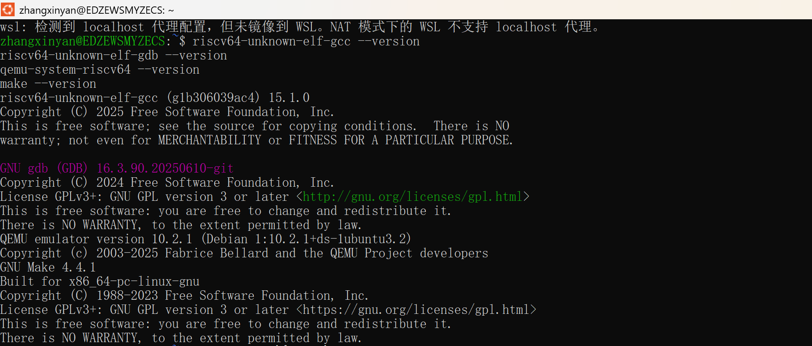
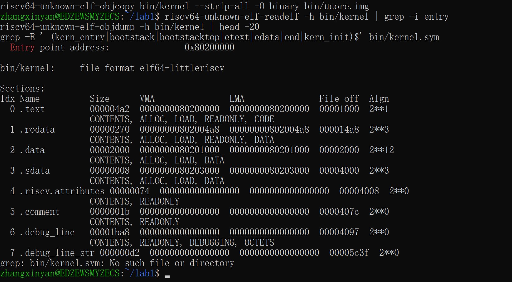
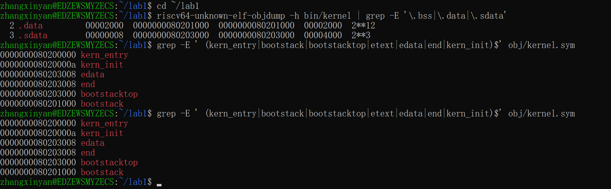
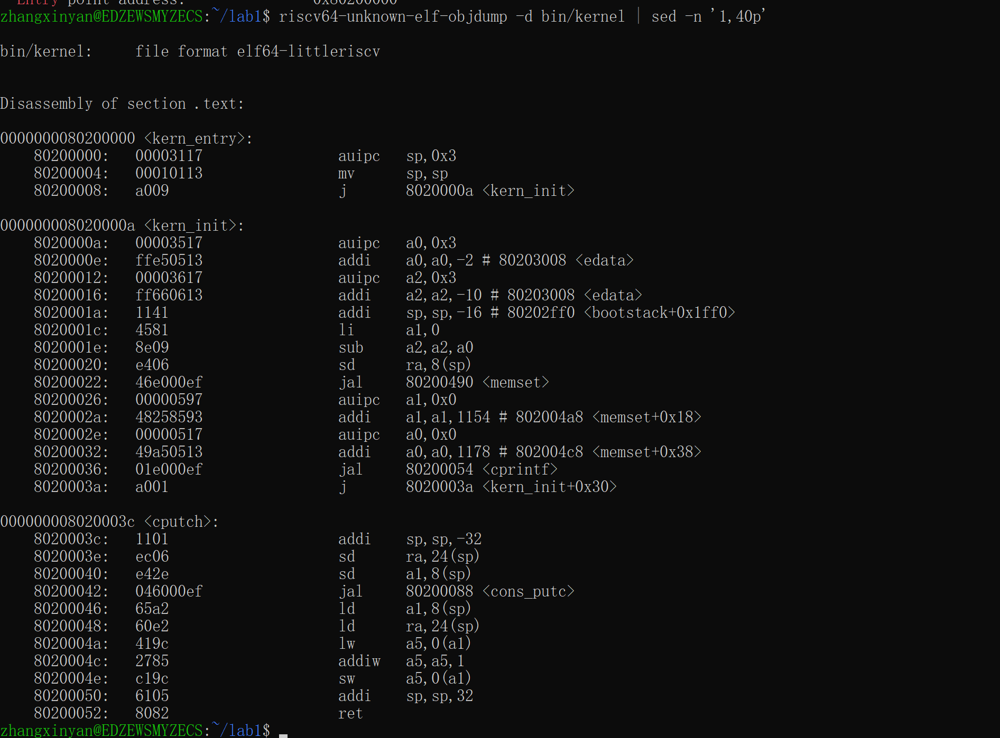
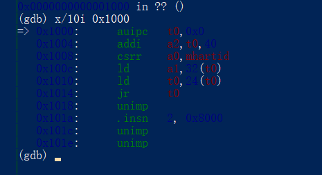
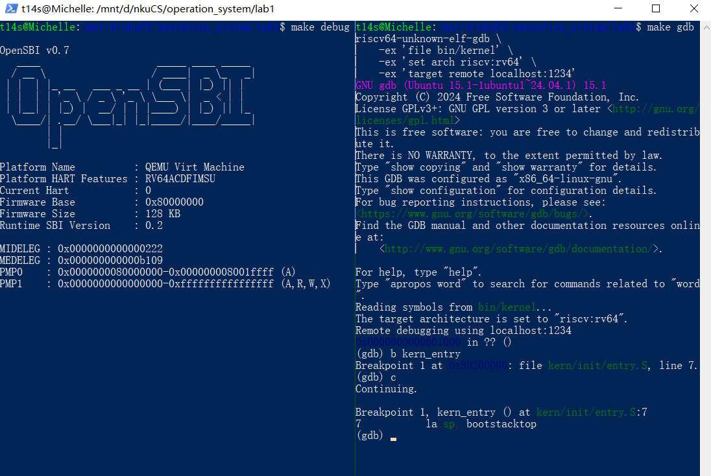
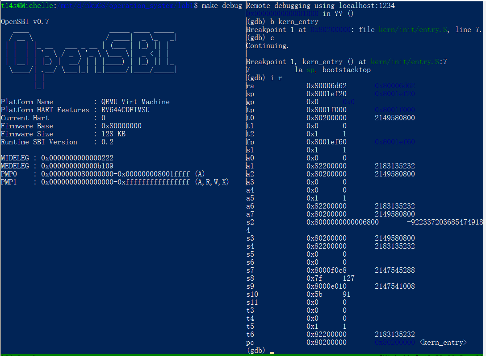
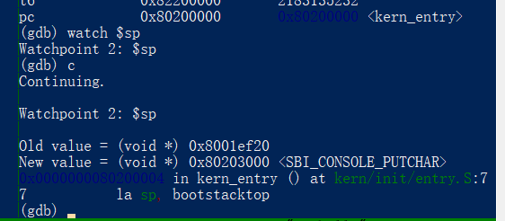
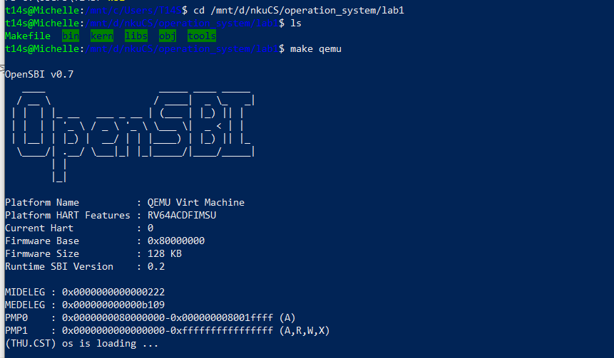
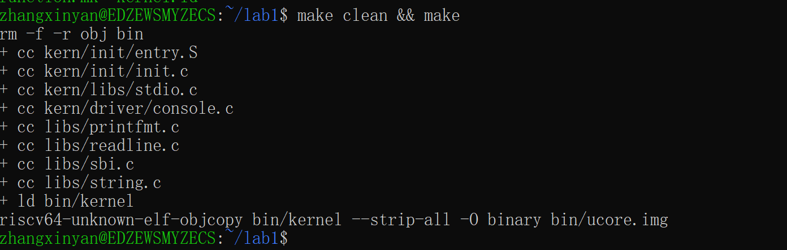

# 操作系统实验报告

## 实验基本信息

| 项目       | 内容                                  |
| -------- | ----------------------------------- |
| **实验名称** | Lab 1: 最小可执行内核                      |
| **小组成员** | 2410699-张欣妍、2411433-李烁菲、2411570-何美璇 |
| **完成日期** | 2026-10-09                             |

### 小组分工

| 成员          | 负责的练习/模块                                        | 负责的实验报告模块                                                 |
| ----------- | ----------------------------------------------- | --------------------------------------------------------- |
| 2410699-张欣妍 | 练习1、链接脚本(tools/kernel.ld)+ 内核入口(entry.S/init.c) | 四（链接脚本与内存布局、内核入口两个模块）、练习1、三（整体逻辑分析统稿）、六（知识点对照表核对与统稿）、全文顺稿 |
| 2411433-李烁菲 | libs/sbi.c → console.c → stdio.c 整条封装链          | 实验目的、整体分析、SBI模块对应部分                                       |
| 2411570-何美璇 | 练习2、Makefile 编译流程(elf→bin、QEMU 启动参数)            | 四、Makefile编译流程模块；五、测试与验证；练习2                              |

---

## 一、实验目的

1. 掌握计算机底层的启动流程；
2. 理解程序的内存布局与链接机制；
3. 实践特权级与系统接口调用（SBI）；
4. 构建内核的基础执行环境；
5. 熟悉内核调试工具与环境。

---

## 二、实验环境

| 项目 | 内容 |
| --- | --- |
| 运行环境 | WSL2 / Ubuntu（Windows 侧无交叉工具链，全部命令在 Linux 侧执行） |
| 交叉编译器 | `riscv64-unknown-elf-gcc` 15.1.0（支持 `-mcmodel=medany`，为 Makefile 所需） |
| 交叉调试器 | `riscv64-unknown-elf-gdb` 16.3 |
| 模拟器 | `qemu-system-riscv64` 10.2.1（内置 OpenSBI v1.8，对应 `-bios default`） |
| 构建工具 | GNU Make 4.4.1 |



> **关于 QEMU 版本**：答疑确认 lab1 可在 4.1.1 以上版本完成，本组使用 10.2.1；后续实验将回到 4.1.1。

### AI 编程工具

| 成员          | AI 编程工具               | 底层模型               | 备注  |
| ----------- | --------------------- | ------------------ | --- |
| 2410699-张欣妍 | DeepSeek Harness      | DeepSeek-V41-Flash |     |
| 2411433-李烁菲 | Cursor Agent          | GPT-5.5            |     |
| 2411570-何美璇 | Claude Code（终端 Agent） | DeepSeek-V4-Flash  |     |

---

## 三、实验整体逻辑分析

### 3.1 本章节的逻辑主线

本章节围绕“最小可执行内核的启动与环境搭建”这一核心主题展开。

整个实验旨在解决“从裸机状态到操作系统内核运行”这一从无到有的跨越问题。由于操作系统不能在“真空”中运行，必须依赖底层的硬件环境和启动引导程序。因此，本实验通过精简内核代码，剖析从硬件加电、OpenSBI 固件引导、内核加载到最终内核入口函数开始执行的完整链条，揭示了操作系统启动的底层机制，为后续复杂功能的实现构建了一个最基础的“骨架”。
```text
复位向量 0x1000（MROM，M 模式，CPU 上电第一条指令）
      ↓  jr
OpenSBI 固件 0x80000000（M 模式：机器态初始化 + 提供 SBI 服务 + 交接）
      ↓  按约定的下一阶段地址跳转，特权级降为 S
ucore 内核 0x80200000（S 模式：kern_entry → kern_init → 打印 → while(1)）
```
### 3.2 功能的逐步实现

本章实验遵循了“自底向上、先环境后逻辑”的实现顺序，具体逻辑如下：

1.首先实现内存布局与内核入口（tools/kernel.ld 与 entry.S）：这是构建内核的物理基础。只有通过链接脚本规划好内存各段（.text, .bss 等）的位置，并定义好程序运行的第一条指令入口（kern_entry），处理器才能在跳转到内核空间后，找到正确的代码并建立起运行 C 语言环境的栈空间。

2.接着完善 SBI 字符输出封装（`libs/sbi.c → console.c → stdio.c`）：在内核没有实现完整硬件驱动之前，它是无法输入输出的。通过逐层封装 OpenSBI 提供的 ecall 接口，我们实现了最基础的控制台输出功能。这可以让我们在后续实验中进行调试、查看内核状态。

3.最后完成编译流与调试验证（Makefile 与 GDB 调试）：前两步完成了代码构建，最后需要将其自动化。通过编写 Makefile 自动化编译流（生成 elf 和 bin 镜像）以及使用 GDB 进行真机模拟调试，我们完成了对启动逻辑的实证。只有在这一步验证成功，才能证明上述内核架构在硬件模拟器上是真正可运行的，从而形成从代码到运行的完整闭环。

## 四、实验内容与实现

### 功能模块：链接脚本与内存布局

**负责人：** 2410699-张欣妍

#### 模块功能描述

**需要分析的链接脚本与内存布局：**

```ld
OUTPUT_ARCH(riscv)              /* 目标架构 */
ENTRY(kern_entry)               /* 内核入口符号 */
BASE_ADDRESS = 0x80200000;      /* 内核被链接到的基准地址 */

SECTIONS
{
    . = BASE_ADDRESS;           /* 第一条指令的地址，即入口点 */
    .text : {                   /* 代码段：入口符号排在最前 */
        *(.text.kern_entry .text .stub .text.* .gnu.linkonce.t.*)
    }
    PROVIDE(etext = .);         /* 代码段结束地址 */

    .rodata : { ... }           /* 只读数据段（字符串常量等） */

    . = ALIGN(0x1000);          /* 数据段起始位置按页对齐 */

    .data : { ... }             /* 已初始化数据段：8KB 内核栈 bootstack 在此 */
    .sdata : { ... }            /* 小数据段 */
    PROVIDE(edata = .);         /* 数据段结束地址 = .bss 起点 */

    .bss : { ... }              /* 未初始化数据段（本工程为空） */
    PROVIDE(end = .);           /* 内核镜像结束地址 */

    /DISCARD/ : { ... }         /* 丢弃 .eh_frame 等无用段 */
}
```

**功能说明：** 链接脚本决定内核镜像由哪些段组成、各段放在什么地址，是整条启动链的物理基础。它把入口点 `kern_entry` 固定在 `0x80200000`，以对接 OpenSBI 的跳转约定；把内核栈所在的数据段安排到页对齐地址，以满足 `sp` 的对齐要求；并导出 `etext`/`edata`/`end` 三个边界符号，供 `init.c` 清零 `.bss` 使用。该模块向下与固件、加载器约定加载地址，向上为 `entry.S`、`init.c` 提供可依赖的地址与符号。

**实测结果：**





**结果分析：**

1. 入口点与 `BASE_ADDRESS` 一致（`0x80200000`），说明 `ENTRY(kern_entry)` 与 `.text` 中入口符号排在最前的写法生效。
2. `.data` 段大小为 `0x2000`（8192 字节），与 `kern/mm/memlayout.h` 中定义的 `KSTACKSIZE`（`KSTACKPAGE × PGSIZE = 2 × 4096`）相同，可见该段中只有内核栈 `bootstack`；结合符号表 `bootstack = 0x80201000`、`bootstacktop = 0x80203000`，可确定这段栈的地址区间为 `0x80201000`–`0x80203000`。
3. 本工程没有 `.bss` 段。`tools/kernel.ld` 中按 `PROVIDE(edata = .)` → `.bss : { ... }` → `PROVIDE(end = .)` 的顺序定义了两个边界符号，正常情况下 `end - edata` 即为 `.bss` 的大小。但本最小内核没有任何未初始化全局变量，`.bss` 属于空输出段，被 `ld` 丢弃（`objdump -h` 中看不到 `.bss` 行），两个边界符号因此落在同一地址：`obj/kernel.sym` 中 `edata = end = 0x80203008`。相应地，`kern/init/init.c` 中 `memset(edata, 0, end - edata)` 的长度参数为 0，实际清除 0 字节（反汇编中 `sub a2, a2, a0` 使长度寄存器 `a2 = 0`，见“内核入口”模块的结果分析）。该语句本身是通用写法：链接脚本的 `.bss` 输出段与边界符号均已就位，后续实验一旦引入未初始化全局变量，它会自动落入 `.bss` 并使这行 `memset` 真正生效。

---

##### 第一次迭代：让 AI 逐条解释链接脚本

**遇到的问题：**

- 问题1：AI 泛泛地说“链接脚本描述内存布局”，没有指出 `PROVIDE`、`ALIGN`、`/DISCARD/` 各自的作用，也没提到 `edata`/`end` 会被 `init.c` 使用。

**问题解决策略：**

- 针对问题1：追问时补充 `kern/init/entry.S` 与 `kern/init/init.c` 作为上下文；`[GUARANTEE]` 按模板改为“需要交付说明的语句与符号清单”（`OUTPUT_ARCH` → `/DISCARD/`），使回答逐条可核对。

---

##### 第二次迭代：用工具输出反向验证 AI 的结论

**遇到的问题：**

- 问题1：AI 声称“`etext`、`edata`、`end` 三个符号都会被定义并出现在符号表中”；实测 `grep -E ' (etext|edata|end)$' obj/kernel.sym` 只得到 `edata` 与 `end`，**`etext` 根本不存在**。
- 问题2：AI 沿用指导书写法，认为符号文件是 `bin/kernel.sym`；实测该路径不存在（`grep: bin/kernel.sym: No such file or directory`），真实位置是 `obj/kernel.sym`。

**问题解决策略：**

- 针对问题1：追问“`PROVIDE(sym = .)` 在什么条件下才会真正定义符号？”→ 确认 GNU `ld` 的语义是“**仅当该符号被引用、且别处未定义时才定义**”。本工程 `init.c` 的 `extern char edata[], end[]` 引用了后两者，而全工程无人引用 `etext`，因此它未被定义。结论以实测为准。
- 针对问题2：阅读 `Makefile` 中 `symfile = $(call cgtype,$(call toobj,$(1)),o,sym)` 的展开过程，确认符号表与反汇编产物的真实路径是 `obj/kernel.sym`、`obj/kernel.asm`，并把这一“读码发现”记入报告。

**最终结果：**

经过 2 次迭代，该模块最终：

- 编译通过（`make clean && make`，8 个源文件全部编译、链接成功）
- 入口点与设计一致（`Entry point address: 0x80200000`）
- 段布局与设计一致（`.text` 起于 0x80200000；`.data` 恰为 8KB 内核栈；`.sdata` 紧随其后）
- 符号地址与推导一致（`bootstack = 0x80201000`、`bootstacktop = 0x80203000`、差值 `0x2000`）

**关键改进点总结：**

1. 把“入口点必须落在 `BASE_ADDRESS`”这类**正确性约束**作为边界情况写进 `[SPECIFICATION]` 的 Case 3（不把 `.text.kern_entry` 排首条会怎样），而不是任由 AI 泛泛解释。
2. `[GUARANTEE]` 按模板改为“需要交付说明的语句与符号清单”（`OUTPUT_ARCH` / `ENTRY` / `BASE_ADDRESS` / `SECTIONS` / `PROVIDE` / `/DISCARD/`），使每条回答都能落到具体语句上。
3. 明确“**以工具输出为准**”的验证原则：`PROVIDE` 的语义、符号文件的真实路径都由 `readelf`/`objdump`/`obj/kernel.sym` 定案，而不是采信 AI 的复述。

---

### 功能模块：内核入口 entry.S / init.c

**负责人：** 2410699-张欣妍

#### 模块功能描述

**需要分析的函数与入口指令：**

```asm
// kern/init/entry.S
#include <mmu.h>                    // 引入 PGSIZE、PGSHIFT
#include <memlayout.h>              // 引入 KSTACKPAGE、KSTACKSIZE

    .section .text,"ax",%progbits   // 代码段：可分配、可执行
    .globl kern_entry               // 导出入口符号，供链接脚本 ENTRY(kern_entry) 使用
kern_entry:
    la sp, bootstacktop             // 建立内核栈：sp ← 栈顶地址（bootstack + KSTACKSIZE）
    tail kern_init                  // 尾调用进入 C 入口，不保存返回地址

.section .data                      // 内核栈放在已初始化数据段
    .align PGSHIFT                  // 按 2^12 = 4096 字节对齐（页对齐）
    .globl bootstack
bootstack:                          // 栈底（低地址端）
    .space KSTACKSIZE               // 预留 8KB 内核栈空间
    .globl bootstacktop
bootstacktop:                       // 栈顶（高地址端），即 sp 的初值
```

```c
// kern/mm/mmu.h
#ifndef __KERN_MM_MMU_H__
#define __KERN_MM_MMU_H__

#define PGSIZE      4096    // 一页映射的字节数
#define PGSHIFT     12      // log2(PGSIZE)

#endif /* !__KERN_MM_MMU_H__ */
```

```c
// kern/mm/memlayout.h
#ifndef __KERN_MM_MEMLAYOUT_H__
#define __KERN_MM_MEMLAYOUT_H__

#define KSTACKPAGE  2                       // 内核栈占用的页数
#define KSTACKSIZE  (KSTACKPAGE * PGSIZE)   // 内核栈大小 = 2 × 4096 = 8192

#endif /* !__KERN_MM_MEMLAYOUT_H__ */
```

```c
// kern/init/init.c
#include <stdio.h>      // cprintf
#include <string.h>     // memset
#include <sbi.h>        // SBI 服务封装

int kern_init(void) __attribute__((noreturn));

int kern_init(void) {
    extern char edata[], end[];         // 链接脚本导出的段边界符号
    memset(edata, 0, end - edata);      // 清零 .bss（本工程 .bss 为空，长度实际为 0）

    const char *message = "(THU.CST) os is loading ...\n";
    cprintf("%s\n\n", message);         // 输出启动信息
    while (1)                           // 死循环：此时无进程可调度
        ;
}
```

**功能说明：** 该模块是汇编阶段与 C 阶段的交接点，也是内核启动后真正被执行的第一段代码。`entry.S` 在尚无 C 运行环境时建立内核栈并把控制权交给 C 入口，`kern_init` 随后清零 `.bss`、输出启动信息并进入死循环。它依赖链接脚本提供的地址布局与边界符号，并调用 `libs/string.c` 的 `memset` 与输出链的 `cprintf`。

**实测结果：**



**结果分析：**

1. `la sp, bootstacktop`（`kern/init/entry.S` 中 `kern_entry:` 标号后的第一行，其地址即 `kern_entry = 0x80200000`，见 `obj/kernel.sym`）是伪指令：RISC-V 指令固定 32 位，能容纳的立即数最多 20 位（`auipc`：`rd = PC + (imm20 << 12)`）或 12 位（`addi`：`rd = rd + imm12`），装不下完整地址，因此汇编器将其拆成“取高位 + 补低位”两条，即 `A_disasm.png` 中的 `auipc sp, 0x3` 与 `mv sp, sp`（`addi sp, sp, 0`）。前者已使 `sp = PC + 0x3000 = 0x80203000`；由于 `bootstacktop = 0x80203000`（见 `obj/kernel.sym`）低 12 位为 0，后者立即数为 0 而成为空操作（`addi rd, rd, 0` 的伪指令写法即 `mv rd, rd`），这与 `entry.S` 中 `.align PGSHIFT`（`PGSHIFT = 12`，见 `kern/mm/mmu.h`）要求的页对齐一致。因此 `auipc` 执行完 `sp` 即为最终值，练习2 中 `watch $sp` 才会在 `PC = 0x80200004` 处命中并显示 `New value = 0x80203000`。
2. `tail kern_init` 落地为 2 字节压缩指令 `j 8020000a <kern_init>`（`jal x0` 的压缩形式 `c.j`），故 `kern_entry` 仅占 10 字节机器码，`kern_init` 恰好落在 `0x8020000a`，与符号表一致；这也说明工具链启用了压缩指令扩展（对应 OpenSBI 启动信息中 `Boot HART Base ISA : rv64imafdch` 的 `c`）。

| 地址           | 指令                                | 字节数   |
| ------------ | --------------------------------- | ----- |
| `0x80200000` | `auipc sp, 0x3`                   | 4     |
| `0x80200004` | `addi sp, sp, 0`（显示为 `mv sp, sp`） | 4     |
| `0x80200008` | `j 8020000a <kern_init>`          | **2** |
| `0x8020000a` | ← 下一条指令处，即 `kern_init` 的入口        |       |
3. `kern_init` 开头将 `a0`、`a2` 分别置为 `edata`、`end`（均为 `0x80203008`），`sub a2, a2, a0` 使 `a2 = 0`，机器级地证明 `edata == end`、`memset` 长度为 0。
4. `kern_init` 不是叶子函数，仍分配 16 字节栈帧并保存 `ra`；`while (1)` 编译为跳转到自身的 2 字节 `j`。
5. 传给 `cprintf` 的字符串指针位于 `.rodata`（`0x802004a8` 即段表中 `.rodata` 的起始地址），与上一模块的段布局证据互相印证。

---

##### 第一次迭代：解释入口两条指令

**遇到的问题：**

- 问题1：AI 把 `bootstacktop` 描述为“栈的**底部**”（它其实是高地址末端、即栈顶），方向说反。
- 问题2：AI 只回答了“设置了栈指针”，**没有回答“目的”**（满足 C 调用约定、为 `kern_init` 准备运行环境），而练习1 正是要求“操作 + 目的”两问。
- 问题3：`tail` 被说成“普通函数调用”，没有指出它不保存返回地址。

**问题解决策略：**

- 针对问题1、3：把“不得把 `bootstacktop` 说成栈底”“说明 `tail` 与 `call` 的区别”写进 `[SPECIFICATION]` 的边界情况与 `[Requirements]`，而不是事后反复纠正。
- 针对问题2：在 `[PROMPT]` 的任务描述中把问题拆成“完成了什么操作”“目的是什么”两问，并在 `[GUARANTEE]` 中把这两个符号列为交付项，要求逐项作答。

---

##### 第二次迭代：数值推导与实测核对

**遇到的问题：**

- 问题1：AI 给出的 `KSTACKSIZE` 只有符号表达式，没有算出字节数；报告需要“8KB / 0x2000 / 2 页”这类可核对的具体数字。
- 问题2：AI 依据指导书认为符号文件是 `bin/kernel.sym`，且认为 `tail` 一定被汇编为 4 字节的 `jal x0`；实测反汇编显示它是 **2 字节的 `c.j`**，`kern_entry` 处合计仅 10 字节。

**问题解决策略：**

- 针对问题1：在 `[RELY]` 中给出 `PGSIZE`、`PGSHIFT`、`KSTACKPAGE` 的真实宏定义，要求“必须给出具体数值”，据此得到 `KSTACKSIZE = 2 × 4096 = 8192 = 0x2000`。
- 针对问题2：以 `objdump -d`、`obj/kernel.sym` 的实测输出为准修正结论，并进一步发现：由于 `bootstacktop` 页对齐，`la` 展开后的第二条 `addi sp, sp, 0` 是空操作，**`auipc` 执行完 `sp` 即为最终值**；这正好解释了练习2 中 `watch $sp` 在 `PC = 0x80200004` 处就命中并显示 `0x80203000` 的现象。

**最终结果：**

经过 2 次迭代，该模块最终：

- 编译通过，反汇编与源码逐行对应
- `sp` 的最终值与设计一致（`0x80203000`，即 `bootstack + 0x2000`）
- 与成员C 的 GDB 实测相互印证（`0x8001ef20 → 0x80203000`）
- 功能符合预期（`kern_init` 成功打印 `(THU.CST) os is loading ...`）

**关键改进点总结：**

1. 把“完成了什么操作、目的是什么”两问写进 `[PROMPT]` 的任务描述；把“不得把 `bootstacktop` 说成栈底”“说明 `tail` 与 `call` 的区别”分别写进 `[SPECIFICATION]` 的边界情况与 `[Requirements]`，从源头避免方向性错误。
2. 在 `[RELY]` 中补齐真实宏定义，使 `KSTACKSIZE = 8192` 等数值可推导、可核对。
3. 坚持“**以 `objdump -d` / `obj/kernel.sym` 的实测输出为准**”，纠正了指导书关于 `bin/kernel.sym` 与 `tail → jal x0` 的表述偏差，并把压缩指令扩展（`c.j`）这一发现记入报告。

---

### 功能模块：SBI 输出链路构建

**负责人：** 2411433-李烁菲

#### 模块功能描述

**需要分析的函数：**

```c
// libs/sbi.c
uint64_t sbi_call(uint64_t sbi_type, uint64_t arg0, uint64_t arg1, uint64_t arg2);
void sbi_console_putchar(unsigned char ch);
// kern/driver/console.c
void cons_putc(int c);
// kern/libs/stdio.c
int cprintf(const char *fmt, ...);
```

**功能说明：**

该模块通过层层封装，将内核的高级格式化输出请求（cprintf）最终转化为底层的硬件指令调用。它是整个内核在没有任何驱动支持的情况下，唯一能向用户反馈信息的渠道。

主要应用场景为内核初始化（init.c）过程中输出版本、加载信息等。

该模块就是 `libs/sbi.c → console.c → stdio.c` 这条封装链：下层 `libs/sbi.c` 通过 `ecall` 与硬件/固件交互，上层 `kern/libs/stdio.c` 对外提供 `cprintf` 格式化输出。（交互关系）

---

### 功能模块：Makefile 编译流程与 QEMU 加载

**负责人：** 2411570-何美璇

#### 模块功能描述

**需要分析的构建流程：**

```makefile
# Makefile（节选）
$(kernel): tools/kernel.ld
$(kernel): $(KOBJS)
	$(LD) $(LDFLAGS) -T tools/kernel.ld -o $@ $(KOBJS)

$(UCOREIMG): $(kernel)
	$(OBJCOPY) $(kernel) --strip-all -O binary $@

qemu: $(UCOREIMG) $(SWAPIMG) $(SFSIMG)
	$(QEMU) -machine virt -nographic -bios default -kernel $(kernel)

debug: $(UCOREIMG) $(SWAPIMG) $(SFSIMG)
	$(QEMU) -machine virt -nographic -bios default -kernel $(kernel) -s -S
```

**功能说明：**

该模块负责把前两个模块产出的源代码，自动化地转化为一个可以被 QEMU 加载运行的内核镜像，并把整个内核放进可观测、可调试的运行环境中，是连接"静态代码"与"动态运行"的最后一环。

编译链路上，make qemu 首先依次编译各个 .c/.S源文件为目标文件，再由 ld 按照 tools/kernel.ld 规定的内存布局将其链接为 elf 格式的 bin/kernel；随后 objcopy --strip-all -O binary 将 elf 转换为线性的 bin/ucore.img。因为 elf 格式携带程序头、符号表等复杂结构，OpenSBI 这种轻量固件不具备解析能力，转成 bin 之后只需按地址顺序把数据搬进内存即可加载。

运行链路上，-device loader,file=...,addr=0x80200000 这条 QEMU 参数，会在虚拟机启动、CPU 开始执行任何指令之前，直接把内核镜像的内容写入物理地址 0x80200000。这个地址与链接脚本中的 BASE_ADDRESS 完全对应，因此 OpenSBI 完成自身初始化后，跳转到这个地址就能找到内核的第一条指令（即 entry.S 中的 kern_entry）。make debug 与 make qemu 的区别仅在于末尾多了 -s -S：-S 让虚拟 CPU 一启动就暂停在复位地址，-s 在本地 1234 端口等待 GDB 连接，从而为下面练习2的调试验证提供了可控的观察环境。

调试过程中我们还发现了一个值得记录的细节：-device loader 这种加载方式，是 QEMU 在虚拟机初始化阶段直接把文件内容"写入"内存的，并不经过 CPU 执行任何一条 store 指令；这与常见的 -kernel 加载方式（会向 OpenSBI 传递内核入口地址）在实现机制上有本质差异。这个发现也直接影响了我们在练习2中调试方法的选择（详见下文）。

---

### 练习1：理解内核启动中的程序入口操作

**负责人：** 2410699-张欣妍

**题目**：阅读 `kern/init/entry.S`，结合操作系统内核启动流程，说明 `la sp, bootstacktop`、`tail kern_init` 各自完成了什么操作、目的是什么。

#### 执行前的状态

OpenSBI 已完成机器态初始化：建立 PMP 保护、把异常与中断委托给 S 模式、准备好 uart8250 控制台与定时器，并已获知下一阶段入口；内核镜像则由 QEMU 在虚拟 CPU 开始执行之前装入内存（`make qemu` 使用 `-bios default -kernel bin/kernel`，由 QEMU 解析 ELF 程序头并按链接地址装入）。OpenSBI 启动信息中的两行（见 `A_qemu_boot_2.png`）给出了交接时刻的直接证据：

```text
Domain0 Next Address : 0x0000000080200000     ← 交给内核的入口 = 链接脚本的 BASE_ADDRESS
Domain0 Next Mode    : S-mode                 ← 交接后内核运行在 S 模式
```

但此时还没有可用的 C 运行环境：`sp` 仍是 OpenSBI 遗留的值（成员C 在练习2 的 `i r` 记录中为 `0x8001ef20`），`.bss` 也尚未清零。`kern_entry` 就是在这片空白上执行的第一段内核代码。

#### （1）`la sp, bootstacktop`

**操作**：`la`（load address）把标号 `bootstacktop` 的**地址**装入 `sp`。它由汇编器展开为两条指令，本机反汇编（见「内核入口」模块的实测结果 `A_disasm.png`）为：

```text
80200000: 00003117   auipc  sp, 0x3      # sp = PC + 0x3000 = 0x80203000
80200004: 00010113   mv     sp, sp      # 即 addi sp, sp, 0，低 12 位为 0，空操作
```

`bootstacktop` 按 `PGSHIFT = 12` 页对齐、低 12 位为 0，故第二条 `addi` 的立即数为 0，**`auipc` 执行完毕 `sp` 即等于最终值 `0x80203000`**——这正是成员C 在练习2 中观察到 `watch $sp` 于 `PC = 0x80200004` 处命中并显示 `0x80203000` 的原因。

**目的**：`bootstack` 是 `entry.S` 在 `.data` 中用 `.space KSTACKSIZE` 预留的内核栈，大小由头文件算出（`KSTACKPAGE(2) × PGSIZE(4096) = 8192` 字节 = 8KB），并经 `.align PGSHIFT` 页对齐；链接结果（见「链接脚本与内存布局」模块的实测结果 `A_symbols_bss.png`）为 `bootstack = 0x80201000`、`bootstacktop = 0x80203000`，差值 `0x2000` 与 `KSTACKSIZE` 一致。`bootstacktop` 是这段区域的**高地址末端**；RISC-V 栈向低地址增长，“空栈”时 `sp` 指向最高处，因此 `sp` 指向 `bootstacktop` 即表示内核栈建立完成：一是满足 RISC-V 调用约定中 `sp` 的 16 字节对齐要求，二是让接下来要调用的 C 函数能够压栈、保存返回地址、使用局部变量。**没有栈，编译器生成的 C 代码无法运行**，因此这是从汇编阶段迈向 C 阶段的必要前置条件。

#### （2）`tail kern_init`

**操作**：`tail` 是尾调用伪指令，效果是**无条件跳转到目标函数**并把控制权交出去；本机反汇编为

```text
80200008: a009       j      8020000a <kern_init>
```

即 **2 字节的压缩指令 `c.j`**（`jal x0, offset` 的压缩形式），位于 `kern_entry` 的最后，跳转目标是 C 函数 `kern_init` 的入口 `0x8020000a`。

**目的**：完成“汇编阶段 → C 阶段”的交接，把执行权交给编译器生成的 C 代码。之所以用 `tail` 而不是 `call`：`kern_init` 在 `kern/init/init.c` 中声明为 `__attribute__((noreturn))`（源码见上一模块），其函数体末尾是 `while (1);`，对应反汇编 `8020003a: a001  j 802003a <kern_init+0x30>`（跳转到自身，见 `A_disasm.png`），**永远不会返回**；既然不需要返回地址，就不必用 `call`（`jal ra, ...`）保存 `ra`，也无需在 `kern_entry` 里开栈帧——只要栈已备好，直接跳转到 `kern_init` 的入口（`0x8020000a`）即可。

#### 小结

`kern/init/entry.S` 是链接脚本 `ENTRY(kern_entry)` 所指向的第一段内核代码，它只做两件事：**装好栈、交给 C**。随后 `kern_init` 清零 `.bss`（本工程该段为空，反汇编中 `a2 = end - edata = 0`，`memset` 长度为 0，但清零机制已就位），并通过 `cprintf` 打印 `(THU.CST) os is loading ...`，最后以 `while (1)` 停住。至此三者被完整串通：

```text
kernel.ld 规定 0x80200000 与 bootstack 布局
        ↓
entry.S 把 sp 置为 bootstacktop = 0x80203000（链接期符号 → 运行期寄存器）
        ↓
kern_init 清 .bss 并 cprintf → (THU.CST) os is loading ...
```

---

### 练习2：使用GDB验证启动流程

**负责人：** 2411570-何美璇

使用 tmux 分屏，左侧窗格执行 `make debug` 启动带 `-S -s` 参数的 QEMU（CPU 启动后暂停执行，并监听本地 1234 端口），右侧窗格执行 `make gdb` 连接调试，依次执行 `file bin/kernel` 加载调试符号、`set arch riscv:rv64` 指定架构、`target remote localhost:1234` 建立连接。连接成功后，GDB 显示程序停在 `0x0000000000001000`，即 QEMU 为这颗虚拟 RISC-V CPU 设定的复位地址。

第一步，在下断点之前，先反汇编复位地址处的代码，观察最初执行的几条指令具体是什么：

```bash
x/10i 0x1000
```



可以看到，`0x1000` 处的复位入口代码实际包含以下 6 条指令，执行到最后的 `jr t0` 后跳转到下一阶段固件入口：

```bash
0x1000: auipc t0, 0x0        # t0 = 当前PC = 0x1000
0x1004: addi  a2, t0, 40     # a2 = t0 + 40 = 0x1028
0x1008: csrr  a0, mhartid    # a0 = 当前 hart 编号
0x100c: ld    a1, 32(t0)     # a1 = 从 0x1020 处读出一个 8 字节值
0x1010: ld    t0, 24(t0)     # t0 = 从 0x1018 处读出一个 8 字节值
0x1014: jr    t0             # 跳转到 t0 中保存的地址
```

这几条指令主要完成启动阶段的信息准备和跳转：首先通过 `auipc t0, 0x0` 获取当前地址 `0x1000` 作为基准，然后读取当前 hart 编号（`csrr a0, mhartid`）和设备树（DTB）地址（`ld a1, 32(t0)`），同时从预先存放的数据中取得下一阶段固件 OpenSBI 的入口地址，并将动态固件信息结构体（`fw_dynamic_info`）的地址保存到 `a2`。最后通过 `jr t0` 跳转到 `0x80000000`，将执行权交给 OpenSBI。

第二步，在内核入口处下断点并继续执行：

```
b kern_entry
c
```

命中结果如下：



GDB 显示 `Breakpoint 1, kern_entry () at kern/init/entry.S:7`，程序正停在 `la sp, bootstacktop` 这一行、尚未执行。这证明 OpenSBI 在完成自身初始化（加载横幅、PMP 配置等）之后，确实按照约定把 CPU 控制权移交到了 `0x80200000`，即内核入口 `kern_entry`。

第三步，查看此刻的完整寄存器状态：

```
i r
```



可以看到 `pc` 正是 `0x80200000 <kern_entry>`，与断点信息吻合；`sp` 为 `0x8001ef20`，这是 OpenSBI 遗留下来的栈指针，还不是内核自己管理的栈空间；`a0` 为 0、`a1` 为 `0x82200000`，符合 RISC-V SBI 规范中“固件跳转到 S 态内核时，`a0` 传入 hart id、`a1` 传入设备树 dtb 地址”的调用约定，说明 OpenSBI 不仅移交了控制权，还按规范传递了启动参数。

第四步，验证 `la sp, bootstacktop` 这条指令的真实效果。这里我最初尝试用 `watch *0x80200000` 观察内核镜像被加载的过程，但发现该观察点始终没有触发。分析后确认，镜像是在 QEMU 启动阶段、VCPU 开始执行之前就已经被装入 `0x80200000` 的，因此当 GDB 建立连接并设置 watchpoint 时，这次内存写入已经完成，后续也没有再次发生对该地址的写入，所以无法触发观察点。于是改用监控寄存器本身的变化：

```bash
watch $sp
c
```



该观察点在 `la sp, bootstacktop` 执行完毕的瞬间成功触发，输出显示 `Old value = (void *) 0x8001ef20`、`New value = (void *) 0x80203000`，PC 也随之前进到 `0x0000000080200004`。这就直接、真实地证明了 `la sp, bootstacktop` 这条指令确实把栈指针从 OpenSBI 遗留的旧值，替换成了内核自己预留的栈顶地址 `bootstacktop`（即 `0x80203000`），为紧接着的 `tail kern_init` 建立起了合法的 C 语言运行环境。

> **关于 `PC = 0x80200004` 的补充说明（2410699-张欣妍）**：由第四章的反汇编可知，`la sp, bootstacktop` 展开为 `auipc sp, 0x3` + `addi sp, sp, 0`；由于 `bootstacktop = 0x80203000` 页对齐、低 12 位为 0，第二条 `addi` 是空操作，**`auipc` 执行完毕 `sp` 就已经等于 `0x80203000`**。因此观察点在第一条指令执行后（`PC = 0x80200004`）即命中并显示最终值，与链接期符号完全一致。

综合以上四步调试过程，可以回答本练习的问题：

RISC-V 硬件加电（复位）后，PC 被固定设置为复位地址 `0x1000`，CPU 从这里开始执行了 6 条指令（详见上文第一步的反汇编结果）：先取得当前地址作为基准，再依次读取 hart 编号、设备树地址、下一阶段固件入口地址这三项关键启动参数，最后跳转到 `0x80000000`。也就是说，`0x1000` 处这段代码的功能并非直接做硬件初始化，而是为即将运行的 OpenSBI 固件准备好必要的启动参数，随后把控制权移交出去。

QEMU 在启动阶段就已经把内核镜像预先装入了物理地址 `0x80200000`；OpenSBI 在完成自身的平台探测与运行环境初始化（即左侧窗格打印出的启动横幅内容）之后，将控制权交给该地址处的内核入口 `kern_entry`，并通过 `a0`（hart id）、`a1`（dtb 地址）两个寄存器向内核传递了启动参数。

内核拿到控制权后，第一件事就是通过 `la sp, bootstacktop` 建立自己的运行栈，随后 `tail kern_init` 跳转进入 C 语言初始化逻辑，完成 `.bss` 清零并输出启动信息，最终进入死循环。

---

## 五、测试与验证

### 5.1 运行验证：`make qemu`

编译及运行结果如下：

**测试截图：**



执行 make qemu 后，终端依次输出编译过程（cc/ld/objcopy 各步骤）、OpenSBI 启动横幅（平台信息、PMP 配置等），最终打印 (THU.CST) os is loading ...，内核随后进入预期的死循环状态，说明整个从编译到运行的流程验证通过。GDB 调试验证启动流程的过程与截图详见上方"练习2"部分。

### 5.2 编译与链接验证

| 验证项 | 命令 | 结果 |
|---|---|---|
| 编译链接 | `make clean && make` | 8 个源文件编译成功，生成 `bin/kernel`、`bin/ucore.img` |
| 入口点 | `riscv64-unknown-elf-readelf -h bin/kernel \| grep -i entry` | `Entry point address: 0x80200000` ✅ |
| 段布局 | `riscv64-unknown-elf-objdump -h bin/kernel` | `.text` 起于 `0x80200000`，`.data` 恰为 8KB 内核栈 ✅ |
| 符号地址 | `grep -E ' (kern_entry\|bootstack\|bootstacktop\|etext\|edata\|end\|kern_init)$' obj/kernel.sym` | `bootstacktop - bootstack = 0x2000`；`edata == end`（无 `.bss`）✅ |
| 反汇编 | `riscv64-unknown-elf-objdump -d bin/kernel` | `la` → `auipc`+`addi`；`tail` → 2 字节 `c.j` ✅ |

对应截图：




---

## 六、实验总结与收获

### 对操作系统的理解

本次实验我们三人分别负责链接脚本与内核入口（张欣妍）、SBI 输出链路（李烁菲）、Makefile 与 GDB 调试（何美璇），合起来正好覆盖了“从一份 ELF 到内核输出一行信息”的完整链条，也把课堂上的一些抽象说法变成了可以观察的对象。

其中最直接的体会是：课上所说的“特权级切换”与“底层驱动接口”，在本实验里就是几行代码——内核并非一个孤立的程序，它必须依赖底层固件（OpenSBI）提供的服务来获取硬件能力，`ecall` 正是通过“受控陷阱（Trap）”跨越特权级边界的指令。同时，链接脚本（`kernel.ld`）与入口汇编（`entry.S`）的协同，让我们看清了内核程序从二进制镜像被加载至特定物理地址（`0x80200000`）、到建立 C 语言运行环境（栈空间分配）的启动逻辑，这体现了操作系统作为管理者的特点。

另一层收获来自“怎么确认自己真的读懂了”：以往学习链接脚本、`entry.S` 等内容时，更多停留在看代码和理解原理的层面，而这次通过实际运行 `make qemu`、用 GDB 一步步跟踪启动过程、观察 `la sp, bootstacktop` 执行前后的寄存器变化，才把内存布局、内核加载地址和程序跳转这几个概念具体地联系起来；`.bss` 是否存在、`tail` 落地为几条指令、符号产物在哪个目录这类问题，仅凭阅读源码或沿用指导书都会出错，只有 `readelf`、`objdump`、`obj/kernel.sym` 的实测结果才能定案。

本实验的局限也很清楚：它通过调用 OpenSBI 接口完成了控制台交互，但这一过程屏蔽了物理硬件驱动的细节。硬件中断响应逻辑、UART 串口控制器的寄存器操作以及更复杂的中断处理程序，都是内核构建中重要的部分，也是我们以后可以探索的方向。

结合课上对操作系统定位的讨论（它既是**控制程序**，也是**资源管理器**：对外为用户与开发者提供接口，对内管理处理器时间、内存、存储与 I/O，并屏蔽硬件细节差异），以及“一个程序的执行状态对应于 CPU 上的寄存器值、把全部寄存器打包称为上下文”这一视角，我们把 lab1 涉及的知识点与 OS 原理的对应关系整理如下。需要说明的是，lab1 只完成了“内核能在机器上跑起来”这一步，尚未承担任何资源管理职责。

#### 1. 本实验知识点与 OS 原理知识点的对照

| 本实验知识点                                                          | OS 原理对应知识点              | 含义、关系与差异                                                                                |
| --------------------------------------------------------------- | ----------------------- | --------------------------------------------------------------------------------------- |
| 链接脚本与内存布局（`.text`/`.rodata`/`.data`/内核栈）                        | 可执行文件格式与地址空间布局          | 实验是**链接期**确定的静态物理地址布局（MMU 未开启）；原理关注**运行期**的虚拟地址空间，由加载器按 ELF 段语义映射，每个进程各自独立。             |
| `0x1000` → `0x80000000` → `0x80200000` 的“三级跳”                   | 引导流程（固件 → 引导程序 → 内核）    | 实验为 MROM → OpenSBI(M 模式) → 内核(S 模式)；PC 为 UEFI → GRUB → OS，层次同构，但每步还要做安全校验与设备探测。         |
| RISC-V M/S/U 特权级与 `ecall`                                       | 特权态与系统调用（syscall）       | 课上指出设备操作需在“特权态”执行、进程须请求操作系统代为完成；本实验的 `ecall` 是内核向固件请求服务（S → M），而“用户程序 → 内核”（U → S）尚未出现。 |
| 内核栈的建立（`bootstack`，8KB）与 `sp` 的初值（GDB 中可观测 `pc`/`sp`/`a0`/`a1`） | 上下文（context）、上下文切换与调用约定 | 课上把“程序的执行状态”归结为寄存器组、打包为**上下文**，靠保存/恢复实现无感知切换；本实验是单栈、无进程，只建立栈并把 `sp` 指向栈顶，尚未保存或恢复任何寄存器。  |
| `tail` vs `call`、`la` 展开为 `auipc`+`addi`                        | 函数调用约定、地址相关/无关代码        | 实验借此说明“内核必须加载到链接时假设的地址”；原理中借助 MMU 与重定位可实现地址无关代码，同一程序可加载到任意虚拟地址。                         |
| `cprintf` → `ecall` → uart8250 的输出链                             | 设备驱动与 I/O 抽象层次          | 实验跳过驱动细节，直接借用固件服务（类似“借 BIOS 的显示服务”）；原理要求内核自己实现驱动并在其上提供统一 I/O 抽象。                        |

#### 2. OS 原理中重要、但本实验没有对应上的知识点

1. **进程与线程**：课上用 PCB、创建/就绪/运行/等待/退出状态以及就绪队列、等待队列管理运行中的程序；本实验只有一个执行流，`kern_init` 打印后即 `while (1)` 停住，没有 PCB，也没有状态与队列。
2. **上下文切换与处理器调度**：课上把程序执行状态归结为寄存器组、打包为“上下文”，靠保存/恢复实现任务切换（并测算过切换的访存代价）；本实验单执行流、未保存或恢复任何寄存器，也没有时钟中断与就绪队列，“选谁运行”的前提都不存在。
3. **虚拟内存、分页与缺页异常**（含进程挂起与交换）：本实验 MMU 未开启、没有页表，`0x80200000` 就是物理地址；页表、页框分配、缺页处理以及“换出到外存再激活”的挂起模型，都要到后续实验才出现。
4. **中断与异常处理机制、系统调用与用户态**：本实验未安装异常入口（`stvec`、`trapframe` 尚未实现），也未使用 U 模式；`ecall` 只用于内核向固件请求服务（S → M），而非“用户程序请求内核服务”（U → S）。
5. **同步与互斥**：没有并发就没有临界区问题；本实验单核顺序执行，`libs/riscv.h` 里的原子指令封装也未被使用。
6. **文件系统、设备驱动与物理内存管理**：本实验没有持久存储抽象，I/O 全靠固件转发（`ecall`）；内核栈在链接期由 `.space` 预留、`.bss` 为空，运行中不需要动态申请内存，因此也没有内存分配器与驱动框架。

### AI 协作开发的经验

本实验没有强制补代码，我们的工作重心是“把代码读懂、把结论验证住”，与以往“让 AI 写代码”的用法差别很大。最大的体会是：**AI 给出的解释必须用工具输出反证**——它曾把 `.text.kern_entry` 排在最前解释为“性能优化”（实为入口点必须落在 `0x80200000` 的正确性要求），也曾断言 `etext`/`edata`/`end` 三个符号都会出现在符号表里（实测 `etext` 根本不存在），这些都靠 `readelf`、`objdump`、`obj/kernel.sym` 的实测结果纠正；由此我们也学会了**把口径与边界提前写进提示词**（如在 `[SPECIFICATION]` 中明确“不得把 `bootstacktop` 说成栈底”），比事后反复纠正更省力。

另一面是 AI 的边界：它在解释寄存器调用约定、`la`/`tail` 等伪指令的展开方式时给出的解释基本准确，但涉及到具体环境报错时，给出的方案有时并不完全贴合我们实际的环境与工具链，需要结合 `which`、`find` 等命令实地排查、反复确认之后才能定位到真正原因。这也让我们体会到底层调试中实际分析和动手验证的重要性——例如发现 `watch *0x80200000` 看不到内核加载过程后，改用 `watch $sp` 去观察内核建立栈空间，才真正理解每一步操作背后的原理。

