# OSlab2 实验报告

## 实验基本信息

| 项目       | 内容                                  |
| -------- | ----------------------------------- |
| **实验名称** | Lab 2: 物理内存和页表                      |
| **小组成员** | 2411570-何美璇、2410699-张欣妍、2411433-李烁菲 |
| **完成日期** | 2026-10-21                            |

### 小组分工

| 成员           | 负责的练习/模块                                            | 负责的实验报告模块                                           |
| -------------- | ---------------------------------------------------------- | ------------------------------------------------------------ |
| 2411570-何美璇 | 功能模块一（任务一、扩展任务 Challenge）；分支任务-GDB调试 | 一、实验目的；三、实验整体逻辑分析；四、实验内容与实现（功能模块一（任务一、扩展任务 Challenge）、GDB 分支任务）；六的对应部分 |
| 2410699-张欣妍 | 功能模块二（任务一 First-Fit 分析、任务二 Best-Fit 实现）  | 二、实验环境；四、实验内容与实现（功能模块二 任务一、任务二）；六（知识点对照补充、成员B感悟） |
| 2411433-李烁菲 | 功能模块二（任务三 Buddy System）；扩展任务 Challenge-SLUB | 四、实验内容与实现（功能模块三、扩展任务slub）；五、运行验证的截图分析；六的对应部分 |

***

## 一、实验目的

本实验的主要目的是：

1. **理解物理内存的探测与描述方法**：掌握内核如何通过 OpenSBI 传递的设备树获取物理内存的起始地址和大小，如何用 Page 描述符数组为每个物理页建立“档案”，并把内核镜像、OpenSBI 和描述符数组自身占用的页排除在可分配范围之外，理解虚拟地址、物理地址、物理页号和 Page 描述符地址之间的区别与转换。
2. **掌握页表的建立与使用方法，理解地址翻译过程**：理解 Sv39 启动页表如何让内核在分页模式下运行，页表中为什么填写的是物理地址，并通过 GDB 调试 QEMU 源码，观察一次访存经过 TLB 查询、页表遍历和 TLB 回填，最终翻译为物理地址的完整过程。
3. **理解物理内存的管理方法与页面分配算法**：掌握 `pmm_manager` 的“机制与策略分离”设计，读懂 First-Fit 的空闲块管理与合并，并分别实现 Best-Fit 和 Buddy System（选做 SLUB 分配器），比较不同分配策略在分配效率和碎片方面的特点。
4. **学习使用 AI 辅助开发操作系统核心功能**：学习按“四段式”框架（[PROMPT]、[RELY]、[GUARANTEE]、[SPECIFICATION]）编写提示词，通过描述“需要满足什么”而不是“怎么实现”来引导 AI 生成代码，并结合测试与调试验证 AI 生成的结果，积累与 AI 协作开发内核的经验。

***

## 二、实验环境

你们使用的 AI 工具

| 成员          | AI 编程工具               | 底层模型              | 备注  |
| ----------- | --------------------- | ----------------- | --- |
| 2411570-何美璇 | Claude Code（终端 Agent） | Claude Sonnet 5.5 |     |
| 2410699-张欣妍 | DeepSeek Harness      | DeepSeek-V4-Flash |     |
| 2411433-李烁菲 | claude      | claude sonnet 5                  |     |

**运行环境与工具链**

| 项目 | 内容 |
| --- | --- |
| 运行环境 | WSL2 / Ubuntu 26.04 LTS（Windows 侧无交叉工具链，全部命令在 Linux 侧执行） |
| 交叉编译器 | `riscv64-unknown-elf-gcc` 15.1.0（支持 `-mcmodel=medany`，为 Makefile 所需） |
| 交叉调试器 | `riscv64-unknown-elf-gdb` 16.3 |
| 模拟器 | `qemu-system-riscv64` **4.1.1**（源码编译安装于 `/usr/local/bin`，内置 OpenSBI v0.4，对应 `-bios default`） |
| 构建工具 | GNU Make 4.4.1 |

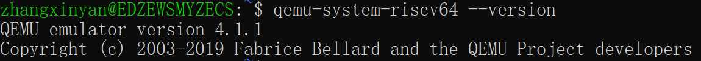

> **关于 QEMU 版本**：本组 lab1 在 10.2.1 上完成，lab2 起统一改用源码编译的 4.1.1，固件因此回到 `OpenSBI v0.4`，与指导书样例一致。

***

## 三、实验整体逻辑分析

### 3.1 本章节的逻辑主线

本章围绕**物理内存管理**展开，并以**页表和地址翻译**作为背景。核心问题是：操作系统内核刚启动时，对机器的内存几乎一无所知，它怎样才能知道有多少内存、在哪里，把它们描述清楚，再按需分配和回收？

这件事在内核里是一条依次推进的链：

```bash
① pmm_init ()
总入口：组织整个初始化过程
        ↓
② init_pmm_manager ()
选择具体的内存分配算法
        ↓
③ page_init ()
探测物理内存，建立 Page 描述符，划分保留区与空闲区
        ↓
④ init_memmap ()
把可用的物理页交给分配器管理
        ↓
⑤ alloc_pages () /free_pages ()
实际分配和回收物理页
        ↓
⑥ check_alloc_page ()
初始化阶段的自检，验证分配器是否正常
```

可以拆成三层：

1. **知道有什么**：通过 OpenSBI 传来的设备树，得到物理内存的起始地址和大小。
2. **把它描述出来**：用 Page 描述符数组给每个物理页建一份“档案”，并把内核镜像、OpenSBI、数组自身这些已占用的页标为保留，剩下的完整空闲页交给物理内存管理器。
3. **对其进行管理**：管理器负责分配和回收。这里把机制和策略分开：机制是统一的接口（`init_memmap`、`alloc_pages`、`free_pages` 等，用函数指针放在 `pmm_manager` 里），策略是具体算法（`First-Fit`、`Best-Fit`、`Buddy System`、`SLUB`）。换算法只需要换指针指向的对象，不用动上层。

另外还有一条支线任务：内核在进入 `kern_init` 之前，`entry.S` 已经建好 Sv39 启动页表并开启分页，所以本章所有的物理内存初始化，都是在分页模式下完成的。虚拟地址要经过 MMU 翻译才能变成物理地址，而页表里填的是物理地址。通过 GDB 调试 QEMU，可以亲眼看到一次访存如何完成地址翻译，从而理解“为什么构造页表时必须区分虚拟地址和物理地址”。

这一章解决的问题，也是后面虚拟内存管理（页表的建立与使用、缺页处理等）的基础。没有可靠的物理页分配，后续一切都无从谈起。

### 3.2 功能的逐步实现

1. 首先实现物理内存初始化（`kern/mm/pmm.c` 中的 `page_init()`）：这是整个链条的起点，后续所有分配算法管理的“空闲页”，都是由它交给管理器的。只有先通过设备树确定物理内存范围、建立好 Page 描述符数组，并保证已占用的页不会被当作空闲页，管理器才有可靠的数据可以管理。
2. 读懂 First-Fit 并实现 Best-Fit（`kern/mm/default_pmm.c` 与 `kern/mm/best_fit_pmm.c`）：有了空闲页之后，需要先理解框架里已有的 First-Fit，弄清空闲链表的初始化、连续页的分配，以及回收时相邻空闲块的合并，同时掌握 `pmm_manager` 这套接口的用法。Best-Fit 在此基础上，只把“选第一个够用的块”改为“选最合适的块”，改动较小，也最先打通 `check_alloc_page()`。
3. 然后完成 Buddy System（伙伴系统）：它没有现成的代码框架，需要自行设计数据结构和测试。有了前两步对接口和空闲块管理的理解，才能把“块大小为 2 的幂、分配时拆分、回收时与伙伴合并”这套新机制接入同一个 `pmm_manager` 框架，并通过合并更快、外部碎片更少的特点，对比不同策略的差异。
4. 再完成 SLUB 分配器：SLUB 分为两层，第一层按页分配，第二层在其上实现任意大小的对象分配。它直接建立在前面已经稳定的页级分配之上，只有页分配可靠，才谈得上在页内再切分对象，所以放在最后。

```bash
                   物理内存
                       ↓
                  page_init()
                       ↓
                 可用物理页集合
                       ↓
                 pmm_manager
                       ↓
          ┌────────────┼────────────┐
          ↓            ↓            ↓
      First-Fit     Best-Fit    Buddy System
          └────────────┼────────────┘
                 【页级分配策略】
                       ↓
                  页级分配器
                       ↓
                     SLUB
                 【对象级分配器】
                       ↓
                 小对象分配能力
```

此外，通过 GDB 调试 QEMU 完成地址翻译的实证。前面的步骤完成了物理内存的管理，最后需要观察硬件如何使用页表。通过 GDB 分别调试 ucore 与 QEMU 源码，在 QEMU 内部观察一次访存如何经过 TLB 查询、Sv39 页表遍历和 TLB 回填，从而验证“程序中使用的是虚拟地址，翻译由硬件完成，页表里填写的是物理地址”这一原理，形成从物理内存管理到地址翻译的完整闭环。

***

## 四、实验内容与实现

### 功能模块一：物理内存初始化 —— 任务一：实现 `page_init()`

**负责人**：2411570-何美璇

#### 模块功能描述

**需要实现的函数：**

```c
// kern/mm/pmm.c
static void page_init(void);

// 实现中用到的已有接口
uint64_t get_memory_base(void);          // 设备树解析出的物理内存起始地址
uint64_t get_memory_size(void);          // 设备树解析出的物理内存大小
static void init_memmap(struct Page *base, size_t n);   // 把空闲页交给 pmm_manager
struct Page *pa2page(uintptr_t pa);      // 物理地址 -> Page 描述符
uintptr_t PADDR(kva);                    // 内核虚拟地址 -> 物理地址（依赖 va_pa_offset）
extern char end[];                       // 链接脚本 kernel.ld 定义的内核镜像末尾（虚拟地址）
```

**功能说明：**

`page_init()` 是“设备树探测到的物理内存”与“物理内存管理器（`pmm_manager`）”之间的桥梁。它在分页已经开启的状态下（`entry.S` 在进入 `kern_init` 之前就建立了 Sv39 启动页表）完成三件事：

1. **探测**：从设备树解析结果中取得物理内存的起始地址和大小，并打印物理内存布局。
2. **描述**：建立 `Page` 描述符数组 `pages`，一个物理页对应一个描述符，同时设置全局变量 `va_pa_offset`、`npage`、`pages`。
3. **移交**：把“内核镜像、OpenSBI、描述符数组自身”以外的完整空闲页，通过 `init_memmap() `交给当前的 `pmm_manager`，由具体的分配算法（First-Fit / Best-Fit / Buddy）接管。

与其他模块的交互关系：

```bash
dtb_init()
    │ 提供物理内存起始地址和大小
    ▼
page_init()
    │ 调用 init_memmap() 登记空闲物理页
    ▼
pmm_manager（当前选定的页级分配器）
    ├── alloc_pages()      分配物理页
    ├── free_pages()       回收物理页
    ├── nr_free_pages()    查询空闲页数量
    └── check()            检查分配器功能
         ▲
         │ 调用 check() 进行自检
    check_alloc_page()
```

##### Best-Fit、Buddy 等后续模块管理的“空闲页”，全部来自 `page_init()` 移交的那一段连续区间。因此 `page_init()` 是后续所有分配算法的前提。

**最终代码实现：**

（见`kern/mm/pmm.c`）

```c
static void page_init(void) {
    extern char end[];  // 链接脚本 kernel.ld 定义：内核镜像（含 BSS）的结束虚拟地址

    // 1. 内核虚拟地址 = 物理地址 + va_pa_offset，必须最先设置，后面的 PADDR() 依赖它
    va_pa_offset = PHYSICAL_MEMORY_OFFSET;

    // 2. 从设备树解析结果中取得物理内存范围；无效则无法继续
    uint64_t mem_begin = get_memory_base();// 获取物理内存的起始地址
    uint64_t mem_size = get_memory_size();// 获取物理内存的大小
    if (mem_size == 0 || mem_begin == 0) {
        panic("page_init: invalid physical memory info from device tree");
    }
    if (mem_begin != DRAM_BASE) {
        panic("page_init: memory base 0x%lx != DRAM_BASE 0x%lx", mem_begin, (uint64_t)DRAM_BASE);
    }
    uint64_t mem_end = mem_begin + mem_size;  // 计算出物理内存的结束地址（开区间上界）

    cprintf("physical memory map:\n");
    cprintf("  memory: 0x%016lx, [0x%016lx, 0x%016lx].\n", mem_size, mem_begin, mem_end - 1);

    // 3. 总页数上界（PPN 本身是右移，对未对齐的 mem_end 天然向下取整）
      /* nbase：DRAM 内存起始页号，定义过的固定常量，`0x80000000`对应的 PPN
-        npage：DRAM 内存结束页号（开区间），运行时从设备树探测得到 */
    npage = PPN(mem_end); // 将物理地址转换为物理页号（Page Frame Number）。
    if (npage <= nbase) {
        panic("page_init: no physical pages above DRAM base");
    }
    size_t page_cnt = npage - nbase; //可管理的有效页数 (描述符数组的元素个数)

    // 4. Page 描述符数组紧跟在内核镜像之后，起点按页对齐
    pages = (struct Page *)ROUNDUP((uintptr_t)end, PGSIZE);

    // 5. 先清零，再统一标记为"保留"（采用【全部先标记保留，再把空闲页取消保留】策略）
    memset(pages, 0, sizeof(struct Page) * page_cnt);
    for (size_t i = 0; i < page_cnt; i++) {
        SetPageReserved(pages + i);
    }

    // 6. 空闲区间：起点 = 描述符数组末尾向上对齐；
    //    终点 = min(mem_end, PHYSICAL_MEMORY_END) 向下对齐
    uintptr_t freemem = PADDR((uintptr_t)(pages + page_cnt));
    uintptr_t free_begin = ROUNDUP(freemem, PGSIZE);
    uintptr_t managed_end = mem_end < PHYSICAL_MEMORY_END ? mem_end : (uintptr_t)PHYSICAL_MEMORY_END;
    uintptr_t free_end = ROUNDDOWN(managed_end, PGSIZE);

    // 7. 只有确有完整空闲页时才交给管理器
    if (free_begin < free_end) {
        init_memmap(pa2page(free_begin), (free_end - free_begin) / PGSIZE);
    }

```

**几个关键设计点：**

1. **设备树内存探测与页号空间规划**

- 方案：通过设备树接口 `get_memory_base() `和 `get_memory_size()` 获取 DRAM 起始地址与总大小，计算出物理内存开区间上界 `mem_end`。利用 PPN() 宏将物理地址转换为物理页号，划定左闭右开的管理区间` [nbase, npage)`。
- 优势：通过页号统一管理全部 DRAM 区域，使后续的地址转换逻辑（如 `pa2page` / `page2pa`）更加统一；同时 PPN 转换天然是向下取整，避免了将末尾不完整的内存残页纳入管理。

2. **默认“保留”的页面管理策略**

- 方案：初始化时，循环遍历所有页描述符，统一调用 `SetPageReserved()` 将全部物理页默认标记为“保留”状态。只有被明确划入空闲区间的页面，才会通过 `init_memmap()` 移交至内存管理器，由管理器内部逻辑完成页面初始化并清除保留标志。
- 优势：这是一种安全的防御性设计。内核镜像、OpenSBI 固件以及描述符数组自身所占用的内存由于默认处于保留（Reserved）状态，避免了被内存分配器误分配的风险，从而有效防止了关键数据被覆盖。

3. **空闲区间的边界限制与页对齐控制**

- 方案：

    - 空闲起点向上对齐：free_begin = ROUNDUP(freemem, PGSIZE)，舍弃描述符数组末尾的碎片空间，避免将其纳入。
    - 空闲终点向下对齐：取硬件内存末尾 mem_end 与框架管理上界 PHYSICAL_MEMORY_END 的较小值作为截断点，再使用 ROUNDDOWN() 向下对齐。

- 优势：双重的上限保护确保超出内核直接访问范围的内存不会交给分配器；起终点的正向对齐保证了纳入管理的每一页内存都是完整且对齐的。

4. **空闲页的安全移交与模块解耦**

- 方案：引入 `if (free_begin < free_end)` 安全判断，仅在确有完整空闲页时调用` init_memmap()`，将空闲区间转换为 `struct Page` 范围并交由当前 Pmm 管理器。
- 优势：防止传入页数为 0 引发断言崩溃；同时实现了初始化框架与底层分配算法（如 First-Fit、Buddy 等）的完全解耦，后续切换分配算法时无需修改 `page_init `逻辑。

注：四种地址的区分

| 概念 | 代码中的体现 | 说明 |
| --- | --- | --- |
| 物理地址 PA | `mem_begin`、`mem_end`、`free_begin`、`free_end` | 设备树给出的范围，以及空闲区间 |
| 虚拟地址 VA | `end`、`pages` | 内核里的指针，VA = PA + va_pa_offset |
| 物理页号 PPN | `npage`、`nbase` | `PPN = PA >> PGSHIFT`；`npage` 是内存上界对应的页号，`nbase` 是 DRAM 起始页号 |
| Page 描述符地址 | `pages + i` | 用 `pa2page() `/ `page2pa()` 与物理地址互相转换 |

#### 最终提示词

以下是经过迭代优化后，最终成功实现该功能的提示词：

```sql
[PROMPT] 任务：修改文件 kern/mm/pmm.c，在标有 "//lab2 function1" 的位置实现物理内存初始化功能（page_init）： 根据设备树提供的物理内存信息，建立可管理物理页的 Page 描述符布局，并把排除 OpenSBI、内核镜像和 描述符数组所占空间之后的完整空闲页面交给当前 pmm_manager 管理。该功能在 Sv39 分页已经开启之后执行； pmm_init() 中已有对它的调用，因此它必须定义在 pmm_init() 之前。本任务只负责"探测、描述、移交"， 不负责设备树的解析、物理内存管理器的内部实现，也不负责管理器的选择与切换。
操作要求：你必须在项目中修改实际文件，而不是仅展示代码。
可以修改：仅限 pmm.c 中标记位置，以及该功能所需的 static 辅助函数、内部宏和模块内静态变量。
不得修改：pmm.c 中标记位置之外的现有代码（包括 pmm_init、init_pmm_manager 及其中对管理器的选择、
init_memmap、pa2page 等已有函数）；pmm.h、memlayout.h、dtb.h 等头文件中已有的接口、结构体和宏定义；
各物理内存管理器的实现文件；entry.S、Makefile、链接脚本，以及 tools/ 下的测试和评分文件。
保留文件中的现有代码和注释。
输出要求：直接在标记位置写入完整实现，使用下面 [RELY]、[GUARANTEE]、[SPECIFICATION] 的信息， 以工程真实代码为准，若与示例不一致以当前工程为准，不要引入无关功能。实现完成后必须满足：
在 -Werror 下无警告通过编译；
内核能正常启动，管理器自检 check_alloc_page() 通过（该自检在本函数移交的空闲页上分配和回收）；
[SPECIFICATION] 中 Post-Condition 描述的各项状态均成立（可由 tools/test_lab2.c 中的 Page Init 检查验证）；
终端按如下格式输出物理内存范围（三个值依次为内存大小、起始地址、末尾地址，含）：
physical memory map:
memory: 0x%016lx, [0x%016lx, 0x%016lx].
[RELY] // 宏定义 #define PGSIZE                  4096                      // mmu.h #define PGSHIFT                 12 #define PPN(la)                 (((uintptr_t)(la)) >> PGSHIFT)   // 地址 -> 物理页号（天然向下取整） #define DRAM_BASE               0x80000000                // libs/riscv.h，DRAM 起始物理地址 #define PHYSICAL_MEMORY_OFFSET  0xFFFFFFFF40000000        // 内核虚拟地址 = 物理地址 + 该偏移 #define PHYSICAL_MEMORY_END     0x88000000                // 框架可管理的物理内存上界（物理地址） ROUNDUP(a, n) / ROUNDDOWN(a, n)                           // defs.h，按 n 向上/向下对齐 PADDR(kva)                                                // 内核虚拟地址 -> 物理地址，依赖 va_pa_offset；kva 非法时 panic
// 数据结构（memlayout.h） struct Page { int ref;                        // 引用计数 uint64_t flags;                 // 状态标志 unsigned int property;          // 空闲块大小（由具体管理器使用） list_entry_t page_link;         // 空闲链表链接 };                                  // 一个 Page 描述一个物理页，sizeof 为 40 字节 #define PG_reserved 0               // flags 的第 0 位：1 表示该页为内核保留，不可被分配/释放 SetPageReserved(page) / PageReserved(page)
// 全局变量（pmm.c） struct Page *pages;                 // Page 描述符数组，pages[i] 对应物理页号 nbase + i size_t npage = 0;                   // 物理页号的上界 const size_t nbase = DRAM_BASE / PGSIZE;    // 描述符数组第 0 项对应的物理页号 uint64_t va_pa_offset;              // 虚拟地址与物理地址之间的偏移 extern char end[];                  // 链接脚本定义：内核镜像（含 BSS）结束处的虚拟地址
// 可用函数 uint64_t get_memory_base(void);     // 设备树解析出的物理内存起始地址；dtb_init() 已在 kern_init 中执行，未成功解析时为 0 uint64_t get_memory_size(void);     // 设备树解析出的物理内存大小；未成功解析时为 0 static void init_memmap(struct Page *base, size_t n);   // 把从 base 起的 n 个页交给 pmm_manager。 // 契约：n > 0；这 n 个页此前必须处于"保留"状态（管理器会断言）， // 接管后管理器负责把它们初始化为空闲页 struct Page *pa2page(uintptr_t pa); // 物理地址 -> 描述符，等价于 &pages[PPN(pa) - nbase]；越界时 panic panic(fmt, ...)、cprintf(fmt, ...)、memset(s, c, n)
// 地址关系 // 物理布局（QEMU virt）：[0x80000000, 0x80200000) 为 OpenSBI；[0x80200000, PADDR(end)) 为内核镜像； // 其后依次是（页对齐的）Page 描述符数组、可分配空闲页，直到设备树报告的内存上界。 // 描述符数组本身位于被它描述的物理内存之中，其虚拟起点是 end 向上按页对齐。
[GUARANTEE] 必须实现的接口： static void page_init(void);   // kern/mm/pmm.c；由 pmm_init() 调用，必须定义在 pmm_init() 之前 你可以根据需要添加：
辅助函数（建议设为 static，仅供本模块内部调用，不改变对外接口）
内部使用的宏定义
模块内部的静态变量
[SPECIFICATION] page_init Pre-Condition:
dtb_init() 已执行，设备树内存信息可通过查询接口获得；
分页已开启，内核可以通过虚拟地址访问内核镜像及其后的物理内存；
pmm_manager 已选定；pages、npage 尚未初始化。
Post-Condition:
虚拟地址与物理地址的转换关系已建立，此后的地址转换结果正确；
npage 表示设备树所报告的物理内存上界对应的物理页号；
pages 是页对齐的 Page 描述符数组，位于内核镜像之后，为 [nbase, npage) 内的每个物理页各有一个描述符，
各描述符的初始状态确定，不依赖内存的原有内容；
内核镜像（包括镜像末尾所在的页）、OpenSBI 以及描述符数组自身占用的页均保持"保留"状态，没有交给管理器；
管理器只接管一段连续、页对齐、完整的空闲页，起点在描述符数组之后，终点不超过框架可管理的上界；
交给管理器的空闲页数大于 0，且不超过受管理的总页数；
已按输出要求输出物理内存范围。
Case 1（正常）:
设备树信息有效，且描述符数组之后到可管理上界之间至少有一个完整页：建立描述符布局，把这段完整空闲页
一次性交给管理器，并输出物理内存范围。
Case 2（设备树信息无效）:
内存大小或基址缺失，或内存上界不高于描述符数组所假设的起始页号，或内存基址不符合框架对页号起点的假设：
通过 panic 终止初始化。此时不向管理器注册任何空闲页，不对管理器的状态产生任何影响。
Case 3（内存超出可管理上界）:
设备树报告的内存上界高于框架可管理的上界：超出的部分不交给管理器；物理页号上界仍按设备树的真实上界给出，
超出部分的描述符存在并保持"保留"状态。
Case 4（没有完整的空闲页）:
描述符数组之后到可管理上界之间不足一个完整页：不调用 init_memmap，函数正常返回，
不对管理器的状态产生任何影响。
Case 5（内存上界未按页对齐）:
设备树报告的内存上界不是页的整数倍：最后不足一页的部分不交给管理器，其余的完整页都必须交出，
不得遗漏最后一段完整页。
Requirements:
必须先建立虚实转换关系，再做任何依赖它的地址转换；
虚拟地址、物理地址、物理页号和 Page 描述符地址在代码和注释中必须区分清楚；
空闲区间的起点向上对齐、终点向下对齐，保证交给管理器的都是完整的页；
必须满足 init_memmap 的契约（n > 0，页此前处于保留状态）；
除建立上述全局状态和向管理器移交空闲页之外，不产生其他副作用。
```

#### 实现迭代过程

本模块的实现经历了 2 次迭代，过程如下：

***

##### 第一次迭代

**遇到的问题：**

- 问题：移交前清除了空闲页的保留位,管理器断言失败。

现象：内核启动时在 `init_pmm_manager` 之后 `panic`:

```c
 kernel panic at kern/mm/default_pmm.c:LINE:
      assertion failed: PageReserved(p)
```

原因分析：模型认为空闲页就应该是“未保留”的,于是在 `init_memmap` 之前对 `[free_begin, free_end)` 逐页 `ClearPageReserved`。但 `default_init_memmap` 一开始就断言这些页处于保留状态,并由管理器自己把 flags 和 property 清零。V1 的 [RELY] 暴露了 `ClearPageReserved`，但又没有在 Post-Condition 里说明“移交时页仍为保留”，模型于是用上了它。

**问题解决策略：**

从 [RELY] 中删掉 `ClearPageReserved`,在 `init_memmap` 的契约里强调“这 n 个页此前必须处于保留状态，接管后由管理器负责初始化为空闲页”。

***

##### 第二次迭代

**遇到的问题：**

- 问题：物理内存范围的输出格式与指导书样例不一致。

现象：功能、启动和 `check_alloc_page()` 都正常，但模型最初自创了多行 `page_init:` 格式；改成指导书的两行后，又用了 `%08lx`，打印出 `memory: 0x08000000, [0x80000000, 0x87ffffff].`，而指导书样例是 `memory: 0x0000000008000000, [0x0000000080000000, 0x0000000087ffffff].`（16 位十六进制）。grader 只检查 `[Test 1] ... PASS`，所以测试不会报错，但输出与指导书对不上。

原因分析：这一版 prompt 的 [SPECIFICATION] 只写了“输出探测到的物理内存范围”，没有给出格式串和样例。模型只能按自己的习惯选择格式和 `%lx` 宽度，于是先自创多行格式，后来虽然改成两行，宽度仍是 8 位。

**问题解决策略：**

把指导书的样例原样贴进输出要求，并明确使用 `%016lx`：

```c
physical memory map:
  memory: 0x%016lx, [0x%016lx, 0x%016lx].
```

验证：实际输出与样例逐字符一致。

***

##### **最终结果：**

经过 2 次迭代，该模块最终：

- ✅ 编译通过
- ✅ 所有相关测试通过
- ✅ 功能符合预期

**关键改进点总结（如有）：**

1. 在 [RELY] 中删去 ClearPageReserved,并强调 init_memmap 的“移交时保留、由管理器清除”契约,避免保留位被提前清除。
2. 在输出要求中贴出指导书的两行样例并固定 `%016lx`，避免模型自创格式或使用 8 位宽度。

***

### Challenge：硬件的可用物理内存范围的获取方法（思考题）

**负责人**：2411570-何美璇

如果 OS 无法提前知道当前硬件的可用物理内存范围，请问你有何办法让 OS 获取可用物理内存范围？

**回答**：如果操作系统无法预先获知硬件的可用物理内存范围，可以通过固件或引导程序提供信息，也可以在缺少相关信息时，通过查询硬件配置或主动探测等方式获取。

1. **固件或引导程序提供内存信息（主流方案）**

- 设备树（DTB）：在 RISC-V、ARM 等平台上，固件可以通过设备树二进制文件（DTB）向操作系统传递硬件信息。内核在启动早期解析其中的 memory 节点，获取物理内存的起始地址和大小，并结合保留内存等信息确定内存布局。本实验采用的就是这种方式：OpenSBI 启动内核时，会把 DTB 的物理地址通过寄存器 a1 传入（a0 为 hartid），内核据此解析内存信息。
- BIOS / UEFI 内存映射：在传统 x86 平台上，可以通过 BIOS 的 E820 接口获取内存区域描述表；在 UEFI 环境下，可以通过内存映射服务获取内存描述符。相关信息不仅包含地址范围，还标明了区域的类型，有助于区分可用 RAM 与保留区域。
- 引导程序传递信息：Bootloader（如 GRUB、U-Boot）可以在启动过程中获取或整理内存布局信息，再通过启动参数或约定的数据结构传递给内核，减少内核直接探测硬件的工作。

这类方法的优点是能够利用固件已经掌握的硬件信息，通常比操作系统直接探测未知地址更加安全可靠，也更容易识别内存空洞和硬件保留区域。

**2. 查询硬件配置或主动探测内存（补充方案）**

如果操作系统无法获得可靠的固件内存信息，可以根据具体硬件条件，尝试以下方法。

（1）查询内存控制器配置寄存器

某些 SoC 的 DRAM 控制器提供描述容量、地址映射的配置寄存器，早期启动代码可以按照硬件手册读取；在 x86 平台上，也可以读取内存条的 SPD 信息（通过 SMBus）来获得容量参数。这种方法不需要逐个地址做读写测试，效率较高，但依赖具体硬件的实现和文档，不能作为通用方案。

（2）通过读写测试探测内存

在缺少固件信息和可靠硬件查询接口时，可以在硬件平台允许的前提下，对候选物理地址进行读写测试。探测必须避开已知占用区域：内核镜像、固件（如本实验中位于 0x80000000～0x80200000 的 OpenSBI，可能受 PMP 保护）以及已知的设备地址。因此应从内核镜像结束位置（end 对应的物理地址）之后的页对齐地址开始，向高地址探测。

对目标地址 addr 的一次测试可以这样写（必须通过 volatile 指针访问，防止编译器优化掉读写）：

```c
old = *addr
ok = true
*addr = 0x55
if (*addr != 0x55) ok = false
*addr = 0xAA
if (*addr != 0xAA) ok = false
*addr = old            // 无论成功与否，都要恢复原值
return ok
```

实际探测时通常不会逐字节测试，而是选择页、较大的地址间隔或具有代表性的地址，以减少启动阶段的开销。例如，已知 RAM 从 0x80000000 开始，内核结束于 0x80300000，可以依次测试 0x80400000、0x80500000……逐步寻找内存边界。如果已经确定"低地址有效、高地址无效"具有单调性，还可以使用二分查找减少测试次数，例如在 0x80400000～0x100000000 的候选范围内测试中间地址，根据结果缩小区间，较快定位内存上界。

这种方法存在明显局限，需要逐条处理：

- 写入会覆盖已有内容：需要保存并在所有出口恢复原数据（见上面的伪代码）。
- MMIO 副作用：未知地址可能属于设备区域，写操作可能改变设备状态，读取某些寄存器本身也可能产生副作用。
- 缓存导致误判：写入后立即读回，可能直接命中缓存而读到刚写入的值，并不能说明该地址背后真的有存储器。探测时需要绕过缓存（如关闭缓存或使用非缓存映射），或者在写入后执行缓存刷新和内存屏障再读回。
- 访问异常：访问不存在、未映射或受 PMP 保护的地址会触发异常。实际做法是先安装好 trap 处理函数，把"该地址访问异常"当作"该地址无效"的信号，而不是让内核崩溃。
- 地址别名（aliasing）：不同物理地址可能访问同一存储位置，造成误判。可以在向候选地址写入特征值之后，回读已确认有效的基址（或其他已测地址）处的值，如果被改变，说明发生了别名，当前地址不是新的独立内存。

因此，读写探测只能说明某个地址"表现得像可读写存储器"，不能仅凭一次测试就确定它一定是可供操作系统使用的 RAM，实际系统通常优先采用固件提供的内存布局信息。

综上，优先采用固件或引导程序提供的内存布局信息；如果缺少可靠信息，可以进一步查询硬件配置寄存器，必要时再采用有严格安全限制的内存探测方法。核心在于不仅要确定物理地址的范围，还要识别其中哪些区域可以安全地交由操作系统管理。

***

### GDB 分支任务：调试 QEMU 源码，观察页表查询过程

**负责人**：2411570-何美璇

#### 1. **调试方法与环境**

ucore 程序里写的都是**虚拟地址**，它们是 QEMU 的输入。虚拟地址到物理地址的翻译（查 TLB，未命中则遍历页表）发生在 **QEMU 内部**，由软件模拟硬件 MMU。要观察这个过程，需要两个 GDB 同时工作：

| 终端 | 命令 | 调试对象 |
| --- | --- | --- |
| 终端 1 | `make debug QEMU=$DQEMU` | 启动 QEMU，参数含 `-s -S`，启动后先挂起等待 GDB（图 1） |
| 终端 2 | `gdb -p <QEMU 的 PID>` | **QEMU 源码**（地址翻译函数） |
| 终端 3 | `make gdb` | **ucore 内核**，通过 QEMU 的 GDB stub 连接（图 2） |

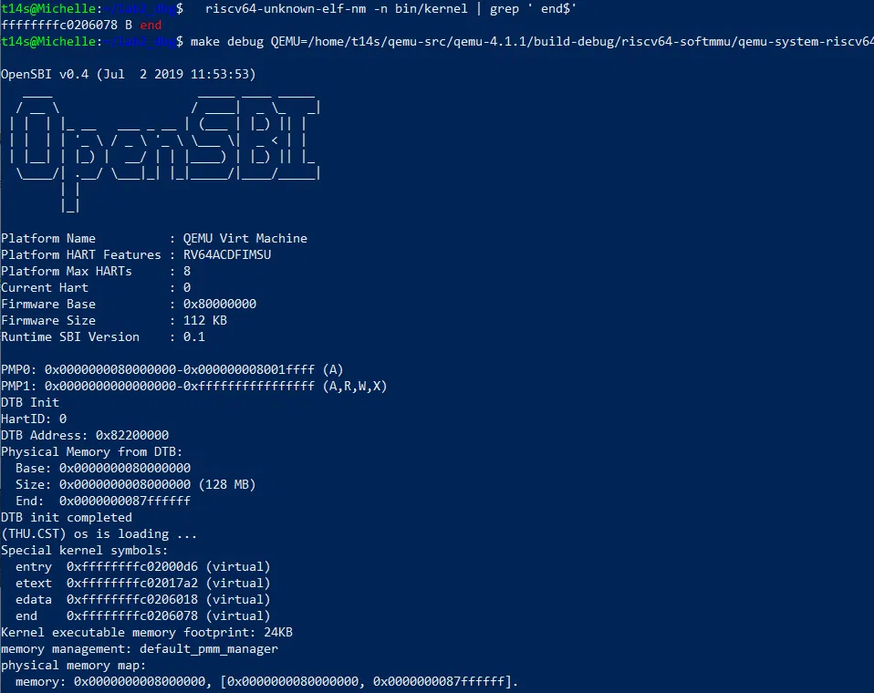

*图 1　终端 1：先用 `nm` 查到 `end = 0xffffffffc0206078`，再用 `make debug QEMU=...` 启动 QEMU（图中为终端 3 `continue` 之后，QEMU 已打印 OpenSBI 与内核启动信息）*

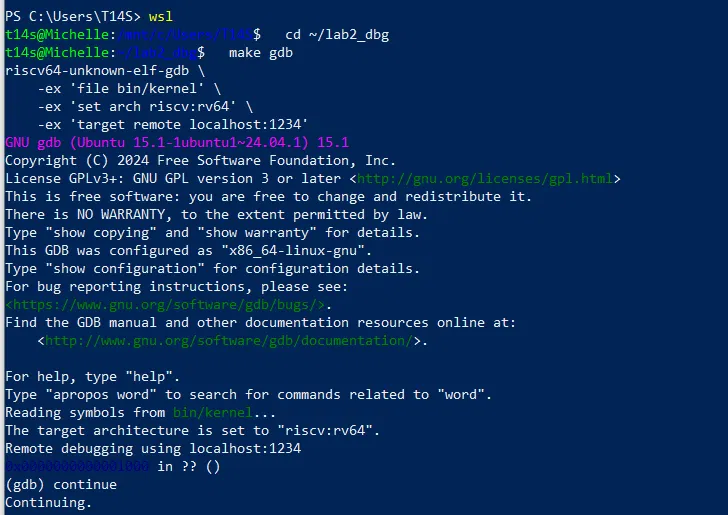

*图 2　终端 3：`make gdb` 通过 QEMU 的 GDB stub 连接 [`localhost:1234`](http://localhost:1234)，`continue` 后内核开始运行*

***

#### 2. **关键调用路径**

**断点命中后，**`bt` 的输出（图 3）如下：

| 层 | 函数 | 位置 | 说明 |
| --- | --- | --- | --- |
| #0 | `get_physical_address` | `target/riscv/cpu_helper.c:158` | 地址翻译核心 |
| #1 | `riscv_cpu_tlb_fill` | `cpu_helper.c:451` | RISC-V 的 TLB 未命中处理 |
| #2 | `tlb_fill` | `accel/tcg/cputlb.c:878` | 通用 TLB 未命中入口 |
| #3 | `store_helper` | `cputlb.c:1522` | 慢路径的存储处理 |
| #4 | `helper_ret_stb_mmu` | `cputlb.c:1642` | 1 字节存储（`size=1`，`val=0`） |
| #5 | `code_gen_buffer` | TCG 生成的代码 | guest 访存指令被翻译成的宿主机代码 |
| #6～#8 | `cpu_tb_exec` → `cpu_loop_exec_tb` → `cpu_exec` | `accel/tcg/cpu-exec.c:173/621/732` | 执行翻译块 |

**这次访存对应的 guest 指令**（图 3）：

| 项目 | 值 |
| --- | --- |
| `addr` | `0xffffffffc0207000` |
| `access_type` | 1（`MMU_DATA_STORE`，写） |
| `mmu_idx` | 1（S 模式；在 RISC-V 这里 `mmu_idx` 就是特权级） |
| `size` | 1（它是调用者 `riscv_cpu_tlb_fill` 的参数，需要先 `up` 再打印） |
| `env->pc` | `0xffffffffc0201790` |
| `env->satp` | `0x8000000000080205`（`MODE = 8`，即 Sv39；`PPN = 0x80205`，根页表物理地址 `0x80205000`） |

用 `riscv64-unknown-elf-addr2line -e bin/kernel -f -i 0xffffffffc0201790` 得到 **`memset`，`libs/string.c:276`**，即 `page_init()` 里清零描述符数组的那一次写。

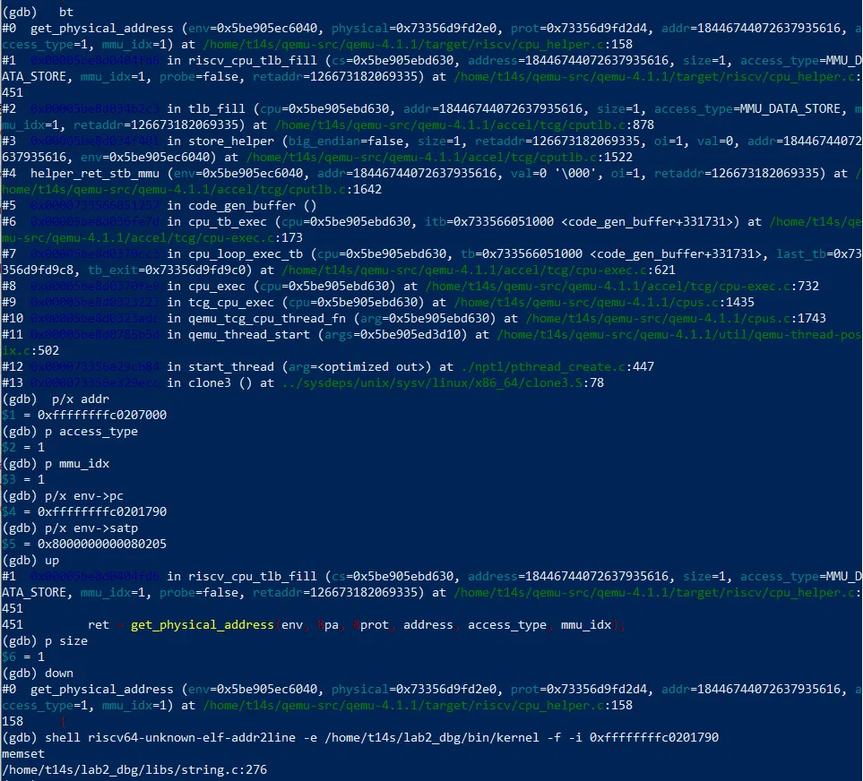

*图 3　终端 2：`bt` 得到 #0～#13 的完整调用栈，`p/x addr`、`p access_type`、`p mmu_idx`、`p/x env->pc`、`p/x env->satp` 的取值，以及 `addr2line` 解析出 `memset`、`libs/string.c:276`*

**关键分支（`get_physical_address` 内部，依次判断）：**

1. M 模式下若 `mstatus.MPRV` 置位（取指除外），先把 `mode` 换成 `MPP` 指示的特权级；
2. `mode == PRV_M`（或无 MMU 特性）：**直接 `*physical = addr`**，不查页表；
3. `satp.MODE == 0`（`VM_1_10_MBARE`）：**同样直接 `*physical = addr`**；
4. `satp.MODE == 8`（Sv39）：`levels = 3`，进入逐级遍历的循环；
5. 循环内：读页表项后，`V` 位为 0 则缺页；`R/W/X` 全 0 说明是内部节点，继续下一级；否则是叶子，检查权限和大页对齐，再按需置 `A`、`D` 位；
6. 到达叶子后，计算物理地址和 `prot`，返回 `TRANSLATE_SUCCESS`；之后 `riscv_cpu_tlb_fill` 做 PMP 检查，通过后调用 `tlb_set_page` 回填 TLB。

***

#### 3. **Sv39 页表翻译过程（单步观察）**

在终端 2 中，程序停在 `get_physical_address` 入口后，使用 `until` 命令运行到目标代码行，再打印对应变量。函数入口处局部变量尚未赋值，直接打印会得到无效垃圾值；`idx`、`pte_addr`、`pte`、`ppn` 均在循环体内声明，执行到对应行之前尝试打印，会提示 `No symbol`。因此不适合使用 `display`自动持续监视，应当采用 “走到哪一行、打印哪个变量” 的按需调试策略。

**观察（图 4、图 5）：**

| 走到的行 | 打印 | 观察到的值 | 含义 |
| --- | --- | --- | --- |
| `until 238` | `mode` / `levels` / `ptidxbits` / `ptesize` | 1 / 3 / 9 / 8 | S 模式；Sv39 三级页表，每级 9 位，页表项 8 字节 |
| 同上 | `base`、`ptshift`、`i` | `0x80205000`、18、0 | 根页表物理地址 = `satp.PPN << 12`；第一轮 `ptshift = (levels-1) × ptidxbits = 18` |
| `until 242` | `idx` | `0x1ff`（511） | 虚拟地址的 `VPN[2]`，正好是启动页表的最后一项 |
| `until 252` | `pte_addr` | `0x80205ff8` | `base + idx × ptesize = 0x80205000 + 511 × 8` |
| `next` | `pte` | `0x200000cf` | 读出的页表项 |
| `until 334` | `ppn`、`vpn` | `0x80000`、`0xffffffffc0207` | `ppn = pte >> 10`；`vpn = addr >> 12` |
| `next` | `*physical` | **`0x80207000`** | 翻译结果 |

**计算验证：**

```
*physical = (ppn | (vpn & ((1 << ptshift) - 1))) << 12
          = (0x80000 | (0xffffffffc0207 & 0x3ffff)) << 12
          = (0x80000 | 0x207) << 12
          = 0x80207000        ← 与 GDB 中 p/x *physical 完全一致
```

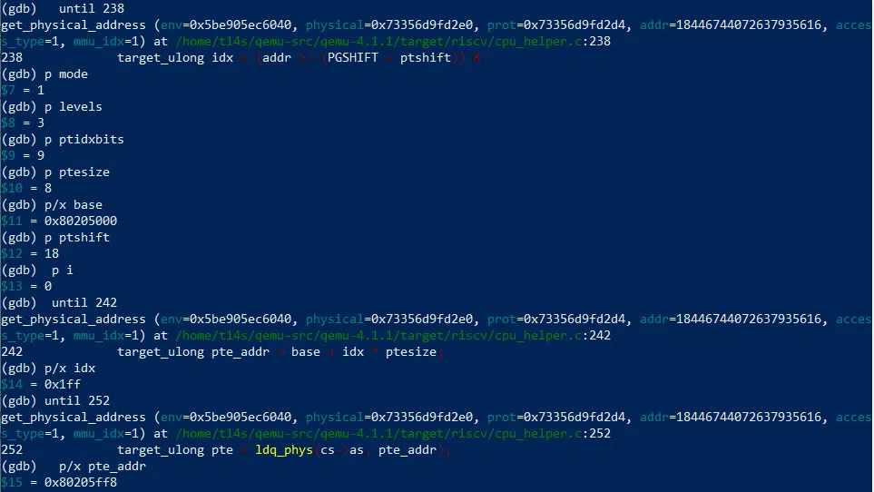

*图 4　`until 238` 得到 `mode=1`、`levels=3`、`ptidxbits=9`、`ptesize=8`、`base=0x80205000`、`ptshift=18`、`i=0`；`until 242` 得到 `idx=0x1ff`；`until 252` 得到 `pte_addr=0x80205ff8`*

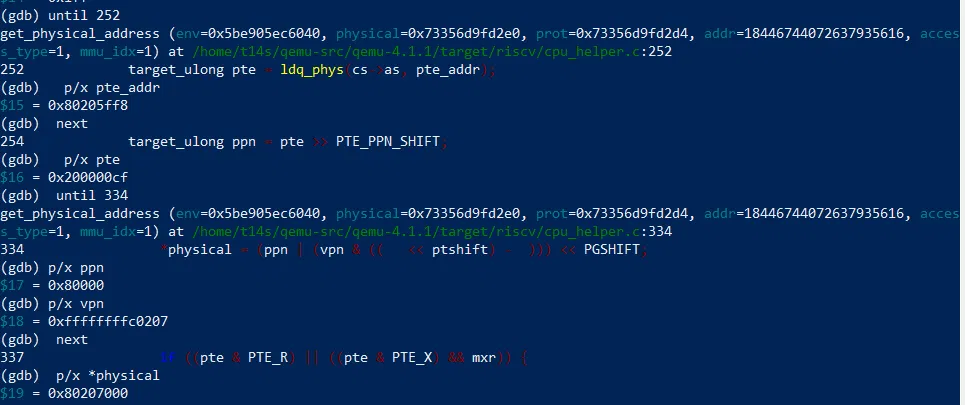

*图 5　`next` 得到 `pte=0x200000cf`；`until 334` 得到 `ppn=0x80000`、`vpn=0xffffffffc0207`；再 `next` 后 `*physical=0x80207000`*

***

#### 4. **TLB：回填过程与代码**

翻译成功后，`riscv_cpu_tlb_fill` 调用 `tlb_set_page`，最终进入 **`tlb_set_page_with_attrs`**（`accel/tcg/cputlb.c`）。局部变量 `tn`（新的 TLB 表项）和 `addend` 都在这个函数里，赋值发生在第 804 行`tn.addend = addend - vaddr_page;`，所以断点设在 `accel/tcg/cputlb.c:804`，而不是 `tlb_set_page` 的入口，那只是一层包装。

**观察（图 6）：**

| 变量 | 值 | 含义 |
| --- | --- | --- |
| `vaddr` / `vaddr_page` | `0xffffffffc0207000` | 虚拟页地址（页对齐后不变） |
| `paddr` | `0x80207000` | 与第 3 节算出的物理地址一致 |
| `xlat` | `0x207000` | `paddr − 0x80000000`，RAM 区域内的偏移 |
| `addend`（停在 804 行时已算出） | `0x733558007000` | `ram_ptr + xlat`，即该物理页的**宿主机内存地址** |
| `tn.addend`（执行 804 行后） | `0x733597e00000` | `addend − vaddr_page`（按 64 位回绕） |
| `prot` | 7 | \`PAGE_READ |
| `tn.addr_read` / `addr_write` / `addr_code`（`until 835` 之后） | 均为 `0xffffffffc0207000` | 三个标签都设为该虚拟页，说明读、写、取指都可以命中 |

`vaddr + tn.addend = 0xffffffffc0207000 + 0x733597e00000 = 0x733558007000`，正好等于 `addend` 变量，也就是 guest 物理页 `0x80207000` 在宿主机上的实际地址，快路径 `host_addr = addr + addend` 成立。

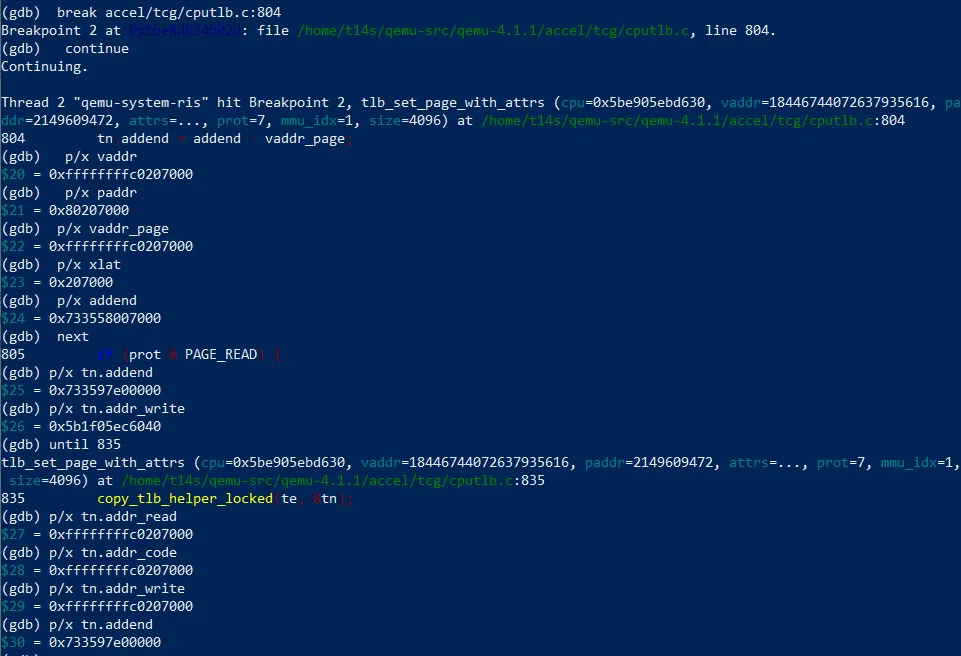

*图 6　`break accel/tcg/cputlb.c:804` 命中后依次打印 `vaddr`、`paddr`、`vaddr_page`、`xlat`、`addend`、`tn.addend`；第 805 行处的 `tn.addr_write` 仍是栈上垃圾值，`until 835` 后三个标签才都是 `0xffffffffc0207000`*

**由此得到 QEMU 的 TLB 的关键特点：** 表项里存的**不是物理页号**，而是一个加在客户机虚拟地址上就能得到宿主机地址的偏移 `addend`。之后当同一页再次被访问时，QEMU 生成的宿主机机器码只需要做一次“标签比较”和一次简单的加法（host_addr = addr + addend），就能直接算出宿主机内存地址，根本不需要再进 C 语言函数去查页表。

**TLB 的数据结构与代码位置：**

| 内容 | 位置 |
| --- | --- |
| `CPUTLBEntry`（三个标签 + `addend`） | `include/exec/cpu-defs.h` |
| 命中判断 `tlb_hit_page` | `include/exec/cpu-all.h` |
| 下标 `tlb_index = (addr >> 12) & mask` | `include/exec/cpu_ldst.h` |
| victim TLB（8 项）与 `victim_tlb_hit` | `cpu-defs.h`、`accel/tcg/cputlb.c` |

主 TLB 是**直接映射**（每个下标只有一项），默认 `2^8` 项，可动态扩大（上限 `2^22`）；另有一个 8 项的 victim TLB 作补充。每个特权级（`mmu_idx`）各有一张表。

***

#### 5. **QEMU 的 TLB 与真实 CPU 的 TLB 的区别**

##### **（1） 未开启地址翻译与开启的路径对比**

按指导书的提示，找几条不同翻译状态下的访存，对比调用路径：

- **场景 A（M 模式固件层）**：处于最高特权级（mmu_idx = 3），页表还未启用（satp = 0）。断点条件 `env->satp == 0 && access_type == 1`；
- **场景 B（S 模式内核早期引导）**：虽然进入了内核态（mmu_idx = 1），但在 `entry.S` 开启分页之前，satp 依然为 0。断点条件 `env->satp == 0 && mmu_idx == 1 && access_type == 1`；
- **场景 C（Sv39 正常翻译阶段）**：内核正常运转，分页已开启（satp 拥有有效页表基址）。

| 场景 | `mmu_idx` | `satp` | 地址 `addr` | `env->pc` | 走的分支 | 结果 |
| --- | --- | --- | --- | --- | --- | --- |
| A | 3（M） | 0 | `0x8001be00` | `0x8000017e`（OpenSBI） | `mode == PRV_M` 的快速返回 | `*physical = addr = 0x8001be00` |
| B | 1（S） | 0 | `0x80206000` | `0x80200000` | `case VM_1_10_MBARE` | `*physical = addr = 0x80206000` |
| C | 1（S） | `0x8000000000080205` | `0xffffffffc0207000` | `0xffffffffc0201790` | Sv39 页表遍历 | `0x80207000` |

**断点命中与单步确认：**

- **场景 A：** 重新开始一轮调试时，先用第 3 节的 `memset` 断点确认内核仍跑到同一处写（图 7a，数值与图 3 一致）；再把条件换成 `env->satp == 0 && access_type == 1`。命中后 `until 171` 停在 `if (mode == PRV_M || !riscv_feature(env, RISCV_FEATURE_MMU))` 这一行，`p mode` 得 3（`PRV_M`）；`finish` 返回值为 0（`TRANSLATE_SUCCESS`），返回后 `p/x pa` 为 `0x8001be00`，与 `addr` 相同（图 7b）。
- **场景 B：** 断点条件加上 `mmu_idx == 1` 后命中内核的早期访存（图 8a）；`until 197` 停在 `*physical = addr;`，`p vm` 得 0（`VM_1_10_MBARE`）；`next` 后到 `*prot = PAGE_READ | PAGE_WRITE | PAGE_EXEC;`，说明权限全开；`finish` 返回值为 0，`p/x pa` 为 `0x80206000`，同样与 `addr` 相同（图 8b）。

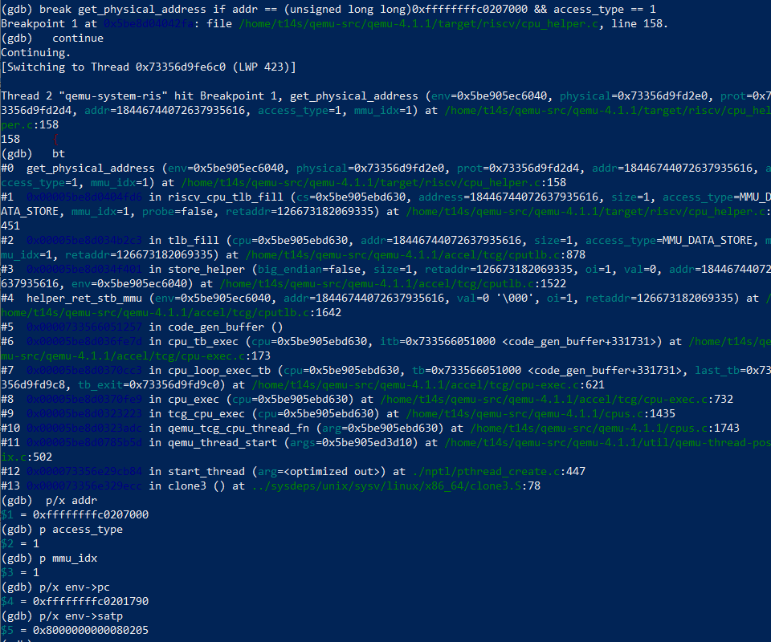

*图 7a　重新启动 QEMU 后，先用第 3 节的条件断点确认 `memset` 的那次写仍能命中；`bt` 与寄存器的数值与图 3 相同*

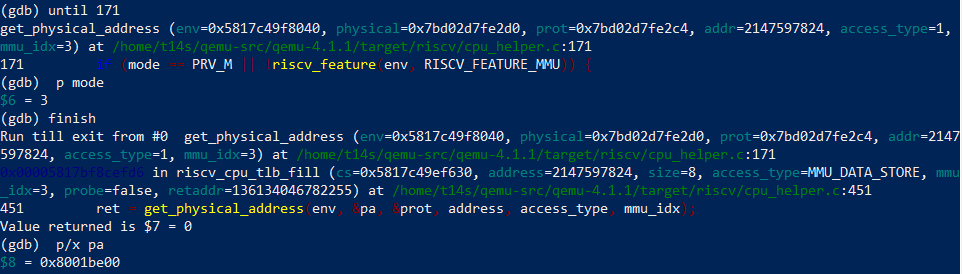

*图 7b　场景 A：`until 171` 停在 M 模式判断行，`p mode` 为 3；`finish` 返回 0，`p/x pa` 为 `0x8001be00`*

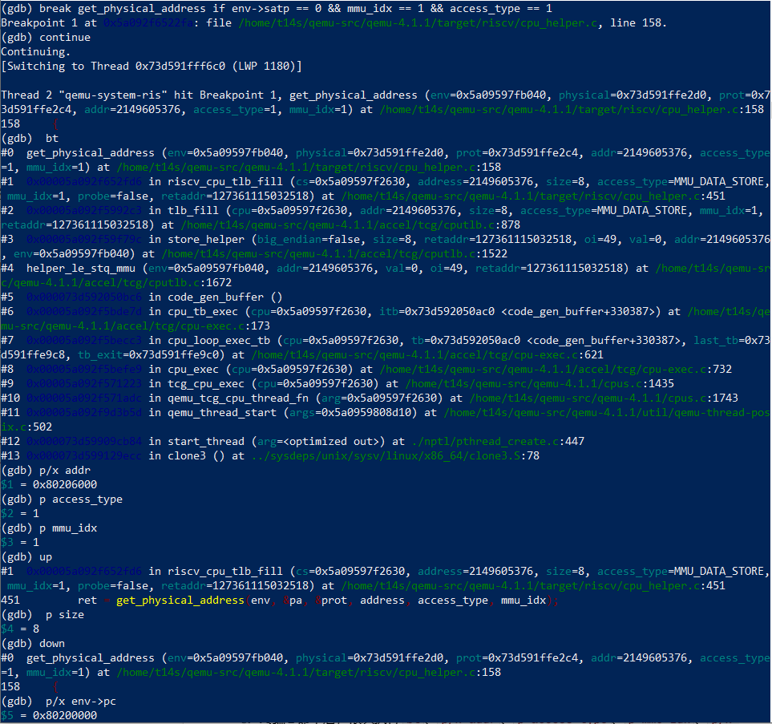

*图 8a　场景 B：`env->satp == 0 && mmu_idx == 1 && access_type == 1` 命中，`addr = 0x80206000`、`env->pc = 0x80200000`、`size = 8`，入口为 `helper_le_stq_mmu`*

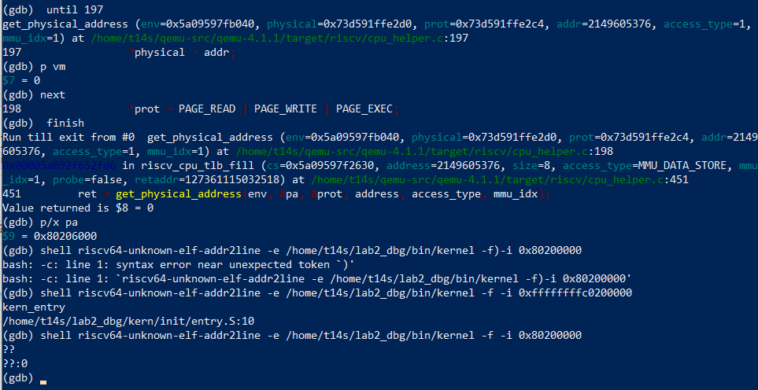

*图 8b　场景 B：`until 197` 处 `p vm` 为 0；`next` 到权限全开的赋值；`finish` 返回 0，`p/x pa` 为 `0x80206000`。图中还包含 `addr2line` 的对比：`0x80200000` 解析为 `??`，加偏移后的 `0xffffffffc0200000` 解析为 `kern_entry`、`entry.S:10`*

**调用栈对比：** 三种场景的 `bt` 主干完全相同，都是 `tlb_fill → riscv_cpu_tlb_fill → get_physical_address`。差异仅体现在访存慢路径的入口函数：场景 A、B 为 8 字节存储操作，入口为 `helper_le_stq_mmu`；场景C 是 `memset` 触发的 1 字节写操作，入口为 `helper_ret_stb_mmu`。

场景 B 中，`addr = 0x80206000` 正是 `boot_hartid` 的物理地址，对应 `entry.S` 里保存 `hartid` 的第一条 `sd` 指令（存入的值为 0）。此时 MMU 关闭，`env->pc = 0x80200000` 是**物理**地址，`addr2line` 不能直接解析：

```
$ riscv64-unknown-elf-addr2line -e bin/kernel -f -i 0x80200000
??
??:0
$ riscv64-unknown-elf-addr2line -e bin/kernel -f -i 0xffffffffc0200000   # 加上 0xffffffff40000000
kern_entry
.../kern/init/entry.S:10
```

场景 A 的 `pc = 0x8000017e` 位于 OpenSBI 中，不在 `bin/kernel` 里，因此不做 `addr2line`符号解析。

由此可见， 在 QEMU 中，“未开启地址翻译” 并不会切换为独立的调用路径，而是在同一套地址翻译函数内部做快速返回。访存操作依旧会经过`tlb_fill`与 TLB 缓存逻辑，只是 `get_physical_address` 直接将虚拟地址原样作为物理地址返回。

##### **（2）逻辑上的区别**

| 方面 | QEMU 中的 TLB | 真实 CPU 的 TLB（通用知识） |
| --- | --- | --- |
| 表项存什么 | 标签 + **宿主机地址偏移 `addend`** | 虚拟页号 → **物理页号**，加权限位、ASID 等 |
| 组织方式 | 软件数组：**直接映射** + 8 项 victim TLB，大小可动态调整 | 硬件电路：通常是组相联或全相联，大小固定，并行比较 |
| 查找 | 一段 TCG 生成的宿主机指令（比较标签，加偏移） | 硬件一个周期内完成 |
| 未命中处理 | 软件函数 `tlb_fill`，调用 C 代码遍历页表 | 硬件页表遍历器（或触发异常交给软件） |
| 关闭地址翻译时 | 仍走同一套流程，翻译函数直接返回原地址 | 地址直接送往总线，不经过 TLB |
| 权限与 `D` 位 | 对尚未置脏的页**故意不给写权限**，使之后的写重新未命中，以便更新 `D` 位 | 由硬件逻辑处理 |
| 访问保护 | 翻译成功后，在 `riscv_cpu_tlb_fill` 里额外做 PMP 检查 | PMP 是独立于地址翻译的硬件检查 |

***

#### 6. **调试中的细节与知识**

以下是本次调试中发现的细节：

- \*\*结构体字段在赋值之前打印，会读到栈上残留的垃圾值。\*\*例如在 `cputlb.c:804` 执行后直接执行 `p/x tn.addr_write`，得到 `0x5b1f05ec6040`这类无效值。因为 `tn.addr_write` 要到 817～832 行才会赋值（先置 `-1`，再根据保护位 `prot` 和页类型设置）。只有执行`until 835`运行到赋值完成之后，再打印，才能得到有效地址 `0xffffffffc0207000`。函数入口处的局部变量也是同理，必须用 `until` 执行越过赋值代码行之后，才能读取合法变量。
- **设了 `satp == 0` 的断点，首次命中的是 OpenSBI（M 模式）代码，而不是 ucore。** 实测 `addr = 0x8001be00`、`pc = 0x8000017e`、`mmu_idx = 3`。根源是 OpenSBI 会在内核启动前先行运行，需要额外增加 `mmu_idx == 1` 的条件，才能精准捕获内核早期的访存行为。
- **`satp == 0` 时 `env->pc` 存放的是物理地址，直接交给`addr2line` 解析不会返回**`??:0`），无法匹配符号；需要加上偏移`0xffffffff40000000`转换为内核虚拟地址，才能正常解析源码行号。

从 QEMU 源码中，也观察到几个有趣的底层实现机制：

- \*\*QEMU 对“还没写过的页”故意不给写权限。\*\*源码中仅当访存是写操作，或者页面已经标记为脏页时，才会设置`PAGE_WRITE`权限。这样页面第一次写入时会再次触发 TLB 缺失，进入慢路径，从而完成 D 脏位的更新。
- **大页采用** **“假叶子”机制。** 对 1GB、2MB 的大页，QEMU 不会把直接整个大页塞进 TLB，而是用公式 `(ppn | (vpn & ((1<<ptshift)-1))) << 12` 算出其对应的 4KB 页的物理地址，以此作为 “假叶子” 回填 TLB。因此 QEMU 的 TLB 内部永远以 4KB 为最小粒度保存映射。
- **页表项里预置了 `A`、`D` 位。** `entry.S` 使用 `0xcf` 作为页表项，其中已经预置 `A`、`D`位，因此内核启动阶段的页表不会触发 `A/D` 位更新逻辑；如果没有预置，会尝试对页表项执行原子更新；若页表项存放在 ROM 或 I/O 区域，该更新操作就会直接失败。

***

#### 7. **哪些问题通过大模型解决**

| 情景 | 我的思路 | 与大模型的交互（问了什么、回答了什么、是否采用） | 结果 |
| --- | --- | --- | --- |
| 需要在 QEMU 4.1.1 中找到地址翻译的入口和关键分支，并确定在哪里下断点 | 先在源码里搜索 `satp` 和 `MMU`，确认地址翻译由 QEMU 自己完成；再用宿主 gdb attach 到 QEMU 进程观察 | 让模型对照 4.1.1 源码定位 `get_physical_address`、`tlb_fill`、`tlb_set_page` 的行号与分支，并给出条件断点；模型同时提醒函数入口处局部变量尚未赋值。采用了这些建议 | 断点一次命中 `memset` 的第一次写，完整观察到 `idx=0x1ff`、`pte=0x200000cf`、`*physical=0x80207000` |
| 在 `tlb_set_page` 入口下断点，`p tn `报 No symbol，以为断点没命中或符号缺失 | 先检查函数名和行号，准备换一个断点 | 问模型为什么 tlb_set_page 里看不到 tn；模型指出 tn 是 tlb_set_page_with_attrs 的局部变量，tlb_set_page\`只是包装，真正给 tn.addend 赋值在 cputlb.c:804 | 改断到 accel/tcg/cputlb.c:804，命中后能看到 tn.addend、vaddr、paddr |
| 终端 2 命中断点后，终端 3 的 GDB 完全没反应，按 Ctrl-C 报 The target is not responding to interrupt requests.，以为 QEMU 死了 | 先检查 QEMU 进程和 1234 端口，准备重启 | 问模型为什么终端 3 连不上；模型解释终端 2 停住断点时整个 QEMU 进程被暂停，GDB stub 的请求得不到响应，不是死机 | 退出时先在终端 2 detach 让 QEMU 恢复，再在终端 3 按Ctrl-C；之后按这个顺序操作不再卡住 |

***

### 功能模块二 任务一：理解 First-Fit 连续物理内存分配算法（思考题）

**负责人：** 2410699-张欣妍

#### 1. 四个函数的分工

`kern/mm/default_pmm.c` 里的 First-Fit 是本节所有分配器的"母版"，它把一块连续物理页当成一个"空闲块（free block）"，块的**头页**（head page）用 `property` 记住块有多大，并把块挂进一条双向链表。四个函数分别负责四件事：

| 函数 | 什么时候被调用 | 做了什么 |
| --- | --- | --- |
| `default_init()` | `init_pmm_manager()` 里，选完管理器马上调用 | 只做两件事：把链表头指向自己（空链表），`nr_free = 0`。此时还没有任何可用页。 |
| `default_init_memmap(base, n)` | `page_init()` 把空闲区间交过来时，只调用一次 | 把这 `n` 页的 `flags / property / ref` 全部清零（这些页此刻还是"保留"状态，函数开头 `assert(PageReserved(p))` 就是在确认这件事），然后**只**把首地址 `base` 这一页设为头页：`base->property = n` 且 `SetPageProperty(base)`；其余页的 `property` 保持 0。最后 `nr_free += n`，并把这一整块**按物理地址升序**插入空闲链表。 |
| `default_alloc_pages(n)` | 上层 `alloc_pages(n)` 转发进来 | 见下面「2. 一次分配」。**First-Fit 的"first"就落在这一行：从链表头开始找到第一个 `property >= n` 的块就 `break`。** |
| `default_free_pages(base, n)` | 上层 `free_pages(n)` 转发进来 | 见下面「3. 一次回收」。 |

四个函数共享的状态只有两样，其余都是"约定"：

```c
// kern/mm/default_pmm.c —— 管理器内部状态（static，文件外不可见）
static free_area_t free_area;             // ★整个管理器只有这一份状态
#define free_list (free_area.free_list)   // ★空闲块链表；表头自身也是节点，空链表时 next 指回自己
#define nr_free   (free_area.nr_free)   // ★空闲页总数，必须恒等于各空闲块 property 之和
```

**头页约定**：一个 `n` 页的空闲块**只由首地址那一页描述**——`base->property = n` 且`PageProperty(base) = 1`，块内其余 `n-1` 页的 `property` 恒为 0。所以"这个块有多大""块到哪结束"的判断只发生在头页上。

#### 2. 一次分配（`default_alloc_pages`）

1. `if (n > nr_free) return NULL;` —— 连总数都不够，直接失败，**不碰链表**；
2. 从表头开始线性扫描，取**第一个** `p->property >= n` 的块（First-Fit）；
3. 把这个块从链表上摘下（先记下 `prev`）；
4. 如果块比要的多（`property > n`），就从 `page + n` 处切出**剩余部分**作为新的头页`p->property = page->property - n`、`SetPageProperty(p)`），插回 `prev` 之后 —— 放回原位置是为了让链表始终按地址升序；
5. `nr_free -= n`，并 `ClearPageProperty(page)`：被分配出去的头页 `property` 语义失效（`PageProperty` 为假表示"这块不空闲"）。

"块只用一个头页描述"就够了，因为块内其余页的 `property` 都是 0，靠"头页 + 连续的 `property` 页数"就能确定边界，省掉了每页都记长度的开销。

对应源码（节选，`★` 处是决定算法行为的关键行）：

```c
// kern/mm/default_pmm.c : default_alloc_pages() —— 与上面 5 步一一对应
static struct Page *
default_alloc_pages(size_t n) {
    assert(n > 0);
    if (n > nr_free) { return NULL; }   // 步骤 1：总数不够，直接失败，不碰链表
    struct Page *page = NULL;
    list_entry_t *le = &free_list;
    while ((le = list_next(le)) != &free_list) {  // 步骤 2：从表头开始线性扫描
        struct Page *p = le2page(le, page_link);
        if (p->property >= n) { page = p; break; } // ★First-Fit 的"first"：第一个够大的就停
    }
    if (page != NULL) {
        list_entry_t* prev = list_prev(&(page->page_link));// 步骤 3：先记前驱，再摘链
        list_del(&(page->page_link));
        if (page->property > n) {        // 步骤 4：块偏大 → 切出剩余部分
            struct Page *p = page + n;   //   剩余块起点 = page + n（页数坐标相加）
            p->property = page->property - n;  //   剩余块大小
            SetPageProperty(p);                //   剩余块成为新的头页
            list_add(prev, &(p->page_link));  //   ★插回原位置：链表才能保持地址升序
        }
        nr_free -= n;                         // 步骤 5：改计数、清头页标记
        ClearPageProperty(page);              //   ★被分配的头页不再是"空闲块头"
    }
    return page;
}
```

**这段里最关键的 3 行**：`break`（这一行决定它是 First-Fit 而不是 Best-Fit）、`list_add(prev, …)`（决定链表按地址有序，从而决定回收时能否合并）、`ClearPageProperty(page)`（决定这页不会被再次分配出去）。

#### 3. 一次回收（`default_free_pages`）：为什么必须合并

1. 逐页 `assert(!PageReserved(p) && !PageProperty(p))`，确认这确实是一段已分配出去的页，然后清 `flags`、`ref` 置 0；
2. `base->property = n; SetPageProperty(base); nr_free += n;` —— 自己先作为一个小空闲块；
3. 按物理地址升序插入链表；
4. **向前合并**：看 `prev`，若 `p + p->property == base`（即前一块的末尾正好接上本块），就把本块并进 `p`，删掉自己的节点，`base = p`；
5. **向后合并**：再看新的 `base` 的 `next`，若 `base + base->property == p`，把后一块并进来，删掉后一块的节点。

这里有一个容易被忽略的前提：**第 4、5 步能直接用 `prev/next` 判断"物理相邻"，完全依赖于链表是按物理地址升序排列的**。
如果链表被改成按块大小排序，`prev/next` 就不再是地址相邻的块，合并会漏掉，碎片会越积越多。

对应源码：

```c
// kern/mm/default_pmm.c : default_free_pages() —— 与上面 5 步一一对应
static void
default_free_pages(struct Page *base, size_t n) {
    /* 步骤 1：逐页 assert(!PageReserved(p) && !PageProperty(p))，再清 flags、ref 置 0 */
    base->property = n;   // 步骤 2：自己先作为一个小空闲块
    SetPageProperty(base);
    nr_free += n;
    /* 步骤 3：按物理地址升序插入链表（与 init_memmap 相同的插入排序，此处略） */

    list_entry_t* le = list_prev(&(base->page_link));    // 步骤 4：向前合并
    if (le != &free_list) {
        p = le2page(le, page_link);
        if (p + p->property == base) {     // ★前一块的"末尾"正好是本块起点
            p->property += base->property; //   两块合成一块，只保留 p 作头页
            ClearPageProperty(base);
            list_del(&(base->page_link));
            base = p;                     // ★base 前移，供下一步继续合并
        }
    }
    le = list_next(&(base->page_link));  // 步骤 5：向后合并
    if (le != &free_list) {
        p = le2page(le, page_link);
        if (base + base->property == p) {    // ★本块的"末尾"正好是后一块起点
            base->property += p->property;
            ClearPageProperty(p);
            list_del(&(p->page_link));
        }
    }
}
```

**不合并会怎样（外部碎片的来源）**：假设连续 `alloc(1)` 两次再 `free` 两次，若不合并，链表里会留下**两个 1 页的块**而不是**一个 2 页的块**——空闲页总数没变，但"能拿到的最长连续块"从 2 页缩到 1 页，之后任何 `alloc_pages(2)`都会失败。这就是外部碎片：**总量够、但被切碎到满足不了连续请求**。合并把相邻的两块还原成一块，是抑制外部碎片的唯一手段，代价是每次 `free` 要多做两次相邻性判断。

#### 4. 思考题：原有的 First-Fit 算法是否有进一步的改进空间？

有，可以从下面几个方向改：

1. **查找代价 O(k)（k 为空闲块数）**：每次分配都要从头扫链表。可以用"分离空闲链表"（按块大小分桶，segregated free list）、按大小排序的链表、位图或红黑树按大小索引，把"找一个够大的块"降到 O(1) 或 O(log k)。代价是维护两套索引、释放时也要同步。
2. **"低地址优先"的偏置**：First-Fit 总是先消耗低地址处第一个够大的块，容易把低地址的大块反复切碎，使低地址区留下大量小碎片、高地址区仍是大块。Next-Fit（从上次分配位置继续找）、Best-Fit 都可以缓解这种偏置。
3. **碎片的"质量"**：First-Fit 切出来的剩余块常常仍然很大（够用就用），Best-Fit 反而会切出很多更小的、更难被再次用上的碎块。所以实践中常见做法是"按大小分桶 + 取最小够用块"，而不是纯粹的 First-Fit。
4. **分配粒度只到页**：小于一页的请求也必须占满一页，浪费严重。这要靠"页上再切一层对象分配器"（slab/SLUB）来解决，也就是本实验后面的 SLUB 扩展任务。
5. **不做内存规整**：只能靠"相邻块合并"，无法把不连续的小块拼成大块（没有页迁移/压缩）。
6. **无并发与局部性考虑**：本实验在关中断的原子上下文里调用，单核、无抢占；真实内核还要考虑每 CPU 缓存（per-cpu cache）、NUMA 节点亲和性等。

---

### 功能模块二 任务二：实现 Best-Fit 连续物理内存分配算法

**负责人：** 2410699-张欣妍

#### 模块功能描述

**需要实现/修改的函数：**

```c
// kern/mm/best_fit_pmm.c（新增，标记 "//lab2 function2-2" 之后）
static void          best_fit_init(void);
static void          best_fit_init_memmap(struct Page *base, size_t n);
static struct Page  *best_fit_alloc_pages(size_t n);
static void          best_fit_free_pages(struct Page *base, size_t n);
static size_t        best_fit_nr_free_pages(void);
const struct pmm_manager best_fit_pmm_manager;      // 注册结构

// kern/mm/pmm.c（只改一行）
static void init_pmm_manager(void) {
    pmm_manager = &best_fit_pmm_manager;            // 原来是 &default_pmm_manager
    ...
}
```

**功能说明：**

- **该模块在整个系统中的作用**：为内核提供"物理页分配"的一种可选策略。内核只通过`pmm_manager` 里的函数指针调用分配/回收，本模块就是这些指针的另一组实现，因此它决定了"要页时从哪个空闲块切、还页时如何并回去"。
- **需要处理的主要场景**：① 开机时一次性接管 `page_init()` 移交的整段空闲区；② 分配 n 页（恰好适配 / 块比 n 大需切分 /无块够大 / 总数不足）；③ 回收 n 页并与前、后相邻的空闲块合并；④ 测试函数人为造出的 `[占用][空闲 2 页][占用][空闲 1 页]`这类碎片布局；⑤ 链表被清空后恢复原状的自洽性。
- **与其他模块的交互关系**：上游由 `pmm_init() → init_pmm_manager()` 选中实例、由`page_init()`（成员A 的模块）通过 `init_memmap()` 把空闲页交给它管理；同层的 `default_pmm_manager` 与它互斥（同一时刻只有一个被 `pmm_manager` 指向）；下游由上层 `alloc_pages()/free_pages()/nr_free_pages()` 三个入口转发调用，`check_alloc_page()` 则调用它的 `check` 完成自检。

Best-Fit 就是把"机制与策略分离"里的**策略**换一种：内核只通过 `pmm_manager` 里的函数指针（`init / init_memmap / alloc_pages / free_pages / nr_free_pages / check`）来要页和还页，Best-Fit 只是提供了另一份实现，并在 `init_pmm_manager()` 里让 `pmm_manager` 指向它。
因此它和 First-Fit 在**数据结构、初始化、回收、合并逻辑上完全相同**，唯一的区别是选块策略：

| | First-Fit | Best-Fit |
| --- | --- | --- |
| 选块 | 链表里**第一个** `property >= n` 的块（找到就 `break`） | 遍历**整条**链表，取所有 `property >= n` 的块中 `property` **最小**的那个 |
| 链表组织 | 按物理地址升序 | 同样按物理地址升序（为了释放时能判相邻、能合并） |
| 查找代价 | 最好 O(1)、最坏 O(k) | 恒为 O(k) |
| 留下的碎片 | 剩余块偏大，但会反复切同一片区域 | 剩余块尽量小，单次浪费最小，但产生的小碎片多而难用 |

除此之外还有两个**框架带来的硬约束**，它们决定了实现不能"另起炉灶"：

- `best_fit_check()` / `basic_check()` 是框架测试、**不允许修改**，而它们直接引用了 `free_list` 和 `nr_free` 这两个名字，并且通过"备份链表头 → 清空 → 再恢复 → 逐块核对"来检查实现是否自洽。所以必须沿用 First-Fit 的写法：一个 `static free_area_t free_area;` 加两个同名宏（`#define free_list (free_area.free_list)`、`#define nr_free (free_area.nr_free)`）。
- 测试会人造出 `[占用][空闲2页][占用][空闲1页]` 这种布局，然后断言 `alloc_pages(1)` 必须拿到**那个 1 页的块**。
  这正是 First-Fit 会失败、Best-Fit 才能通过的地方 —— 也说明这个测试确实能区分两种策略，而不是只看"能不能跑通"。

#### 最终提示词

以下是经过迭代优化后，最终成功实现该功能的提示词：

````
[PROMPT]
**任务**：修改两个文件，完成 Best-Fit（最佳适配）连续物理内存分配算法并接入内核。
1. 在 kern/mm/best_fit_pmm.c 中标有 "//lab2 function2-2" 的位置实现完整的 Best-Fit 分配器，
   包括内部状态、各管理函数，以及 const struct pmm_manager best_fit_pmm_manager 的注册结构
   （该结构已在 kern/mm/best_fit_pmm.h 中 extern 声明）。
   分配策略：从所有 property >= n 的空闲块中选择 property 最小的那个（最合适的块），
   而不是像 First-Fit 那样取链表中第一个够大的块。
2. 在 kern/mm/pmm.c 的 init_pmm_manager() 中把 pmm_manager 由 &default_pmm_manager
   改为 &best_fit_pmm_manager，使内核运行和 check_alloc_page() 检查的都是 Best-Fit。
本任务只做“一种新的分配策略”，不改变 pmm_manager 这套机制，也不实现 Buddy System / SLUB。

**操作要求**：你必须在项目中修改实际文件，而不是仅展示代码。
- 可以修改：kern/mm/best_fit_pmm.c 的标记位置（标记之后、两个测试函数之前），
  以及文件末尾用于注册 best_fit_pmm_manager 的代码；kern/mm/pmm.c 中 init_pmm_manager()
  里那一条给 pmm_manager 赋值的语句及紧邻的一行注释。
- 不得修改：kern/mm/best_fit_pmm.c 中的 basic_check() 与 best_fit_check()（框架测试，逐字保留，
  连注释和 #ifdef ucore_test 也要保留）；kern/mm/default_pmm.c；pmm.h、best_fit_pmm.h、
  memlayout.h、list.h 等头文件；page_init()、entry.S、Makefile、链接脚本，以及 tools/ 下的评分文件。
- 保留文件中已有的代码与注释；把标记里的 "YOUR CODE" 换成我的学号 2410699。

**输出要求**：直接在标记位置写入完整实现。实现完成后必须满足：
1. 在 -Wall -Werror 下无告警通过编译（Makefile 用 -Wno-unused 关掉了"未使用变量/函数"这一类告警，其余告警都会被当成错误）；
2. 内核能正常启动，check_alloc_page() 中 best_fit_check() 的全部 assert 都能通过，
   最后打印 check_alloc_page() succeeded!；
3. make grade 输出 [Test 2] Best-Fit: PASS；
4. 终端打印 memory management: best_fit_pmm_manager。

[RELY]
// kern/mm/pmm.h —— 机制：内核只通过这组函数指针调用具体策略
struct pmm_manager {
    const char *name;
    void (*init)(void);
    void (*init_memmap)(struct Page *base, size_t n);
    struct Page *(*alloc_pages)(size_t n);      // 分配连续的 n 个页
    void (*free_pages)(struct Page *base, size_t n);
    size_t (*nr_free_pages)(void);
    void (*check)(void);
};
extern const struct pmm_manager *pmm_manager;
struct Page *alloc_pages(size_t n);  void free_pages(struct Page *base, size_t n);
size_t nr_free_pages(void);          // 以上三个是上层入口，内部转发给 pmm_manager
#define alloc_page()  alloc_pages(1)
#define free_page(page) free_pages(page, 1)

// kern/mm/memlayout.h —— 页描述符与空闲区
struct Page {
    int ref;                        // 引用计数
    uint64_t flags;                 // 位 0: PG_reserved；位 1: PG_property
    unsigned int property;          // 本节含义：只有空闲块的头页才非 0，值为该块的页数
    list_entry_t page_link;         // 挂到空闲链表上的链节点
};
SetPageProperty(p) / ClearPageProperty(p) / PageProperty(p)
SetPageReserved(p) / ClearPageReserved(p) / PageReserved(p)
#define le2page(le, member) to_struct((le), struct Page, member)   // 链节点 -> Page 首地址
typedef struct { list_entry_t free_list; unsigned int nr_free; } free_area_t;
set_page_ref(page, val) / page_ref(page)   // 引用计数：ref 为 0 表示该页当前没有使用者

// libs/list.h —— 双向链表，表头自身也当作一个节点
list_init(le) / list_empty(le) / list_next(le) / list_prev(le)
list_add(le, elm)            // 把 elm 插到 le 之后
list_add_before(le, elm)     // 把 elm 插到 le 之前
list_del(le)                 // 把 le 从链表中摘下（不重新初始化）

// 现成参考实现：kern/mm/default_pmm.c（First-Fit），可对照它的 init / init_memmap /
// free_pages / 空块合并写法；唯一需要改的是 alloc_pages 的选块策略。

// 框架测试的两个硬性约定（写在 best_fit_pmm.c 里，必须逐字保留、不能改）
// basic_check() 与 best_fit_check() 直接引用了 free_list 和 nr_free 这两个标识符，并且：
//   - 会遍历 free_list，要求每个块头页满足 PageProperty(p)，且各块 property 之和 == nr_free_pages()；
//   - 会通过 free_pages() 造出 [占用][空闲 2 页][占用][空闲 1 页] 这样的布局，
//     再断言 alloc_pages(4) == NULL、alloc_pages(1) 返回的是那个“1 页的空闲块”（地址 p0+4），
//     alloc_pages(2) 取到那个“2 页的空闲块”；
//   - 会把 free_list 与 nr_free 备份后清空、再恢复，并检查恢复后的链表与原来完全一致。
// 因此：空闲链表的头页必须满足“property = 块大小 且 PageProperty 置位”；
//       合并只能发生在物理地址相邻的空闲块之间；链表必须按物理地址升序，prev/next 才是相邻块。

// kern/mm/pmm.c
static void init_pmm_manager(void) {
    pmm_manager = &default_pmm_manager;      // ← 只改这一行（及紧邻注释）
    cprintf("memory management: %s\n", pmm_manager->name);
    pmm_manager->init();
}

[GUARANTEE]
必须提供的符号（best_fit_pmm.c 内部函数都用 static）：
```c
static void best_fit_init(void);
static void best_fit_init_memmap(struct Page *base, size_t n);
static struct Page *best_fit_alloc_pages(size_t n);
static void best_fit_free_pages(struct Page *base, size_t n);
static size_t best_fit_nr_free_pages(void);
const struct pmm_manager best_fit_pmm_manager;   // pmm.h 之外另需 extern 声明（best_fit_pmm.h 已有）
```
你可以根据需要添加内部静态变量与辅助函数，但不得改动两个测试函数与对外接口。

[SPECIFICATION]
## best_fit_init_memmap(base, n)
**Pre-Condition**: n > 0；[base, base+n) 这些页此前处于“保留”状态（best_fit_init_memmap 会断言 PageReserved）。
**Post-Condition**:
- 这 n 个页的 flags 与 property 被清零、ref 置 0；
- base 成为该空闲块的头页：base->property = n 且 PageProperty(base) 为真，其他页的 property 为 0；
- 这一整块以“一个节点”的形式挂在空闲链表上，链表仍按物理地址升序；
- nr_free 增加 n。

## best_fit_alloc_pages(n)
**Pre-Condition**: n > 0；空闲链表与 nr_free 处于一致状态（各块 property 之和 == nr_free）。
**Post-Condition**:
- n > nr_free 或无块满足 property >= n 时：返回 NULL，链表与 nr_free 不变；
- 否则返回一个空闲块的头页地址，块大小 >= n；被返回的块从链表中摘下，头页的 PageProperty 被清除、
  property 为 0（表示已被占用），nr_free 减少 n；
- 若被选中的块比 n 大，剩余部分 (page+n, property-n) 作为新的空闲块头页放回链表原来的位置，
  保持物理地址升序。

## best_fit_free_pages(base, n)
**Pre-Condition**: n > 0；[base, base+n) 是一段已分配出去的连续页（未保留、且头页 PageProperty 为假）。
**Post-Condition**:
- 这 n 个页的 flags 清零、ref 置 0，base 成为空闲块头页（property = n，PageProperty 置位）；
- 该块插入空闲链表并保持物理地址升序；若前一个空闲块（prev）恰好与本块物理相邻则合并，
  若后一个空闲块（next）也相邻则继续合并，合并后只保留一个头页的 property/PageProperty；
- nr_free 增加 n。

## 选块策略
- 只能是“所有 property >= n 的块里 property 最小的一个”，不能遇到第一个够大的块就 break；
- 空闲块大小相同时，取链表中靠前的那个，保证行为确定、可复现。

**Case 1（恰好适配）**: 存在 property == n 的块：直接整块摘下，不产生剩余分片。
**Case 2（过大）**: 最小的够用块 property > n：切出前 n 页返回，剩余部分作为新块留在链表原位置。
**Case 3（相邻合并）**: 释放时相邻空闲块必须合并成更大块，避免同一段内存被切成多个碎片。
**Case 4（空链表）**: 链表为空时 alloc 返回 NULL；free 后链表只含一个节点，表头前后指针自洽。

**Requirements**:
- 两个测试函数 basic_check() / best_fit_check() 不能修改，因此实现必须满足它们对 free_list、nr_free、
  property 与 PageProperty 的上述约定；
- 必须定义 free_list 与 nr_free 这两个标识符（沿用 First-Fit 的做法：一个 static free_area_t
  加两个同名宏），否则测试函数编译不过；
- 不允许改 pmm_manager 结构体，只能提供一个新的 const struct pmm_manager 实例；
- 不允许为了通过测试而修改、关闭或绕过 assert。
````

#### 实现迭代过程

本模块的实现经历了 2 次迭代，过程如下：

---

##### 第一次迭代

**遇到的问题：**

- 问题：`best_fit_check()` 在 `assert(p0 + 4 == p1)` 处失败：

```c
 kernel panic at kern/mm/best_fit_pmm.c:LINE:
      assertion failed: !(p0 + 4 == p1)
```

现象：内核能启动，但走到 `check_alloc_page()` 就 panic；`memory management: best_fit_pmm_manager` 已经打印，说明管理器切换是对的，问题只在选块。

原因分析：模型在扫描空闲链表时写成了"遇到第一个 `property >= n` 的块就 `break`"，这就是 First-Fit 的写法。在那个人造布局里（空闲块依次是 `p0+1` 两页、`p0+4` 一页），First-Fit 会先取到 `p0+1`（两页切出一页），而测试要求 `alloc_pages(1)` 取到最小的够用块 `p0+4`。第一版 `[SPECIFICATION]` 只写了"选择最合适的空闲块"，没有把"最合适"定义成可判定的比较规则，模型只能按最常见的 First-Fit 模板填。

**问题解决策略：**

在 `[SPECIFICATION]` 的「选块策略」里把规则写成可判定的形式：

> 从所有 `property >= n` 的块中选择 `property` 最小的那个；不能遇到第一个够大的块就 `break`；大小相同时取链表中靠前的那个，保证行为确定。

并在 `[RELY]` 里贴出测试的第二处关键断言（`alloc_pages(1)` 期望返回 `p0+4`），让模型知道验收标准长什么样。

---

##### 第二次迭代

**遇到的问题：**

- 问题：`best_fit_check()` 末尾 `assert(count == 0); assert(total == 0);` 失败。

现象：分配、`alloc_pages(4) == NULL`、`alloc_pages(1)` 取到 `p0+4` 都过了，但函数末尾统计"空闲块数/空闲页总数是否与进入时一致"时对不上，说明回收后再也回不到原来的链表状态。

原因分析：这一版模型为了"让 Best-Fit 更快"，把空闲链表改成**按块大小升序**维护，于是`alloc_pages` 取链表头就是最小的够用块。但 `free_pages` 的合并逻辑依赖"`prev/next` 就是物理上相邻的块"（`p + p->property == base` 这类判断），链表按大小排序后这个前提不成立，相邻空闲块不再被合并，`count`/`total` 自然回不到原值。这也是 First-Fit 分析里强调过的那个隐含前提：地址有序是合并正确性的基础。

**问题解决策略：**

在 `[SPECIFICATION]` 里明确两条约束：

> - 空闲链表必须按物理地址升序维护，`prev/next` 才代表物理相邻；
> - 选块的最优性通过"遍历比较 property"实现，**不允许**通过改变链表排序来优化查找。

并把"不追求时间复杂度，能通过测试即可"写进 `[PROMPT]`（指导书也明确"算法的时空复杂度不做要求"），避免模型自作主张引入额外索引结构。

---

**最终结果：**

经过 2 次迭代，该模块最终：

- ✅ 编译通过（`-Wall -Werror` 无告警）
- ✅ `make qemu` 打印 `memory management: best_fit_pmm_manager`，`check_alloc_page()` 中 `best_fit_check()` 全部断言通过
- ✅ `make grade` 里 `[Test 1] Page Init: PASS`、`[Test 2] Best-Fit: PASS`
- ✅ 功能符合预期

**关键改进点总结（如有）：**

1. 把"最合适"写成可判定的比较规则（`property` 最小、平局取靠前），并说明"不能遇到第一个够大的就 `break`"。
2. 明确"链表按物理地址升序"是合并正确性的前提，禁止用"按大小排序"来优化查找。
3. 点明测试函数对 `free_list` / `nr_free` 的依赖，以及在 `[GUARANTEE]` 中列全必须提供的符号（含注册结构体）。

#### 思考题：你的 Best-Fit 算法是否有进一步的改进空间？

有，而且 Best-Fit 的"改进"往往不是"让单次浪费更小"，而是"让碎片更好用"：

1. **查找仍是 O(k)**：本实现为了可读性遍历整条链表。可以按大小建立分离空闲链表（size 分桶）或红黑树/最小堆做索引，把选块降到 O(log k)；同时保留按地址的链表（或让每个桶内按地址有序）以维持合并的正确性。
2. **精确适配可提前结束**：若扫描到 `property == n`，它必然是最优解，可以立即 `break`；这是唯一允许的提前退出。
3. **纯 Best-Fit 会产生大量难用的小碎片**：可加"分裂阈值"——若剩余部分小于某个最小值（例如 1 页或若干页），就不切分、整块给出，用少量内部碎片换外部碎片质量。
4. **合并策略可改进**：现在是即时合并（每次 free 都合并），也可以用延迟合并（延迟到分配失败时再整理），减小 free 的常数开销；代价是碎片暂时更多。
5. **没有规整能力**：不连续的小块无法拼成大块，可以引入页迁移/压缩（代价很大，本实验不做）。
6. **没有局部性与并发考虑**：可以加 per-CPU 缓存（多数分配不必进全局链表）与 NUMA 亲和性；本实验是单核、关中断的原子上下文。


在实验报告中，为了既体现代码的实现细节，又能展示你对内核机制的掌控，建议采用“**逻辑概览 + 代码片段 + 设计决策**”的组织方式。以下是针对任务三和扩展任务的报告范例。

---


### 功能模块三：Buddy System 分配器实现
**负责人**：241433-李烁菲

**1. 实现思路与设计决策**
Buddy System 的核心难点在于内存块的对齐与递归合并。为了满足 [SPECIFICATION] 中的契约，本模块设计如下：
*   **全局对齐约定**：规定页下标 `idx` 为 $2^k$ 倍数的页方可作为 $k$ 阶块头页。
*   **拆分策略**：`buddy_alloc_pages` 采用“向下寻找”策略，若目标阶无空闲块，则向上查找并逐级拆分。
*   **合并前提**：释放时，利用 `idx ^ (1 << order)` 查找伙伴，若伙伴状态满足 `PageProperty` 为真且阶数相等，则递归向上合并。

**2. 核心代码分析**
合并逻辑中，关键在于对伙伴状态的精确判定，以防止错误合并：

```c
// kern/mm/buddy_pmm.c：合并伙伴块
while (order < BUDDY_MAX_ORDER) {
    size_t buddy_idx = idx ^ ((size_t)1 << order); // 通过异或计算伙伴下标
    if (buddy_idx >= buddy_page_cnt()) break;
    struct Page *buddy = pages + buddy_idx;
    // 关键断言：仅当伙伴是空闲块头页且阶数一致时才合并
    if (!PageProperty(buddy) || buddy->property != ((size_t)1 << order)) break;
    buddy_remove_block(buddy); // 从链表摘下
    if (buddy_idx < idx) idx = buddy_idx; // 更新头页下标为两者较小者
    order ++;
}
buddy_insert_block(pages + idx, order);
```
该段代码通过异或运算快速定位物理位置上的“伙伴”，并通过检查 `PageProperty` 位，确保了只有同阶空闲块参与合并，体现了“只有空闲块才能参与伙伴合并”的内存分配守恒原则。

**3. 测试思路**
为验证该分配器，我设计了“受控小池”测试用例。通过从真实内存中切分并保存现场，建立一个隔离的 16 页测试空间，确保测试期间不会与内核真实空闲页混淆。通过 `buddy_check_invariants()` 持续监控 `buddy_nr_free` 与 `nr_free_pages()` 的守恒关系，有效排除了内存泄漏的可能性。

---

### 提示词 ：Buddy System 分配器实现与内核集成

#### 第一轮迭代：明确基本任务

##### 第一轮提示词

```
[PROMPT]
请在 ucore 操作系统中实现 Buddy System（伙伴系统）物理页分配器，并将其接入内核。新建 buddy_pmm.c 和 buddy_pmm.h，实现伙伴系统的初始化、物理页分配、物理页释放等功能，并修改 pmm.c，使内核能够使用该分配器。

[RELY]
参考项目中已有的 default_pmm.c、best_fit_pmm.c、pmm.h 和 pmm.c，了解物理页分配器的接口和实现方式。使用项目现有的物理页描述符、链表及内存管理函数。

[GUARANTEE]
实现 Buddy System 所需的 pmm_manager 接口，包括初始化、内存管理初始化、分配、释放和空闲页数量统计等功能。保证分配器能够正常分配和释放连续物理页，并可以通过内核编译。

[SPECIFICATION]
使用伙伴系统的基本原理管理物理页。分配时根据请求大小选择合适的块；块过大时进行拆分；释放时检查相邻伙伴块，并在满足条件时合并。尽量沿用原有内核框架，不影响其他模块。
```

##### 问题分析

第一轮明确了实现目标和涉及的主要文件，但对伙伴系统的内部管理方式规定不足，容易导致 AI 采用不同的数据结构或合并策略。另外，内核已有分配器的接口约束没有具体列出，可能造成接口不匹配或修改范围过大。

##### 改进思路

第二轮进一步明确实际文件修改要求、内核集成位置、最大阶数、伙伴块识别方式和拆分合并规则，同时限制修改范围，减少 AI 自行设计造成的实现偏差。

#### 第二轮迭代：细化算法与接口约束

##### 第二轮提示词

```
[PROMPT]
请在 ucore 的 kern/mm/ 目录中实现 Buddy System 物理页分配器。新建 buddy_pmm.c 和 buddy_pmm.h，并修改 pmm.c，将 pmm_manager 切换为 buddy_pmm_manager。必须直接修改项目文件，而不是只输出代码。

[RELY]
参考现有 default_pmm.c、best_fit_pmm.c、pmm.h、pmm.c 和 list.h。遵守项目已有的 pmm_manager 接口，使用 Page 描述符及现有链表操作函数。不要自行更改公共接口。

[GUARANTEE]
实现伙伴系统的初始化、空闲块管理、连续物理页分配、释放、空闲页统计及分配器注册。保证分配块大小符合伙伴系统的阶数要求，分配失败时按框架约定返回失败结果。保留已有分配器文件，不重写其他分配器。

[SPECIFICATION]
1. 以 2 的幂次表示块大小，设置最大阶数。
2. 使用空闲链表维护不同阶数的空闲块。
3. 分配时向上寻找可满足请求的最小可用阶数，并逐级拆分较大的块。
4. 释放时检查伙伴块是否空闲，若可以合并则逐级向上合并。
5. 正确维护 Page 描述符的 property 等字段。
6. 修改 pmm.c 时只进行必要的 include 和分配器注册修改。
7. 完成后检查编译结果，并修复由本次实现引入的错误。
```

##### 问题分析

第二轮已经明确了算法框架，但仍未完全解决伙伴块定位的细节。例如，如果直接使用局部页号计算伙伴，可能在不同内存区域或不满足对齐条件的情况下产生错误；同时，空闲链表的组织顺序和合并时的边界检查也缺少严格约束。

##### 改进思路

最终版进一步固定全局页下标对齐方式、伙伴计算公式、块属性维护方式和空闲链表的顺序，并明确最大阶数为 15。这样可以减少边界错误，确保实现与后续测试的约定一致。

#### 最终版

```
见prompt.md文件
```


### 提示词 ：Buddy System 测试函数实现

#### 第一轮迭代：要求基本功能测试

##### 第一轮提示词

```
[PROMPT]
请在 kern/mm/buddy_pmm.c 中实现 buddy_check() 测试函数，检查 Buddy System 分配器是否能够正常分配和释放物理页。

[RELY]
使用项目已有的 alloc_pages、free_pages、nr_free_pages 等物理内存管理接口，并参考 Buddy System 的实现。

[GUARANTEE]
测试分配器的基本功能，包括分配物理页、释放物理页、分配失败处理及空闲页数量变化。测试完成后输出成功信息。

[SPECIFICATION]
测试不同大小的连续物理页分配请求，检查分配结果是否有效；释放已分配的页，并确认内存能够重新使用。对不合法请求进行基本检查，避免测试本身破坏内核内存管理状态。
```

##### 问题分析

第一轮只提出了功能性测试要求，没有说明如何判断分配和释放是否真正正确，也没有考虑测试过程对全局物理内存状态的影响。如果测试过程中随意申请或释放页面，可能干扰其他模块，甚至使测试结果依赖系统当时的空闲内存情况。

##### 改进思路

第二轮引入明确的测试场景、断言和内存状态恢复要求。通过独立测试内存池隔离测试过程，减少测试对原有分配器状态的影响，并对分配与释放的结果进行检查。

#### 第二轮迭代：增加边界测试与状态恢复

##### 第二轮提示词

```
[PROMPT]
请在 kern/mm/buddy_pmm.c 中实现 buddy_check()，对 Buddy System 分配器进行系统测试。只修改测试函数及必要的测试辅助代码，不要为了通过测试而更改分配器逻辑。

[RELY]
使用现有 alloc_pages、free_pages、nr_free_pages 和 Page 描述符。测试应符合内核当前的物理页管理接口，不能依赖其他分配器的私有实现。

[GUARANTEE]
检查分配块的大小、分配成功与失败、释放后的空闲页变化、块拆分和合并结果。测试结束后恢复测试前的内存状态，并输出测试成功信息。若发现问题，应定位原因，而不是简单删除断言。

[SPECIFICATION]
1. 测试单页和多个连续页的分配。
2. 测试不同阶数的分配请求。
3. 测试连续分配与交错释放。
4. 测试分配失败及边界情况。
5. 在适当的情况下验证释放后伙伴块是否能够合并。
6. 记录测试前后的空闲页数量。
7. 保证所有测试分配的页面均被正确释放，不遗留测试内存。
```

##### 问题分析

第二轮增加了测试覆盖面，但如果直接对整个物理内存池执行测试，仍然可能与内核其他模块争用页面。仅比较测试前后的空闲页数量，也不足以证明每种分配和合并行为均符合预期。

##### 改进思路

最终版进一步要求使用从 32 页分配中隔离出来的 16 页测试池，固定测试步骤，并明确检查块属性、伙伴定位、拆分合并和内存状态恢复等细节，使测试可重复且更容易定位问题。

#### 最终版

```
见prompt.md文件
```


### 扩展任务：SLUB 分配器实现
**负责人**：241433-李烁菲

**1. 实现思路与设计决策**
SLUB 分配器实现了从物理页到内存对象的两层抽象：
*   **两层结构**：利用已实现的 Buddy 分配器作为物理页源，在其上建立 16 到 2048 字节的分级 cache。
*   **元数据埋点**：在 `Page` 结构中新增 `PG_slab` 和 `PG_large` 标志位。SLUB 的 `kmalloc` 逻辑中，直接通过这些位来区分对象分配模式。

**2. 核心代码分析**
对于大块直通分配，代码通过复用 `Page.property` 字段巧妙地规避了额外的数据结构开销：

```c
// kern/mm/slub.c：大块直通分配
if (size > SLUB_MAX_SIZE) {
    size_t n = (size + PGSIZE - 1) / PGSIZE;
    struct Page *page = alloc_pages(n); // 调用第一层分配器
    if (page == NULL) return NULL;
    SetPageLarge(page);
    page->property = n; // 在头页描述符中暂存申请的页数
    return page2kva(page);
}
```
这段代码展示了与第一层分配器的“契约式”交互：`kmalloc` 并不关心 Buddy 分配器如何工作，它仅要求返回一段连续页。通过将页数记入头页 `property`，`kfree` 能够准确知晓该归还多少页给 Buddy 系统，实现了平滑的二级缓存扩展。

**3. 测试思路**
SLUB 的测试核心在于验证“slab 增长”与“空闲对象复用”的准确性：
*   **全量校验**：在 `slub_check()` 中采用先填充特征字节（`slub_fill`）、后全量校验（`slub_verify`）的方式，确保了不同分级间的内存边界隔离。
*   **页账目审计**：通过记录分配前后的 `nr_free_pages()`，严格断言分配 `N` 个对象应导致页数的变化，验证了“slab 填满增长”与“空 slab 立即回收”逻辑的正确性。

---


### 提示词 ：SLUB 分配器实现与内核集成

#### 第一轮迭代：实现基本对象分配功能

##### 第一轮提示词

```
[PROMPT]
请在 ucore 中实现 SLUB 内存分配器，为内核提供 kmalloc() 和 kfree() 接口。创建 slub.c 和 slub.h，实现小对象分配与释放，并将其接入现有内核。

[RELY]
参考内核已有的物理页分配接口 alloc_pages、free_pages，以及 Page 描述符和链表操作。SLUB 应通过物理页分配器申请底层内存。

[GUARANTEE]
实现 slub_init()、kmalloc()、kfree() 等接口。能够为不同大小的对象分配内存，并在释放后重新利用空间。实现后保证内核可以编译。

[SPECIFICATION]
使用多个不同大小的对象缓存管理小对象。缓存没有可用空间时申请新的物理页；对象释放后，将空间放回缓存以供后续分配。对于较大的对象，可以直接向物理页分配器申请连续页。避免重复分配同一对象，并保证释放操作正确。
```

##### 问题分析

第一轮说明了 SLUB 的基本目标，但对对象分级、slab 内部布局、空闲对象管理和大块分配策略都没有给出精确约定。AI 可能采用与后续测试不一致的数据结构，或者在释放空 slab 时出现页泄漏。

##### 改进思路

第二轮明确对象分级、单页 slab、空闲对象链表、partial/full 链表和大块分配策略，同时列出需要实现的接口及文件修改范围。

#### 第二轮迭代：固定缓存布局和管理规则

##### 第二轮提示词

```
[PROMPT]
请在 ucore 的 kern/mm/ 中实现 SLUB 分配器，创建 slub.c 和 slub.h，并根据需要修改 memlayout.h、pmm.c 中与集成相关的内容。直接修改工程文件，不要只输出代码。

[RELY]
使用项目现有的 alloc_pages、free_pages、nr_free_pages、Page 描述符和 list.h 中的链表接口。不得假设底层物理页分配器一定是 Buddy System。

[GUARANTEE]
实现 slub_init()、kmalloc()、kfree() 及相关查询和测试接口。保证小对象分配、对象释放、空 slab 回收和大块分配都能正常工作。缓存描述符不能依赖 kmalloc() 动态分配。

[SPECIFICATION]
1. 设置多个固定大小的对象缓存。
2. 每个 slab 使用一个物理页，并在页首存储管理信息。
3. 使用空闲对象链表记录可用对象。
4. 区分存在空闲对象和已满的 slab。
5. 小对象释放后应能够再次分配。
6. 大对象通过 alloc_pages/free_pages 直接管理。
7. 使用页描述符标记 SLUB 管理的页面。
8. 正确处理 NULL 指针、非法大小和分配失败。
9. 确保所有分配与释放操作正确更新内部状态。
```

##### 问题分析

第二轮已经有了较明确的结构，但对象缓存的具体大小、空闲对象的复用顺序、slab 头部对齐以及空 slab 的回收时机仍然不够明确。此外，如果 SLUB 直接修改底层分配器的内部状态，可能无法兼容不同的物理页分配器。

##### 改进思路

最终版固定 8 个对象大小等级、slab 的页面布局、LIFO 空闲对象复用规则和空 slab 立即回收策略；同时明确大块分配的页数记录、页面标志和底层接口约束，避免实现与测试产生歧义。

#### 最终版

```
见prompt.md文件
```


### 提示词 ：SLUB 测试函数实现

#### 第一轮迭代：验证分配与释放

##### 第一轮提示词

```
[PROMPT]
请在 kern/mm/slub.c 中实现 slub_check()，测试 SLUB 分配器的基本功能，包括对象分配、对象释放和不同大小的分配请求。

[RELY]
使用 SLUB 对外提供的 kmalloc()、kfree() 和底层物理页分配接口。测试应通过公开接口检查分配器行为。

[GUARANTEE]
检查常见对象大小的分配与释放是否正确，确保释放的内存可以再次利用。测试通过后输出成功信息。

[SPECIFICATION]
测试不同大小的对象，验证返回指针有效；释放对象后再次申请相同大小的对象，观察是否可以正常分配。还应测试 NULL 指针释放及较大对象的申请和释放。
```

##### 问题分析

第一轮只验证了基本调用是否成功，没有对对象内容是否被覆盖、对象是否重复分配、slab 是否及时回收以及大块内存是否归还等问题进行检查。即使分配器存在内存泄漏，也可能因为基本分配调用成功而被误判为通过。

##### 改进思路

第二轮增加数据完整性、缓存边界、大对象分配和空闲页变化检查，并要求在测试前后比较内存状态，确保测试既能发现错误，也不会遗留测试占用的内存。

#### 第二轮迭代：增加覆盖率与内存账目检查

##### 第二轮提示词

```
[PROMPT]
请在 kern/mm/slub.c 中实现 slub_check()，对 SLUB 分配器进行系统测试。只替换测试函数并添加必要的测试辅助函数，不要修改分配器自身逻辑来迁就测试结果。

[RELY]
使用 kmalloc()、kfree()、slub_class_size()、slub_objs_per_slab() 和 nr_free_pages() 等公开接口。测试不能依赖 SLUB 内部数据结构的具体布局。

[GUARANTEE]
覆盖不同对象大小、重复分配、交错释放、小对象缓存回收和大对象分配。检查对象内容是否保持正确，记录测试前后的空闲页数量。测试结束后应释放全部对象并恢复内存状态。

[SPECIFICATION]
1. 测试各个对象大小等级及等级边界。
2. 测试多个对象同时存活，检查对象之间是否互相覆盖。
3. 测试释放后重新分配。
4. 测试 slab 使用完毕后的回收。
5. 测试大块分配与释放。
6. 测试 NULL、非法大小及过大的分配请求。
7. 通过 nr_free_pages() 检查物理页数量变化。
8. 测试结束后恢复测试前的空闲页数量。
9. 如果测试失败，判断问题属于测试逻辑还是分配器实现，不得通过降低断言要求来掩盖错误。
```

##### 问题分析

第二轮增强了功能覆盖与页数检查，但如果只测试少量固定场景，仍然容易漏掉随机分配、交错释放和边界组合造成的问题。另外，单纯检查页数不能发现所有对象重叠、空闲链表被覆盖等内部错误。

##### 改进思路

最终版采用更系统的测试策略：覆盖全部分级边界、验证对象特征字节、检查 slab 的分配与回收、测试大块页数向上取整及极大请求的溢出，并加入固定随机种子的压力测试。最后要求空闲页数量恢复到测试前的值，以检查是否存在页面泄漏。

#### 最终版

```
见prompt.md文件
```


## 五、测试与验证

<!-- 根据该实验的具体情况，提供完整的测试运行截图，应包含：

- 编译及运行成功的输出（make qemu），可能有多个
- 测试通过的结果（make grade），只有一个

\-->

**测试截图：**

**运行验证 `make qemu`（QEMU 4.1.1 + Best-Fit）：**


**评分 `make grade`：**


接下来是buddy与slub的验证，
如图所示，内核成功挂载了 `buddy_pmm_manager`，并通过了 Buddy System 和 SLUB 分配器的全部自检逻辑：


#### 1. 系统初始化与内存布局
 **内存探测**：`physical memory map: memory: 0x0000000008000000, [0x0000000080000000, 0x0000000087ffffff]` 表明系统已正确探测到 128MB 的物理内存，且地址范围覆盖了从 `0x80000000` 到 `0x87ffffff` 的有效区域。
**管理器切换**：`memory management: buddy_pmm_manager` 明确显示内核已成功将内存管理策略切换为伙伴系统，验证了 `init_pmm_manager()` 中的配置逻辑正确。

#### 2. 自检功能验证（关键验证点）
 **Buddy System 自检**：`buddy_check() succeeded!` 表明伙伴系统的分配与合并逻辑（包含拆分、级联合并、边界检查等）在真实内存环境下运行正常，未出现内存重叠或账目错误。
 **页级分配器完整性**：`check_alloc_page() succeeded!` 证明了上层分配器接口（`alloc_pages` / `free_pages`）能够正常工作，为 SLUB 分配器提供了可靠的底层支持。
**SLUB 分配器自检**：`slub_check() succeeded!` 表明 SLUB 分配器能够正确处理对象分级、slab 链表流转（partial/full）、LIFO 对象复用以及大块直通分配，且在测试结束后通过了内存平衡校验，无内存泄漏。

#### 3. 页表初始化
  **地址翻译基址**：`satp virtual/physical address` 的输出显示页表构建符合预期。这是系统从物理地址空间向虚拟地址空间平稳过渡的标志，确保后续内核对 `kmalloc` 分配地址的访问能够通过 MMU 得到正确翻译。

***

## 六、实验总结与收获

### 对操作系统的理解

1. 本实验知识点与 OS 原理知识点的对照

| 本实验中的知识点 | 对应的 OS 原理知识点 | 含义、关系与差异 |
| --- | --- | --- |
| 链接符号 `end`、`kernel.ld` 与内核镜像的内存布局 | 链接器与加载器：链接器把编译好的目标文件摆放到虚拟地址空间中，确定每个变量的位置（4.1） | 4.1 讲"文件各自独立编译只能看到本文件的符号，外部符号只能留白，等待链接器填充"，链接器负责摆放各段并确定变量地址。实验把这套机制落到"内核镜像末尾"这个具体符号上：`kernel.ld` 里的 `PROVIDE(end = .)` 让链接器把镜像结束处写进 `end`，`page_init()` 再用它算 Page 数组的起点。差异：课堂关心"变量地址怎么定"，实验关心"内核镜像到哪儿结束"。 |
| `struct Page` 数组 `pages`；`page2pa` / `pa2page` | 物理页帧的记录方式：用位图、链表等数据结构记录内存的分配和使用情况（4.1） | 课堂用"位图/链表"这样的抽象结构描述如何记账；实验用一整块 `struct Page` 数组，一页一个描述符，含引用计数 `ref`、状态位 `flags`、空闲块大小 `property`。差异：位图只要 1 位/页、链表只挂在空闲块头上；实验的描述符更"重"（每页 40 字节），但能同时承载引用计数与空闲块大小，不必再单独维护一张表。 |
| First-Fit / Best-Fit 的空闲块分裂与相邻合并 | 连续内存分配算法：首次匹配（first fit）、最优匹配（best-fit）、最坏匹配（worst fit）、下次匹配（next fit）；碎片问题 | 4.1 讲最优匹配是"将分区按大小顺序组织，找到的第一个适应分区是大小与要求相差最小的空闲分区"，并指出它"个别来看外碎片较小，整体来看会形成较多外碎片，但较大的空闲分区可以被保留"。实验把这套"分区"实现成以头页 `property` 描述的空闲块，沿物理地址升序串成链表。差异：课堂以位图/分区为单位描述，实验用 Page 描述符数组 + 链表，粒度固定为一页。 |
| `alloc_pages(n)` 只支持整页、连续分配；`pages[]` 用物理页号索引 | 分页机制：页表完成"逻辑页号 → 物理帧号"的转换（4.2） | 4.2 用的词是"逻辑页号 / 物理帧号 / 页帧"，实验代码里对应"虚拟地址 / PPN / 物理页（`struct Page`）"——同一组概念的两种命名。差异：课堂关心"地址如何被翻译"，实验这一段只做"物理帧的分配与回收"，翻译由 `entry.S` 建好的启动页表和 MMU 完成。 |

2. OS 原理中重要、但本实验没有对应上的知识点

- **换出 / 换入（Swapping）与页面置换**：4.1 讲了内存不够用时"把空闲进程换到硬盘、需要时再换入"。本实验的物理页只分配、不换出，没有页面置换与换入的机制。
- **缺页异常的处理**：4.2 讲了"查表发现该页表项未填入有效值，因此产生缺页异常，由 OS 响应，OS 需要分配对应的页帧"。本实验没有处理缺页——启动页表在 `entry.S` 里预先建好，所有映射一次到位。
- **多级页表（分级页表）的建立与切换**：4.2 讲了把页号分成 k 级、"建立页表'树'以减少每级页表的长度"，并给出二级页表实例（PTBR / CR3 指向第一级页表）。本实验只有一张启动页表 `boot_page_table_sv39`（Sv39 下只填了最后一个 1GB 大页项），既没有分级建立，也没有进程间切换页表。
- **页表项里的访问权限与保护位**：4.2 的 x86 页表项结构含 U（用户态标志）、A（访问位）、D（修改位）、AVL（保留位）等。本实验的启动页表项直接用 `0xcf` 把 V/R/W/X/A/D 一次置位，没有区分用户态与内核态的访问权限。
- **碎片整理（compaction）**：4.1 讲了碎片紧缩/整理——"通过移动分配给进程的内存分区来合并外部碎片"，前提是"所有的应用程序可动态重定位"。本实验的物理页只分配、不移动，没有这种规整能力。

### AI 协作开发的经验

成员A：

本次实验与上次不同：AI 参与 `page_init()` 的代码生成，和 AI 协作时，真正的工作量从“写代码”转移到了“提需求”。 代码本身 AI 很快就能生成，但生成得对不对，几乎完全取决于需求有没有说清楚。我的工作重心也随之放在怎么写好 prompt 上，把 “任务边界、已有布局、可修改范围、验收条件” 写成一份模型能照着执行的规格。在一次次迭代打磨 prompt、核对 AI 输出、排查代码 bug 的过程中，我不再只是被动接收现成结论，而是主动梳理内存管理的底层契约、接口约束与隐含前提，对操作系统内存初始化、页保留机制这些知识点建立起更扎实、更具象的理解，不再停留在书本上抽象概念层面。

同时我也看清 AI 的能力边界，AI 对 Sv39 三级页表遍历、TLB 未命中回填、M/S 模式特权级判断这类通用机制解释基本准确，但落到特定环境与版本，细节可能和实际不符。例如`get_physical_address()`在 QEMU 4.1.1 中的行号、上下文和新版不同，AI 凭记忆给出的函数名、行号和我手上的源码有时存在不匹配，断点条件也需要按真实代码调整。实验结论需要来自断点捕获后读取寄存器和调用栈的实测结果，而非盲目依赖 AI 生成的解释。

成员B：

这次任务是"换一种策略"，看起来改动很小，但真正花时间的不是写代码，而是**把验收标准说清楚**。第一版提示词只说"实现最佳适配"，模型给出的其实是 First-Fit；补上"从所有够大的块里取 property 最小的、不能提前 break"之后才一次通过。第二次我让模型"优化性能"，它把链表改成按大小排序，结果分配看起来更快了、回收却再也合并不回去 ——这让我真正理解了 First-Fit 分析里那句"链表按地址有序是合并的前提"，也理解了为什么指导书说"复杂度不做要求，能通过测试即可"：在这个阶段，正确性比常数因子重要得多。

另外我也体会到，**测试函数本身就是最好的规格说明**。`best_fit_check()` 里那几行断言（尤其是
`assert(alloc_pages(4) == NULL)`、`assert(p0 + 4 == p1)`）把"什么叫最佳适配"写成了可执行的定义，与其在提示词里描述算法，不如把这些断言直接交给模型，让它对齐验收标准。


成员C：

在本次实验中，我采用了“四段式契约（PROMPT/RELY/GUARANTEE/SPECIFICATION）”与 AI（claude）进行协作。
我没有直接要求 AI“实现分配器”，而是详细描述了物理页的 `PG_reserved` 标志、`property` 字段的含义以及链表地址升序的硬性约定。这种方式避免了 AI 产生“代码虽然能跑，但破坏了内存一致性”的逻辑错误。

测试代码是我与 AI 协作的核心。我通过要求 AI 基于 [SPECIFICATION] 中的 Case 编写测试代码，利用断言来“反向调试”实现部分。当测试断言失败时，我对比错误行与分配器的状态机逻辑，从而精确发现并修正了伙伴系统中的边界合并错误。

这次实验让我深刻体会到，AI 在底层系统编程中不仅是一个代码生成器，更是一个能够协助进行逻辑校验的“代码审查伙伴”。通过精确界定契约，AI 的辅助极大地缩短了从算法构思到内核实现、再到稳健性自检的周期。


***
