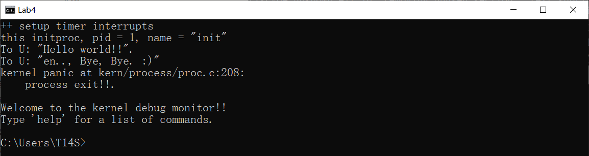
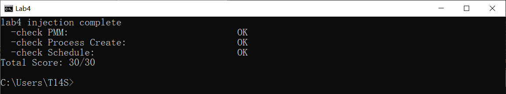
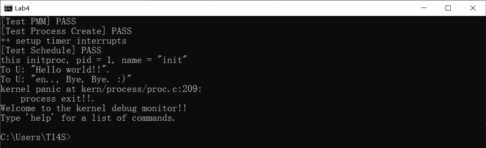

# OSLab4 实验报告

## 实验基本信息

| 项目       | 内容                                  |
| -------- | ----------------------------------- |
| **实验名称** | Lab 4: 进程管理                      |
| **小组成员** | 2411570-何美璇、2410699-张欣妍、2411433-李烁菲 |
| **完成日期** | 2026-11-17                        |

### 小组分工

| 成员          | 负责的练习/模块         | 负责的实验报告模块                    |
| ----------- | ---------------- | ---------------------------- |
| 2411433-李烁菲 | 功能模块一+challenge2 | 实验目的，逻辑主线，模块一和challenge2相关部分 |
| 2411570-何美璇 | 功能模块二 | 模块二、测试截图 |
| 2410699-张欣妍 | 功能模块三+challenge1 | 模块三、challenge1、调度测试与总结       |

## 一、实验目的

1.了解虚拟内存管理的基本结构，掌握虚拟内存的组织与管理方式

2.了解内核线程创建/执行的管理过程

3.了解内核线程的切换和基本调度过程


## 二、实验环境

你们使用的 AI 工具

| 成员          | AI 编程工具          | 底层模型                | 备注  |
| ----------- | ---------------- | ------------------- | --- |
| 2411570-何美璇 | Claude Code      | Claude Sonnet 5.5   |     |
| 2410699-张欣妍 | DeepSeek Harness | DeepSeek-V4.1-Flash |     |
| 2411433-李烁菲 | claude           | claude sonnet 5     |     |

**运行环境与工具链**

| 项目 | 内容 |
| --- | --- |
| 运行环境 | WSL2 / Ubuntu 24.04.5 LTS |
| 交叉编译器 | `riscv64-unknown-elf-gcc` 13.2.0 |
| 交叉调试器 | `gdb-multiarch` 15.1 |
| 模拟器 | `qemu-system-riscv64` 4.1.1 |
| 构建工具 | GNU Make 4.3 |


## 三、实验整体逻辑分析

### 3.1 本章节的逻辑主线

本实验的目标，是让内核从“已经具备物理内存管理和基础页表能力”，走到“能够创建、登记、调度线程并完成上下文切换”。整个启动与执行链可以概括为：

`kern_init → pmm_init → pic_init / idt_init → vmm_init → proc_init → cpu_idle → schedule → proc_run → switch_to`

沿着这条链，本实验可以分成三条相互衔接的主线：

1. **虚拟内存页操作（地址空间准备）。**
   `pmm_init` 建立物理内存管理和内核页表后，内核需要一套可靠的“增删映射”接口，即 `page_insert` 和 `page_remove`。它们决定一个线性地址最终对应哪一页物理内存，并保证页表项、物理页引用计数、TLB 三者一致。这是后面所有地址空间相关逻辑的基础。

2. **进程创建与初始化（线程从哪里来）。**
   `proc_init` 把当前执行现场包装成 `idleproc`，再通过 `kernel_thread → do_fork → copy_thread` 创建第一个真正的内核线程 `initproc`：分配 PCB、内核栈和 PID，登记到链表，并在新线程的内核栈上预先布置好首次运行所需的 `trapframe` 和 `context`。

3. **进程调度（线程如何运行）。**
   `cpu_idle` 在空闲时检测重调度标志并调用 `schedule` 选出下一个可运行线程，`proc_run` 切换 `current` 和页表，`switch_to` 完成寄存器上下文的保存与恢复。新线程第一次运行时，沿着 `forkret → forkrets → __trapret` 的链路进入 `kernel_thread_entry`，最终执行 `initproc` 的入口函数。

### 3.2 功能的逐步实现

本实验的功能不是一次性写完的，而是沿着“地址空间准备 → 线程对象创建 → 调度执行”的顺序逐步推进。这个顺序不是随便定的：没有可靠的页表映射，线程的内核栈和页表就没有落脚点；没有 PCB、内核栈和上下文，调度器就没有可切换的对象；没有调度器，创建出来的线程也只是挂在链表上的结构体，无法真正占用 CPU。具体可以分成三步：

1. 首先实现虚拟内存页操作（功能模块一）。`page_insert` 负责把物理页挂到指定线性地址上，`page_remove` 负责撤销映射；两者一起保证页表项、物理页引用计数和 TLB 三者一致。`pmm_init` 里的 `check_pgdir`、`check_boot_pgdir` 以及 `test_lab4_pmm_basic` 会检查“映射是否建立、同一页多次映射时引用计数是否正确、删除后旧页表项是否清干净”。这一步完成后，内核才有一套可靠的“增删映射”接口，后面的线程内核栈、页表根节点才有基础。

2. 接着实现进程创建与初始化（功能模块二）。`alloc_proc` 先得到一个干净的 PCB；`proc_init` 把当前执行现场包装成 `idleproc`，再通过 `kernel_thread(init_main, ...)` 创建第一个真正的内核线程 `initproc`；`kernel_thread` 构造临时 trapframe，`do_fork` 负责分配内核栈、PID、挂链表、唤醒，`copy_thread` 把 trapframe 和 context 放到新线程自己的内核栈上，并设置 `context.ra = forkret`、`context.sp = proc->tf`、`tf.gpr.s0 = fn`、`tf.gpr.s1 = arg`、`tf.epc = kernel_thread_entry`、`tf.status` 的 SPP/SPIE 位。这一步完成后，系统里至少有两个关键线程：`idleproc` 和 `initproc`，但 `initproc` 还没有真正运行。

3. 最后实现进程调度（功能模块三）。`cpu_idle` 是 idleproc 的执行主体，它发现 `current->need_resched` 为真时调用 `schedule`；`schedule` 在关中断的临界区里从 `proc_list` 中选下一个 `PROC_RUNNABLE` 线程，找不到就退回 `idleproc`；`proc_run` 更新 `current`、把 `satp` 切换到新线程的页表根节点并刷新 TLB，最后 `switch_to` 保存旧线程的 `ra/sp/s0~s11`、恢复新线程的同一组寄存器。新线程第一次运行时，`switch_to` 的 `ret` 会跳到 `context.ra = forkret`，再沿 `forkret → forkrets → __trapret → kernel_thread_entry` 进入 `init_main`。这一步完成后，`initproc` 才真正从 `idleproc` 手里接管 CPU，系统从“有线程对象”变成“线程能轮流执行”。

三条线的联调顺序也对应这个依赖关系：A 先交付出能通过 PMM 测试的版本，因为 `pmm_init` 里的检查会调用 `page_insert`，A 没完成之前 B/C 在 QEMU 里都跑不起来；然后 B 先验证 `[Test Process Create]`，确认 `idleproc`/`initproc` 的字段和首次运行上下文正确；最后由 B 和 C 一起验证 `[Test Schedule]`，确认 `schedule → proc_run → switch_to` 能让测试线程轮流运行。整个启动链可以概括为：

`kern_init → pmm_init → pic_init/idt_init → vmm_init → proc_init → cpu_idle → schedule → proc_run → switch_to`

其中前半段负责把地址空间和线程对象准备好，后半段负责让第一个可运行线程真正跑起来。

## 四、实验内容与实现

### 功能模块一：虚拟内存页操作功能

**负责人**：2411433-李烁菲

#### 模块功能描述

**需要实现的函数：**
```c
static inline void page_remove_pte(pde_t *pgdir, uintptr_t la, pte_t *ptep)
{
    if (*ptep & PTE_V)
    {
        struct Page *page = pte2page(*ptep);
        if (page_ref_dec(page) == 0)
        {
            free_page(page);
        }
        *ptep = 0;
        tlb_invalidate(pgdir, la);
    }
}

int page_insert(pde_t *pgdir, struct Page *page, uintptr_t la, uint32_t perm)
{
    pte_t *ptep = get_pte(pgdir, la, 1);
    if (ptep == NULL)
    {
        return -E_NO_MEM;
    }
    page_ref_inc(page);              // 先加引用，防止旧映射就是同一页时被误释放
    if (*ptep & PTE_V)
    {
        struct Page *old = pte2page(*ptep);
        if (old == page)
        {
            page_ref_dec(page);      // 同一物理页：只更新权限，抵消多加的引用
        }
        else
        {
            page_remove_pte(pgdir, la, ptep);   // 别的物理页：先撤销旧映射
        }
    }
    *ptep = pte_create(page2ppn(page), PTE_V | perm);
    tlb_invalidate(pgdir, la);
    return 0;
}

void page_remove(pde_t *pgdir, uintptr_t la)
{
    pte_t *ptep = get_pte(pgdir, la, 0);   // create=0，删除时不分配页表页
    if (ptep != NULL)
    {
        page_remove_pte(pgdir, la, ptep);
    }
}

```

**功能说明：**

1.int page_insert(pde_t *pgdir, struct Page *page, uintptr_t la, uint32_t perm)

在页表中建立线性地址 la 到物理页 page 的映射，权限为 perm。

如果 la 已映射到同一物理页，只更新权限位，引用计数不变。
如果 la 已映射到另一物理页，先撤销旧映射（旧页引用计数减一，减到 0 则释放），再建立新映射。
成功返回 0；为 la 分配中间级页表页失败时返回 -E_NO_MEM，且不修改任何状态。
页表项更新后会使 la 对应的 TLB 项失效。

2.void page_remove(pde_t *pgdir, uintptr_t la)     撤销 la 上的映射。

如果有映射：对应物理页引用计数减一，减到 0 则释放，同时清空页表项并使 TLB 失效。
如果没有映射：安静返回，不报错，所以重复删除同一地址也是安全的。
查找页表项时不会分配新的页表页。

3.辅助函数 static void page_remove_pte(pde_t *pgdir, uintptr_t la, pte_t *ptep)

撤销一个已经定位好的页表项，上面两个函数共用它。


#### 最终提示词
```
[PROMPT]
任务：修改文件 kern/mm/pmm.c，实现“虚拟内存页操作”功能模块。该模块负责在现有 Sv39 三级页表框架上维护线性地址到物理页的映射：page_insert 把一个物理页挂到指定线性地址上（或更新已有映射），page_remove 撤销指定线性地址上的映射。模块必须保证页表项内容、物理页引用计数、TLB 状态三者始终一致。代码应放在 pmm.c 中标注 “//LAB4 function1 YOUR CODE” 的位置（get_pte/get_page 之后、tlb_invalidate 之前）。

操作要求：你必须在项目中修改实际文件，而不是仅展示代码。完成功能模块的实现，包括但不限于：两个公开函数、辅助函数、内部使用的宏。保留现有代码，只在上述标记位置补全，不要修改 get_pte、get_page、tlb_invalidate、check_pgdir、check_boot_pgdir 等已有函数，不要删除既有逻辑。文件使用 CRLF 换行，请保持原有换行风格。

输出要求：直接进行文件操作，使用下面 [RELY]、[GUARANTEE]、[SPECIFICATION] 部分的信息，以工程真实代码为准，不要引入无关功能。

[RELY]
// 权限位宏（libs/riscv.h）
PTE_V 0x001  // 有效
PTE_R 0x002  // 可读
PTE_W 0x004  // 可写
PTE_U 0x010  // 用户态可访问
// 错误码（libs/error.h）
E_NO_MEM 4   // 内存不足，函数应返回 -E_NO_MEM

// 类型
typedef uintptr_t pte_t;  typedef uintptr_t pde_t;
struct Page { int ref; ... };   // ref 为该物理页当前被引用（映射）的次数
extern struct Page *pages;       // 物理页描述符数组
extern pde_t *boot_pgdir_va;     // 内核启动页目录的虚拟地址

// 可用函数（kern/mm/pmm.h、pmm.c，签名以工程为准）
pte_t *get_pte(pde_t *pgdir, uintptr_t la, bool create);
    // 返回 la 对应的最后一级页表项指针。
    // create=0 且中间级页表不存在时返回 NULL；create=1 时会按需分配中间级页表页，
    // 分配失败返回 NULL。返回的 PTE 本身可能是无效的（未映射）。
    // 中间级页表页的引用计数由 get_pte 自己管理，本模块不要改动。
struct Page *alloc_page(void);
#define free_page(page) free_pages(page, 1)
struct Page *pte2page(pte_t pte);               // PTE 无效时会 panic，调用前必须确认 PTE_V
uintptr_t page2ppn(struct Page *page);          // 物理页号
pte_t pte_create(uintptr_t ppn, int type);      // 构造 PTE，结果已自动带有 PTE_V
int page_ref(struct Page *page);
void set_page_ref(struct Page *page, int val);
int page_ref_inc(struct Page *page);            // 引用计数 +1，返回新值
int page_ref_dec(struct Page *page);            // 引用计数 -1，返回新值
void tlb_invalidate(pde_t *pgdir, uintptr_t la); // 使 la 对应的 TLB 项失效（已在 pmm.c 中实现）
void flush_tlb(void);                            // 刷新整个 TLB

// 已有的相关调用方（供理解，不要修改）
// check_pgdir() / check_boot_pgdir() / tools/test_lab4.c 会调用 page_insert / page_remove，
// 并用断言检查引用计数、权限位、空闲页数是否正确。

[GUARANTEE]
必须实现的主要接口（声明已在 pmm.h 中，签名必须一致）：
int page_insert(pde_t *pgdir, struct Page *page, uintptr_t la, uint32_t perm);
void page_remove(pde_t *pgdir, uintptr_t la);

你可以根据需要添加：
- 辅助函数（必须设为 static，只在 pmm.c 内部使用，不得改变公开接口）
- 内部使用的宏定义

[SPECIFICATION]
## page_insert
Pre-Condition:
- pgdir 是有效的页目录虚拟地址；page 指向有效的物理页描述符；la 是任意线性地址；perm 是调用者希望设置的权限位（不含 PTE_V）。

Post-Condition:
- 成功时：la 稳定地映射到 page 对应的物理页，页表项的权限等于 perm 加上有效位；page 的引用计数正确反映“当前有多少个映射指向它”；la 对应的 TLB 旧翻译已失效；原先被 la 映射、现在不再被引用的物理页已被正确处理。
- 失败时：返回 -E_NO_MEM，页表、引用计数均未被修改，不留下半完成的映射。

  Case 1（无法定位页表项）:
  - 为 la 查找页表项时需要分配中间级页表页但分配失败。此时直接返回 -E_NO_MEM，不改变任何状态。

  Case 2（la 此前没有有效映射）:
  - 建立新映射：page 的引用计数增加一次，写入新的页表项，并使 la 的 TLB 失效，返回 0。

  Case 3（la 此前已映射到同一个物理页）:
  - 只需要更新权限位，page 的引用计数在整个调用前后保持不变，不能多加也不能释放该页；使 la 的 TLB 失效，返回 0。

  Case 4（la 此前映射到另一个物理页）:
  - 先撤销旧映射：旧物理页引用计数减一，若减到 0 则释放该物理页；再为 page 建立新映射，page 的引用计数加一；使 la 的 TLB 失效，返回 0。

Requirements:
- 增加新页引用计数的动作必须发生在处理旧映射之前，保证“重新映射到同一页”时该页不会被误释放。
- 不能简单覆盖旧页表项，否则会泄漏旧物理页的引用计数。
- 页表项一旦被修改，就必须使对应线性地址的 TLB 失效。

## page_remove
Pre-Condition:
- pgdir 是有效的页目录虚拟地址；la 是任意线性地址，该地址不一定存在映射。

Post-Condition:
- 调用结束后 la 不再有有效映射；原来被映射的物理页引用计数减一，减到 0 时被释放；la 对应的 TLB 项已失效。该函数是幂等的。

  Case 1（la 没有有效映射，包括中间级页表不存在）:
  - 什么都不做，安静返回，不得 panic，也不得为了删除而分配新的页表页。

  Case 2（la 存在有效映射）:
  - 物理页引用计数减一，若减到 0 则释放该页；清空页表项；使 la 的 TLB 失效。

Requirements:
- 不得操作或释放中间级页表页（其生命周期由 get_pte 及调用方管理）。
- “撤销一个已知页表项”的逻辑可抽成 static 辅助函数，供 page_insert 与 page_remove 共用。
- 实现后应能通过 check_pgdir、check_boot_pgdir 以及 tools/test_lab4.c 中 PMM 测试的全部断言（引用计数、权限位、空闲页数前后一致）。
```


#### 实现迭代过程

本模块的实现经历了 1 次迭代，过程如下：

##### 第一次迭代

**遇到的问题：**

第一版提示词只列出了函数名清单，规格只有两句话概括，没有拆分 Case。根据它写出的代码有以下问题：

1.同一物理页重复插入时引用计数错乱：只要旧 PTE 有效就先撤销旧映射，导致原地址已映射到同一页时，该页先被减到 0 释放，再被重新映射。

2.`page_remove` 用 `create=1` 调用 `get_pte`：对未映射地址会白白分配页表页，造成内存泄漏，空闲页数断言失败。

3.未判断 PTE 有效性就调用 `pte2page`：删除未映射地址时直接 panic。

4.分配失败用 `assert` 处理，而不是返回 `-E_NO_MEM`；覆盖旧映射的路径还漏了 TLB 刷新。

**问题解决策略：**

[RELY] 补全了接口行为：`get_pte` 的 `create` 语义、`pte2page` 遇到无效 PTE 会 panic、引用计数的加减与释放约定。

[SPECIFICATION] 把 `page_insert` 拆成 4 个 Case（无法定位页表项、原地址无映射、同一物理页、另一物理页），`page_remove` 拆成 2 个 Case（无映射、有映射），并在 Requirements 中要求先加新页引用再处理旧映射、改页表必刷 TLB、失败不留半完成状态。

##### **最终结果：**
经过 1 次迭代，最终实现的 `page_insert` 与 `page_remove` 满足提示词中的全部约束，能够通过 PMM 相关测试。


### 功能模块二：进程创建及初始化功能

**负责人：** 2411570-何美璇

#### 模块功能描述

**需要实现的函数：**

```c
//LAB4 function2 2411570

// alloc_proc - 分配一个 proc_struct 并把它初始化为"刚创建、尚未运行"的状态
static struct proc_struct *
alloc_proc(void)
{
    struct proc_struct *proc = kmalloc(sizeof(struct proc_struct));
    if (proc != NULL)
    {
        memset(proc, 0, sizeof(struct proc_struct)); // 所有字段先清零：context、tf、mm、flags、name 等都是安全的空值
        proc->state = PROC_UNINIT;                   // 已创建，还没有进入调度
        proc->pid = -1;                              // pid 还没分配
        proc->pgdir = boot_pgdir_pa;                 // 内核线程共用内核页表，这里必须是物理地址
    }
    return proc;
}

// copy_mm - 内核线程共享内核地址空间，本实验不需要复制 mm
static int
copy_mm(uint32_t clone_flags, struct proc_struct *proc)
{
    assert(current->mm == NULL); // 内核线程没有用户地址空间
    return 0;
}

// copy_thread - 在新线程的内核栈顶放置 trapframe，并设置首次运行用的 context
static void
copy_thread(struct proc_struct *proc, uintptr_t esp, struct trapframe *tf)
{
    // trapframe 放在内核栈的最高处，栈从它下面向低地址增长
    proc->tf = (struct trapframe *)(proc->kstack + KSTACKSIZE - sizeof(struct trapframe));
    *(proc->tf) = *tf;
    proc->tf->gpr.a0 = 0; // 子线程的返回值为 0
    // esp 为 0 表示内核线程，使用自己内核栈上 trapframe 的位置作为栈顶，否则 sret 之后 sp 就是 0
    proc->tf->gpr.sp = (esp == 0) ? (uintptr_t)proc->tf : esp;

    proc->context.ra = (uintptr_t)forkret;      // 第一次 switch_to 之后返回到 forkret
    proc->context.sp = (uintptr_t)(proc->tf);   // forkret 运行时的栈从 trapframe 下面开始
}

// do_fork - 创建新线程：分配 PCB、内核栈，复制内存管理与 trapframe，登记并设为就绪
int do_fork(uint32_t clone_flags, uintptr_t stack, struct trapframe *tf)
{
    int ret = -E_NO_FREE_PROC;
    struct proc_struct *proc;
    if (nr_process >= MAX_PROCESS)
    {
        goto fork_out;
    }
    ret = -E_NO_MEM;

    if ((proc = alloc_proc()) == NULL)
    {
        goto fork_out;
    }
    proc->parent = current; // 父进程就是调用 do_fork 的当前线程

    if (setup_kstack(proc) != 0)
    {
        goto bad_fork_cleanup_proc;
    }
    if (copy_mm(clone_flags, proc) != 0)
    {
        goto bad_fork_cleanup_kstack;
    }
    copy_thread(proc, stack, tf);

    // pid 分配、哈希表和链表插入、计数必须作为一个整体，期间关中断
    bool intr_flag;
    local_intr_save(intr_flag);
    {
        proc->pid = get_pid();
        hash_proc(proc);
        list_add(&proc_list, &(proc->list_link));
        nr_process++;
    }
    local_intr_restore(intr_flag);

    wakeup_proc(proc); // UNINIT -> RUNNABLE
    ret = proc->pid;

fork_out:
    return ret;

bad_fork_cleanup_kstack:
    put_kstack(proc);
bad_fork_cleanup_proc:
    kfree(proc);
    goto fork_out;
}

// kernel_thread - 构造临时 trapframe，再调用 do_fork 创建内核线程
int kernel_thread(int (*fn)(void *), void *arg, uint32_t clone_flags)
{
    struct trapframe tf;
    memset(&tf, 0, sizeof(struct trapframe));
    tf.gpr.s0 = (uintptr_t)fn;  // kernel_thread_entry 会跳转到 s0
    tf.gpr.s1 = (uintptr_t)arg; // 并把 s1 作为参数传进去
    // SPP=1：sret 后回到内核态；SPIE=1：sret 后打开中断；SIE=0：恢复寄存器的过程中不被打断
    tf.status = (read_csr(sstatus) | SSTATUS_SPP | SSTATUS_SPIE) & ~SSTATUS_SIE;
    tf.epc = (uintptr_t)kernel_thread_entry; // 线程第一次运行的入口
    return do_fork(clone_flags | CLONE_VM, 0, &tf);
}

// proc_init - 把当前执行现场包装成 idleproc，并创建第一个内核线程 initproc
void proc_init(void)
{
    int i;

    list_init(&proc_list);
    for (i = 0; i < HASH_LIST_SIZE; i++)
    {
        list_init(hash_list + i);
    }

    if ((idleproc = alloc_proc()) == NULL)
    {
        panic("cannot alloc idleproc.\n");
    }

    idleproc->pid = 0;
    idleproc->state = PROC_RUNNABLE;
    idleproc->kstack = (uintptr_t)bootstack; // 复用启动时的栈
    idleproc->need_resched = 1;              // 让 cpu_idle 一进来就调度
    set_proc_name(idleproc, "idle");
    nr_process++;

    current = idleproc; // 必须先设置 current，后面创建的 initproc 的 parent 才是 idleproc

    int pid = kernel_thread(init_main, "Hello world!!", 0);
    if (pid <= 0)
    {
        panic("create init_main failed.\n");
    }

    initproc = find_proc(pid);
    set_proc_name(initproc, "init");

    assert(idleproc != NULL && idleproc->pid == 0);
    assert(initproc != NULL && initproc->pid == 1);
}
```

**功能说明：**

1. `static struct proc_struct *alloc_proc(void)`

   分配一个 `proc_struct`，并把它初始化为"刚创建、尚未运行"的状态。

   先把整个结构清零，这样 `context`、`tf`、`mm`、`flags`、`name` 和两个链表节点都是安全的空值。再设置三个字段：`state` 为 `PROC_UNINIT`，`pid` 为 -1，`pgdir` 为 `boot_pgdir_pa`。内核线程共用内核页表，`pgdir` 之后会被写入 `satp`，所以这里保存的是物理地址。内存不足时返回 NULL。

2. `static int copy_mm(uint32_t clone_flags, struct proc_struct *proc)`

   内核线程共享内核地址空间，不需要复制 `mm`。函数只断言 `current->mm` 为 NULL，然后返回 0。保留这个函数是为了后面实验创建用户进程时继续扩展。

3. `static void copy_thread(struct proc_struct *proc, uintptr_t esp, struct trapframe *tf)`

   在新线程自己的内核栈上布置它第一次运行需要的现场。

   把 trapframe 放在内核栈的最高处，并把传入的 trapframe 复制过去，再把 `a0` 设为 0，表示这是子线程。`esp` 为 0 时说明是内核线程，栈指针设成这个 trapframe 自己所在的位置，线程在这个位置之下向低地址使用栈。最后设置 `context.ra` 为 `forkret`，`context.sp` 为 trapframe 的位置，这样第一次 `switch_to` 之后会返回到 `forkret`，再经过 `forkrets`、`__trapret` 进入线程入口。

4. `int do_fork(uint32_t clone_flags, uintptr_t stack, struct trapframe *tf)`

   创建新线程的主函数，按顺序完成：

   - 检查进程数是否已达上限，达到则返回 `-E_NO_FREE_PROC`。
   - 分配并初始化 PCB，把 `parent` 设为 `current`。
   - 分配内核栈，失败则释放 PCB 并返回 `-E_NO_MEM`。
   - 调用 `copy_mm`，失败则释放内核栈和 PCB。
   - 调用 `copy_thread` 设置 trapframe 和 context。
   - 在关中断的区间内完成 pid 分配、插入哈希表、插入进程链表、进程数加一。
   - 调用 `wakeup_proc` 把状态改成 `PROC_RUNNABLE`，返回新线程的 pid。

5. `int kernel_thread(int (*fn)(void *), void *arg, uint32_t clone_flags)`

   因为内核启动时没有父进程可以复制，所以手工构造一个临时 trapframe，再交给 `do_fork`。

   临时 trapframe 先整体清零，然后设置 `s0` 为线程函数，`s1` 为参数，`epc` 为 `kernel_thread_entry`。`status` 在当前 `sstatus` 的基础上置 `SPP` 和 `SPIE`，清除 `SIE`：`SPP` 让 `sret` 之后回到内核态，`SPIE` 让 `sret` 之后打开中断，清除 `SIE` 是为了恢复寄存器的过程中不被中断打断。最后调用 `do_fork(clone_flags | CLONE_VM, 0, &tf)`，返回新线程的 pid。

6. `void proc_init(void)`

   初始化进程管理需要的全局结构，并创建 idleproc 和 initproc。

   先初始化 `proc_list` 和 `hash_list`。然后分配 idleproc，把它设为 pid 0、`PROC_RUNNABLE`，内核栈使用启动时的 `bootstack`，`need_resched` 置 1，名字为 "idle"，并把 `current` 指向它。这一步必须在创建 initproc 之前完成，因为 `do_fork` 会把 `current` 记为父进程。之后调用 `kernel_thread(init_main, "Hello world!!", 0)` 创建 initproc，用 `find_proc` 找到它并命名为 "init"，最后断言两个线程的 pid 分别是 0 和 1。

#### 最终提示词

以下是经过迭代优化后，最终成功实现该功能的提示词：

```
[PROMPT]
任务：修改文件 kern/process/proc.c，实现“进程创建及初始化”功能模块。该模块负责让内核从只有一条执行流，变成能够创建并登记多个内核线程：把当前执行现场包装成第 0 个内核线程 idleproc，再通过 kernel_thread 和 do_fork 创建第 1 个内核线程 initproc，并在新线程自己的内核栈上布置好它第一次被调度时需要的 trapframe 和 context，使它能够沿着 switch_to、forkret、forkrets、__trapret、kernel_thread_entry 这条路径开始执行。代码放在 proc.c 中标注 “//LAB4 function2 YOUR CODE” 的位置（init_main 之后、“//LAB4 function3 YOUR CODE” 之前）。

操作要求：你必须在项目中修改实际文件，而不是仅展示代码。完成功能模块的实现，包括但不限于：六个函数主体、辅助函数、内部使用的宏。保留现有代码，只在上述标记位置补全，不要修改 get_pid、hash_proc、find_proc、setup_kstack、put_kstack、forkret、init_main、do_exit 等已有函数，也不要修改 function3 标记处以及 sched.c、switch.S 等其他文件。

输出要求：直接进行文件操作，使用下面 [RELY]、[GUARANTEE]、[SPECIFICATION] 部分的信息，以工程真实代码为准，不要引入无关功能。

[RELY]
// 进程状态与结构（kern/process/proc.h）
enum proc_state { PROC_UNINIT = 0, PROC_SLEEPING, PROC_RUNNABLE, PROC_ZOMBIE };
struct context { uintptr_t ra, sp, s0, s1, s2, ..., s11; };   // 切换时保存的 14 个寄存器
struct proc_struct {
    enum proc_state state;  int pid;  int runs;  uintptr_t kstack;  volatile bool need_resched;
    struct proc_struct *parent;  struct mm_struct *mm;  struct context context;
    struct trapframe *tf;  uintptr_t pgdir;  uint32_t flags;  char name[PROC_NAME_LEN + 1];
    list_entry_t list_link;  list_entry_t hash_link;
};
#define MAX_PROCESS 4096        // 系统允许的最大进程数
// pgdir 保存页目录的物理地址，进程切换时会被写入 satp

// trapframe（kern/trap/trap.h）
struct trapframe { struct pushregs gpr; uintptr_t status; uintptr_t epc; uintptr_t badvaddr; uintptr_t cause; };
// gpr 中包含 sp、a0、s0、s1 等通用寄存器。sret 返回时，epc 是返回地址，status 决定返回后的特权级和中断使能。

// sstatus 位与 CSR 访问（libs/riscv.h）
SSTATUS_SIE 0x2    // 当前是否允许中断
SSTATUS_SPIE 0x20  // sret 之后 SIE 的取值
SSTATUS_SPP 0x100  // sret 之后的特权级：1 表示内核态（S 模式），0 表示用户态
read_csr(sstatus)

// 全局变量与常量（proc.c / pmm.h / memlayout.h）
list_entry_t proc_list;                          // 所有进程的链表
static list_entry_t hash_list[HASH_LIST_SIZE];   // 按 pid 的哈希表
struct proc_struct *idleproc, *initproc, *current;
static int nr_process;                           // 当前进程数
extern uintptr_t boot_pgdir_pa;                  // 内核页表的物理地址
extern char bootstack[];                         // 启动阶段使用的栈
#define KSTACKSIZE (KSTACKPAGE * PGSIZE)         // 内核栈大小，KSTACKPAGE 为 2
#define CLONE_VM 0x00000100                      // 表示共享地址空间
// 错误码（libs/error.h）
E_NO_MEM 4        // 返回 -E_NO_MEM
E_NO_FREE_PROC 5  // 返回 -E_NO_FREE_PROC

// 可用函数（签名以工程为准）
void *kmalloc(size_t n);  void kfree(void *p);  void *memset(void *s, char c, size_t n);
static int get_pid(void);                        // 返回当前未被占用的 pid
static void hash_proc(struct proc_struct *proc); // 按 pid 插入哈希表
struct proc_struct *find_proc(int pid);
static int setup_kstack(struct proc_struct *proc);   // 成功返回 0，失败返回 -E_NO_MEM，成功时设置 proc->kstack
static void put_kstack(struct proc_struct *proc);    // 释放 proc 的内核栈
char *set_proc_name(struct proc_struct *proc, const char *name);
void wakeup_proc(struct proc_struct *proc);          // 要求 state 不是 ZOMBIE 和 RUNNABLE，把它设为 RUNNABLE
void list_init(list_entry_t *elm);  void list_add(list_entry_t *listelm, list_entry_t *elm);  // 加在 listelm 之后
local_intr_save(x); local_intr_restore(x);       // 关中断/恢复中断，x 是 bool 变量
static void forkret(void);                       // 已定义：新线程第一次被 switch_to 切换进来后到达这里，调用 forkrets(current->tf)
void kernel_thread_entry(void);                  // 汇编（process/entry.S）：调用 s0(s1)，返回后调用 do_exit
static int init_main(void *arg);                 // 已定义：initproc 的入口函数，打印 pid、名字和参数

// 已有的相关调用方（供理解，不要修改）
// init.c 在 kern_init 中调用 proc_init。
// tools/test_lab4.c 的 Process Create 测试在 proc_init 结束后检查：
//   current == idleproc；idleproc 的 pid 为 0、state 为 RUNNABLE、kstack 等于 bootstack、
//   parent/mm/tf 为 NULL、runs 和 flags 为 0、context.ra 为 0；
//   initproc 的 pid 为 1、state 为 RUNNABLE、parent 等于 idleproc、mm 为 NULL、context.ra 和 context.sp 不为 0。
// Schedule 测试会再调用 kernel_thread 创建两个线程，并让三个线程轮流运行。

[GUARANTEE]
必须实现的主要接口（声明已在 proc.h 中，签名必须一致）：
static struct proc_struct *alloc_proc(void);
void proc_init(void);
int kernel_thread(int (*fn)(void *), void *arg, uint32_t clone_flags);
int do_fork(uint32_t clone_flags, uintptr_t stack, struct trapframe *tf);
static void copy_thread(struct proc_struct *proc, uintptr_t esp, struct trapframe *tf);
static int copy_mm(uint32_t clone_flags, struct proc_struct *proc);

你可以根据需要添加：
- 辅助函数（必须设为 static，只在 proc.c 内部使用，不得改变公开接口）
- 内部使用的宏定义

[SPECIFICATION]
## alloc_proc
Pre-Condition:
- 内核堆分配器 kmalloc 已经初始化。

Post-Condition:
- 成功时返回一个处于“刚创建、尚未运行”状态的 PCB，之后任何代码读取其中没有被显式赋值的字段，都只会得到安全的空值；失败时返回 NULL。

  Case 1（内存不足）:
  - kmalloc 失败，返回 NULL，不改变任何其他状态。

  Case 2（成功）:
  - 状态为未初始化态，pid 为 -1 表示尚未分配，页目录基址 pgdir 为内核页表的物理地址，其余字段（运行次数、内核栈、need_resched、父进程、mm、context、tf、flags、name、两个链表节点）全部为 0 或空。

Requirements:
- pgdir 必须是物理地址而不是虚拟地址：内核线程共用内核页表，进程切换时这个值会被写入 satp。
- 不能留下未初始化的随机值：Process Create 测试会检查 idleproc 的 context.ra 为 0、tf 为 NULL、flags 为 0。

## copy_mm
Pre-Condition:
- 调用者是内核线程，current 的 mm 为 NULL。

Post-Condition:
- 返回 0，不创建任何新的地址空间，proc 的 mm 保持为 NULL。

Requirements:
- 当 current 的 mm 不为 NULL 时，说明这不是内核线程的创建，应当用断言暴露出来，而不是悄悄忽略。
- 保持函数形态完整，便于后续实验为用户进程扩展。

## copy_thread
Pre-Condition:
- proc 已经拥有有效的内核栈；tf 指向调用者准备好的 trapframe；esp 为 0 表示新线程是内核线程。

Post-Condition:
- proc 的 trapframe 位于它自己内核栈的最高处，内容是传入 trapframe 的拷贝，并且子线程的返回值为 0。proc 的 context 设置为：第一次被 switch_to 切换进来时进入 forkret，并且 forkret 运行时使用的栈位于 trapframe 之下，不会覆盖 trapframe。

  Case 1（esp 为 0，内核线程）:
  - trapframe 中的栈指针设为该 trapframe 自己所在的地址，线程之后在这个位置之下使用栈。传入的 trapframe 是由 kernel_thread 清零构造的，如果不设置这一项，线程第一次运行时栈指针为 0。

  Case 2（esp 不为 0）:
  - trapframe 中的栈指针使用调用者给定的 esp。

Requirements:
- trapframe 必须完整地放在 kstack 到 kstack + KSTACKSIZE 的范围之内。
- trapframe 中的 epc、status、s0、s1 必须原样保留，它们决定线程第一次运行时从哪里开始、以什么状态运行。

## do_fork
Pre-Condition:
- current 是调用 do_fork 的线程；tf 指向要复制给子线程的 trapframe；stack 为 0 表示内核线程。

Post-Condition:
- 成功时新线程已经创建并登记：它的 pid 在现有进程中唯一，父进程为 current，已加入进程链表和按 pid 的哈希表，进程总数加 1，状态为就绪，函数返回它的 pid。失败时返回负的错误码，并且不留下已经分配却没有释放的资源。

  Case 1（进程数已达上限）:
  - 返回 -E_NO_FREE_PROC，不分配任何资源。

  Case 2（PCB 分配失败）:
  - 返回 -E_NO_MEM，没有需要释放的资源。

  Case 3（内核栈分配失败）:
  - 释放已经分配的 PCB，返回 -E_NO_MEM。

  Case 4（copy_mm 失败）:
  - 释放已经分配的内核栈和 PCB，返回 -E_NO_MEM。

  Case 5（成功）:
  - 按上面的 Post-Condition 完成登记，返回新线程的 pid。

Requirements:
- 父进程必须显式设置为 current：alloc_proc 得到的 parent 为空，Process Create 测试会检查 initproc 的 parent 是 idleproc。
- pid 分配、插入哈希表、插入进程链表、进程数加 1 必须作为一个整体完成，期间不能被中断打断。
- 状态从未初始化变为就绪，必须在线程完全登记之后，通过现有的 wakeup_proc 完成。
- 失败路径按资源分配的相反顺序释放。

## kernel_thread
Pre-Condition:
- fn 是线程入口函数，arg 是传给它的参数；current 指向调用者。

Post-Condition:
- 返回新线程的 pid 或 do_fork 返回的负错误码。新线程第一次运行时在内核态执行 fn(arg)，运行时中断是打开的，fn 返回后进入 do_exit。

  Case 1（do_fork 失败）:
  - 原样返回错误码。

  Case 2（成功）:
  - 返回新线程的 pid。

Requirements:
- 临时 trapframe 先整体清零，再设置：线程函数和参数通过 kernel_thread_entry 约定使用的两个寄存器传递；epc 指向 kernel_thread_entry。
- status 在当前 sstatus 的基础上要满足三点：sret 之后回到内核态（置 SPP）；sret 之后打开中断（置 SPIE）；恢复寄存器的过程中不接受中断（清 SIE）。漏掉 SPP，线程会回到用户态并在取第一条指令时异常；漏掉 SPIE，线程会在关中断状态下运行，三个测试仍然能通过，因此必须由规格保证。
- 调用 do_fork 时 clone_flags 要加上 CLONE_VM，stack 参数为 0。

## proc_init
Pre-Condition:
- 内存管理已经初始化，kmalloc 可用；此时 current 为空。

Post-Condition:
- 进程链表和哈希表已初始化为空表；idleproc 是当前执行现场对应的第 0 个线程，current 指向它；initproc 是第 1 个线程，名字为 init，入口为 init_main，参数为 "Hello world!!"，已经就绪等待调度。

  Case 1（idleproc 分配失败）:
  - 调用 panic 终止初始化。

  Case 2（initproc 创建失败，返回的 pid 不大于 0）:
  - 调用 panic 终止初始化。

  Case 3（成功）:
  - idleproc 的 pid 为 0，状态为就绪，内核栈为启动时使用的 bootstack，need_resched 为 1，名字为 idle，不加入 proc_list（它只作为调度器找不到其他线程时的保底选择），进程计数包含它。initproc 的 pid 为 1，父进程为 idleproc，名字为 init。

Requirements:
- current 必须在调用 kernel_thread 之前就指向 idleproc：do_fork 会把 current 记为父进程，copy_mm 也会读取 current。
- 实现后应能通过 tools/test_lab4.c 中 Process Create 测试以及 Schedule 测试的全部断言。
```

#### 实现迭代过程

本模块的实现经历了 2 次迭代，过程如下：

##### 第一次迭代

**遇到的问题：**

第一版提示词只有任务说明和六个函数的名称，每个函数的规格只用一两句话概括，没有拆分 Case，[RELY] 里也只列了结构体和函数名。AI 生成的代码可以编译通过，但有三处漏掉了提示词没有写明的隐含条件：

1. `do_fork` 没有设置 `proc->parent = current`。`alloc_proc` 得到的 `parent` 本来就是空，代码里没有任何地方给它赋值。运行 Process Create 测试时，在 `initproc->parent == idleproc && initproc->mm == NULL` 这一条断言处失败，系统 panic。

2. `copy_thread` 没有处理 `esp` 为 0 的情况，新线程 trapframe 里的栈指针一直是 0。`kernel_thread` 构造的临时 trapframe 是清零的，`copy_thread` 只是复制了它，没有把栈指针设成内核栈上的位置。这时 Process Create 测试仍然通过，但 initproc 第一次被调度运行时，第一次使用栈就触发存储访问异常（scause 为 7），内核反复进入异常并不断打印 trapframe。

3. `alloc_proc` 没有给 `pgdir` 赋值，保持为 0。这一处最难定位：Process Create 测试通过，进入调度后系统没有任何输出就停住了，原因是切换页表时 `satp` 指向了物理地址 0 处的页表。

**问题解决策略：**

[RELY] 补充了 `pgdir` 的含义（内核页表的物理地址，会被写入 `satp`）、trapframe 各字段的作用，以及 `forkret` 和 `kernel_thread_entry` 的执行过程。[SPECIFICATION] 中，`alloc_proc` 的 Case 写明每个字段的初始值；`copy_thread` 拆成 `esp` 为 0 和不为 0 两个 Case；`do_fork` 的 Requirements 写明父进程必须设为 `current`，并说明对应的测试检查。

##### 第二次迭代

**遇到的问题：**

第二版提示词重新生成后，三个测试都能通过，但对照规格检查并做对比实验时，发现 `kernel_thread` 和 `do_fork` 还有两类问题：

1. `kernel_thread` 对 `status` 的处理不完整。第二版规格只写了"设置 status"，AI 生成的代码只写了 `sstatus | SSTATUS_SPIE`，漏掉了 `SPP`。这样 `sret` 之后 CPU 回到用户态，从内核代码取第一条指令时马上触发指令缺页异常（scause 为 12），异常被反复触发。补上 `SPP` 但漏掉 `SPIE` 时，三个测试仍然全部通过，但新线程是在关中断状态下运行的，测试发现不了这个错误。

2. `do_fork` 的出错处理和保护不完整。`copy_mm` 失败时只释放了 PCB，没有释放已经分配的内核栈，会泄漏两页内存；pid 分配、插入哈希表和链表、进程数加一没有放在关中断的区间里，中断打断时进程链表可能处于半完成状态。这两处没有任何测试会触发，是对照规格检查代码时发现的。

**问题解决策略：**

[SPECIFICATION] 中 `kernel_thread` 的 Requirements 把 `status` 三位逐位写成要满足的行为（回到内核态、返回后打开中断、恢复现场期间不被打断），并写明漏掉 `SPP` 和 `SPIE` 各自的后果。`do_fork` 的失败情况拆成"内核栈分配失败""`copy_mm` 失败"两个 Case，各自写明要释放的资源，并在 Requirements 中要求 pid 分配到进程数加一作为一个整体，期间不被中断打断。

**最终结果：**

经过 2 次迭代，最终实现的六个函数满足提示词中的全部约束，能够通过 Process Create 测试，initproc 也能在 Schedule 测试中被正确调度运行。

**关键改进点总结：**

1. 把 AI 容易漏掉的隐含条件（`parent`、栈指针、`pgdir`、`status` 位）逐条写成 Case 或 Requirements，而不是只写函数的功能。
2. 对测试检查不到的条件（开中断、失败时的资源回收、关中断区间），在规格里明确写出后果，靠规格而不是测试来保证。
3. 在 [RELY] 里补充结构体字段和寄存器位的含义，让 AI 知道 `pgdir` 为什么必须是物理地址、`status` 各位起什么作用。

### 功能模块三：进程调度

**负责人**：2410699-张欣妍

#### 模块功能描述

**需要实现的函数：**

1. `switch_to`（`kern/process/switch.S`）

```asm
#include <riscv.h>

    .text
    .globl switch_to
    .align 2
switch_to:
    # a0 = from, a1 = to
    # 只保存 callee-saved：ra、sp、s0~s11
    STORE ra,   0*REGBYTES(a0)
    STORE sp,   1*REGBYTES(a0)
    STORE s0,   2*REGBYTES(a0)
    STORE s1,   3*REGBYTES(a0)
    STORE s2,   4*REGBYTES(a0)
    STORE s3,   5*REGBYTES(a0)
    STORE s4,   6*REGBYTES(a0)
    STORE s5,   7*REGBYTES(a0)
    STORE s6,   8*REGBYTES(a0)
    STORE s7,   9*REGBYTES(a0)
    STORE s8,  10*REGBYTES(a0)
    STORE s9,  11*REGBYTES(a0)
    STORE s10, 12*REGBYTES(a0)
    STORE s11, 13*REGBYTES(a0)

    # 恢复 to 的 ra、sp、s0~s11
    LOAD ra,   0*REGBYTES(a1)
    LOAD sp,   1*REGBYTES(a1)
    LOAD s0,   2*REGBYTES(a1)
    LOAD s1,   3*REGBYTES(a1)
    LOAD s2,   4*REGBYTES(a1)
    LOAD s3,   5*REGBYTES(a1)
    LOAD s4,   6*REGBYTES(a1)
    LOAD s5,   7*REGBYTES(a1)
    LOAD s6,   8*REGBYTES(a1)
    LOAD s7,   9*REGBYTES(a1)
    LOAD s8,  10*REGBYTES(a1)
    LOAD s9,  11*REGBYTES(a1)
    LOAD s10, 12*REGBYTES(a1)
    LOAD s11, 13*REGBYTES(a1)
    ret
```

2. `proc_run`（`kern/process/proc.c`）

```c
void
proc_run(struct proc_struct *proc)
{
    if (proc != current)
    {
        bool intr_flag;
        struct proc_struct *prev = current, *next = proc;

        local_intr_save(intr_flag);
        {
            current = proc;
            // Sv39：MODE=8 在最高 4 位，低 44 位是页表根节点物理页号
            write_csr(satp, 0x8000000000000000 | (next->pgdir >> RISCV_PGSHIFT));
            flush_tlb();
            switch_to(&(prev->context), &(next->context));
        }
        local_intr_restore(intr_flag);
    }
}
```

3. `cpu_idle`（`kern/process/proc.c`）

```c
void
cpu_idle(void)
{
    while (1)
    {
        if (current->need_resched)
        {
            schedule();
        }
    }
}
```

4. `schedule`（`kern/schedule/sched.c`）

```c
void
schedule(void)
{
    bool intr_flag;
    list_entry_t *le, *last;
    struct proc_struct *next = NULL;

    local_intr_save(intr_flag);
    {
        current->need_resched = 0;

        // idleproc 从链表头开始；普通线程从 current 的下一个开始，绕一圈回到 current
        last = (current == idleproc) ? &proc_list : &(current->list_link);
        le = last;
        do
        {
            // 跳过链表头哨兵 &proc_list
            if ((le = list_next(le)) != &proc_list)
            {
                next = le2proc(le, list_link);
                if (next->state == PROC_RUNNABLE)
                {
                    break;
                }
            }
        } while (le != last);

        // 没有就绪线程时退回 idleproc 保底
        if (next == NULL || next->state != PROC_RUNNABLE)
        {
            next = idleproc;
        }

        next->runs++;
        if (next != current)
        {
            proc_run(next);
        }
    }
    local_intr_restore(intr_flag);
}
```

**功能说明：**

1. `void switch_to(struct context *from, struct context *to)`

   这是最底层的上下文切换。它把当前线程的 `ra`、`sp`、`s0`~`s11` 保存到 `from->context` 的对应位置，再把 `to->context` 里的同一组寄存器恢复到 CPU 上，最后通过 `ret` 跳到 `to->context.ra`。因为线程切换发生在内核态，`a0`~`a7`、`t0`~`t6` 这些调用者保存寄存器由编译器在 `proc_run` 调用 `switch_to` 的调用点负责，所以这里只保存被调用者保存寄存器。`struct context` 的字段顺序和 8 字节偏移必须与汇编完全一致，否则恢复出来的 `sp`、`ra` 会错位。

2. `void proc_run(struct proc_struct *proc)`

   调度器选出下一个线程后，由 `proc_run` 完成真正的切换。它先判断 `proc` 是否就是 `current`，是则直接返回；否则在关中断的临界区内把 `current` 指向 `proc`，把 `satp` 写成 Sv39 模式加 `proc->pgdir` 的物理页号，执行 `sfence.vma` 刷新 TLB，最后调用 `switch_to` 保存旧线程上下文、恢复新线程上下文。这里要求 `proc->pgdir` 是页表根节点的物理地址，不能是虚拟地址；也不能使用 `libs/riscv.h` 里的 `lsatp()`，因为它是 Sv32 的遗留写法，无法表达 Sv39 的 `satp`。

3. `void cpu_idle(void)`

   `idleproc` 的执行主体。`idleproc` 永远就绪、不会被阻塞，是调度器的保底线程。`cpu_idle` 在一个无限循环里检查 `current->need_resched`，为真就调用 `schedule()` 让出 CPU；没有可运行线程时它就继续空转。函数声明为 `noreturn`，不能返回。

4. `void schedule(void)`

   调度器的核心。它先关中断，把 `current->need_resched` 清零，然后从 `proc_list` 里选下一个处于 `PROC_RUNNABLE` 的线程：如果当前是 `idleproc`，从链表头开始找；否则从 `current` 的下一个开始找，绕一圈回到 `current`，实现轮转。找不到就退回 `idleproc` 保底。选中后 `next->runs++`，只有 `next != current` 时才调用 `proc_run`。整个过程必须在 `local_intr_save/restore` 的临界区内，否则定时器中断可能在“选好 next、还没切换”的中间状态再次进入 `schedule`，破坏 `current` 和 `proc_list` 的一致性。


#### 最终提示词

以下是经过迭代优化后，最终成功实现该功能的提示词：

````markdown
[PROMPT]
任务：只修改 kern/process/switch.S、kern/schedule/sched.c、kern/process/proc.c 中
“//LAB4 function3”标记处，实现 Lab4 功能模块三“进程调度”：
switch_to、proc_run、cpu_idle、schedule。
保留所有已有代码和其他标记，不要修改 kern/mm/pmm.c、proc.c 的 function2、
proc.h、sched.h、sync.h、trap/*、init.c。

[RELY]
1. struct context（kern/process/proc.h）按顺序为：
   uintptr_t ra, sp, s0, s1, ..., s11; 每个 8 字节，偏移 0,8,16,...,112。
2. 声明：
   void switch_to(struct context *from, struct context *to);  // 参数在 a0/a1
   void proc_run(struct proc_struct *proc);
   void schedule(void);
   void cpu_idle(void) __attribute__((noreturn));
3. 全局量：current、idleproc、proc_list 已在 proc.c 定义并在 proc.h 声明。
4. struct proc_struct 字段：state、pid、runs、kstack、need_resched、parent、mm、
   context、tf、pgdir、flags、name、list_link、hash_link。
5. 状态：PROC_RUNNABLE；le2proc(le, list_link)；list_next()；
   local_intr_save/local_intr_restore（sync.h）。
6. riscv.h：SATP_MODE_SV39=8、RISCV_PGSHIFT=12、write_csr/read_csr；
   pmm.h：flush_tlb()；pmm.c 的 enable_paging() 是 Sv39 satp 写法参照：
   write_csr(satp, 0x8000000000000000 | (boot_pgdir_pa >> RISCV_PGSHIFT))。
7. next->pgdir 是页表根节点的物理地址（不是虚拟地址）。

[GUARANTEE]
1. switch_to：保存 from 的 ra/sp/s0..s11 到 from->context 对应偏移；
   加载 to 的 ra/sp/s0..s11；最后 ret 返回到 to->context.ra。
   只保存 callee-saved，不保存 a0/a1/t0..t6。
2. proc_run：proc == current 时直接返回；否则关中断，current = proc，
   写 satp 为 Sv39 + (proc->pgdir >> 12)，flush_tlb()，
   switch_to(&prev->context, &next->context)，最后恢复中断。
3. cpu_idle：while (1) { if (current->need_resched) schedule(); }，不得返回。
4. schedule：关中断；current->need_resched = 0；
   current == idleproc 时从 proc_list 头开始，否则从 current->list_link 之后开始；
   找第一个 PROC_RUNNABLE；找不到则 next = idleproc；next->runs++；
   next != current 时 proc_run(next)；最后恢复中断。
5. 所有对 current/proc_list/need_resched 的修改都在 local_intr_save/restore 临界区内。
6. 不使用 lsatp()（Sv32）；不把 pgdir 当虚拟地址；不重复右移 12 位；
   写 satp 后必须刷 TLB。

[SPECIFICATION]
## switch_to
Pre: from、to 指向有效 context；from 是当前线程，to 是目标线程。
Post: from 的 ra/sp/s0..s11 已保存；CPU 寄存器已恢复为 to 的值；
      执行流返回到 to->context.ra；不修改内存中的其他字段。

## proc_run
Pre: proc 是有效 PCB；可能在中断开启或关闭的上下文调用。
Post: proc == current 时无副作用返回；否则 current == proc，
      satp 指向 proc->pgdir（Sv39），TLB 已刷新，
      当前 CPU 上下文已切换到 proc；返回时“当前线程”是 proc。

## cpu_idle
Pre: current == idleproc，proc_init 已把 idleproc->need_resched 置 1。
Post: 永不返回；每次 need_resched 为真时调用 schedule()。

## schedule
Pre: current 有效；proc_list 可能为空；调用者可能持有或不持有中断。
Post: 选中一个 PROC_RUNNABLE 线程；若没有则选 idleproc；
      current->need_resched 清零；next->runs 加一；
      next != current 时完成一次 proc_run；返回时中断状态恢复到进入前。
Cases:
  Case 1: current != idleproc，从 current 之后轮转，回到 current 停止。
  Case 2: current == idleproc，从 proc_list 头开始。
  Case 3: 没有 RUNNABLE，next = idleproc 保底。
  Case 4: next == current，不调用 proc_run，只增加 runs。
  Case 5: proc_list 为空，仍能安全返回/切到 idleproc。
验收：make 编译通过；make qemu 打印 initproc 三行；
      make grade 的 [Test Schedule] PASS，总分 30/30。
````

#### 实现迭代过程

本模块的实现经历了 2 次迭代，过程如下：

##### 第一次迭代

**遇到的问题：**

1. 第一版提示词只写了“实现 switch_to、schedule、proc_run、cpu_idle”，没有给出 `struct context` 的字段顺序和 8 字节偏移。生成的 `switch_to` 如果把 `ra`、`sp`、`s0`~`s11` 的顺序写错，或者把 `a0`~`a7` 也保存进来，就会和 `proc.c` 里的 `struct context` 对不上，`switch_to` 返回后跳到错误地址。
2. 第一版没有强调 `satp` 的写法。AI 容易直接调用 `libs/riscv.h` 里的 `lsatp()`，但它是 Sv32 遗留，模式位是 `SATP32_MODE`，在 Sv39 下会把 `satp` 写错；也容易把 `boot_pgdir_va` 当成页表物理地址，导致 `satp` 指向一个虚拟地址。
3. 第一版没有强调临界区。`schedule` 和 `proc_run` 如果不在 `local_intr_save/restore` 里，定时器中断可能在“选好 next、还没切换”的中间状态再次进入 `schedule`，造成嵌套调度。

**问题解决策略：**

把 `struct context` 的 14 个字段和偏移直接写进 `[RELY]`，要求 `switch_to` 只保存 callee-saved 的 `ra`、`sp`、`s0`~`s11`，并在生成后先用 `objdump` 逐条核对 14 个 `sd`/`ld` 的偏移；把 `satp` 的写法固定为 `0x8000000000000000 | (next->pgdir >> RISCV_PGSHIFT)`，明确 `next->pgdir` 是 `boot_pgdir_pa` 这样的物理地址，并说明不能使用 `lsatp()`；在 `[GUARANTEE]` 里要求 `schedule`、`proc_run` 的所有共享状态修改都在 `local_intr_save/restore` 内完成。

##### 第二次迭代

**遇到的问题：**

1. 联调前发现，C 的 `schedule` 依赖 B 的 `proc_init` 和 `copy_thread`，但两人的接口只写在聊天里，没有落到仓库文档。如果 B 把 `idleproc` 挂进 `proc_list`，`schedule` 从 `initproc` 轮转时可能选中 `idleproc`，切过去后 `cpu_idle` 发现 `need_resched=0` 就不再调度，Schedule 测试会挂起。
2. GCC 15 把 `kern/mm/kmalloc.c` 里的 `kva2page(kva)`（`kva` 是 `unsigned long`）的隐式 `int-conversion` 当成 error，导致整个工程在 C 的代码之前就编不过。

**问题解决策略：**

新增 `docs/BC接口约定.md`，把 `struct context` 布局、`copy_thread` 的 `context.ra/sp` 和 `tf.gpr.s0/s1`、`pgdir` 必须是 `boot_pgdir_pa`、`idleproc` 不挂 `proc_list`、`switch_to` 的 ABI 写成文字，B/C 各自按约定实现；在 `kmalloc.c` 里把 `kva2page(kva)` 改成 `kva2page((void *)kva)`，只做显式类型转换，不改变分配逻辑，并在提交说明里注明这是 GCC 15 的构建兼容性修复。

**最终结果：**

经过 2 次迭代，该模块最终：

- 编译通过（`make` 只在链接阶段缺少 B 的 `proc_init`，C 的四个函数均已编译并解析）
- `switch_to` 反汇编核对通过：14 条 `sd` + 14 条 `ld`，偏移 `0/8/16/.../104`，最后 `ret`
-  `proc_run` 反汇编核对通过：有 `csrr sstatus`、`csrw satp`、`sfence.vma`，并通过 `jalr` 调用 `switch_to`
-  `make qemu` 正常打印 initproc 三行，`make grade` 的 `[Test Schedule]` 通过（详见第五节）

**关键改进点总结：**

1. 在 `[RELY]` 中把 `struct context` 的字段顺序和偏移写死，避免汇编与 C 结构体错位。
2. 在 `[GUARANTEE]` 中明确 `satp` 的 Sv39 写法、`pgdir` 的物理地址语义和 `sfence.vma`，避免误用 `lsatp()` 或漏刷 TLB。
3. 把 `schedule`、`proc_run` 的临界区要求写进提示词，保证 `current`、`proc_list`、`satp`、上下文切换的原子性。
4. 把 B/C 的跨人接口从聊天内容固化成 `docs/BC接口约定.md`，减少联调时的假设。

#### 验证结果

C 的代码先通过编译和静态反汇编验证：`switch_to` 的 14 个寄存器偏移与 `struct context` 完全一致，`proc_run` 中能看到 `satp` 写入、`sfence.vma` 和 `switch_to` 调用。B 的 `proc_init` 合入后，整树 `make` 编译通过，`make qemu` 正常打印 initproc 三行，`make grade` 的 `[Test Schedule]` 通过，最终 `Total Score: 30/30`，运行结果与截图见第五节。

### Challenge题目1：说明语句 `local_intr_save(intr_flag); ... local_intr_restore(intr_flag);` 是如何实现开关中断的。

`local_intr_save(intr_flag); ... local_intr_restore(intr_flag);` 是 ucore 里最常用的“保存并关闭中断”和“恢复中断”配对。它并不是简单地把中断一关一开，而是先记住进入临界区之前中断到底是开着还是关着，退出时再恢复原状。

先看 `local_intr_save`。它在 `kern/sync/sync.h` 里定义为一个宏，展开后是 `do { intr_flag = __intr_save(); } while (0)`，其中 `intr_flag` 是 `bool`。`__intr_save()` 先读 `sstatus` 的 `SIE` 位：如果原来 `SIE=1`，说明中断是开着的，就调用 `intr_disable()` 把 `SIE` 清 0，并返回 1；如果原来 `SIE=0`，说明已经处在临界区里，就什么都不做，返回 0。`intr_disable()` 和 `intr_enable()` 在 `kern/driver/intr.c` 里，分别是对 `sstatus` 的 `SIE` 位做 `clear_csr` 和 `set_csr`。

再看 `local_intr_restore`。它展开为 `__intr_restore(intr_flag)`：只有当 `intr_flag` 为真时才调用 `intr_enable()`。也就是说，如果进入时中断本来是关的，退出时不会擅自打开；如果进入时是开的，退出时才恢复打开。这样做的关键原因是“嵌套”：假设外层已经关中断，内层再调用 `local_intr_save`，读到的 `SIE=0`，`intr_flag=0`；内层退出时 `local_intr_restore(0)` 不会开中断，必须等外层退出、`intr_flag=1` 时才真正打开。如果实现成“无脑关、无脑开”，内层退出就会提前打开中断，外层临界区被破坏。

在 `schedule` 和 `proc_run` 里，这个配对保护的是“调度决策 + 切换”这一整段：`schedule` 要清 `current->need_resched`、遍历 `proc_list`、选 `next`、增加 `runs`，`proc_run` 要改 `current`、写 `satp`、刷 TLB、调用 `switch_to`。这些步骤之间如果被定时器中断打断，中断处理里又调用 `schedule`，就可能出现嵌套调度：`current` 已经指向新线程，但 CPU 还在旧线程的栈上跑，`satp` 和上下文也可能只切了一半。关中断让这段代码变成不可分割的原子操作，保证 `current`、页表、上下文三者一致。

### Challenge题目2

**1.get_pte() 函数中有两段形式类似的代码，结合 sv32、sv39、sv48 的异同，解释这两段代码为什么如此相像。**

get_pte() 在 Sv39 下要走三级页表：先用线性地址的最高一段索引（PDX1）在根页表里找表项，再用中间一段索引（PDX0）在第二级页表里找表项，最后用 PTX 在第三级页表里取出真正的页表项。前两步做的事情完全一样：看这个表项有没有效，没有效就分配一页、清零、把它的物理页号写进上一级表项，然后取出这一页的地址继续往下走。两段代码的唯一区别，只是用的索引和所在的那一级页表不同。

之所以会这样，是因为多级页表每一层的结构都是相同的：每一级页表都是一个 4KB 的页，里面是一排页表项，每个表项都由有效位、权限位和物理页号组成，要么指向下一级页表，要么指向最终的物理页。结构一样，处理它的代码自然也一样。

再看 Sv32、Sv39、Sv48 三种模式，它们的页大小和页表项格式基本一致，区别只在层数和每级索引的位数：Sv32 是两级，Sv39 是三级，Sv48 是四级。所以"检查并分配"这段代码需要重复的次数，总是总层数减一：Sv32 只需要一段，Sv39 需要两段，Sv48 就需要三段。这就是 get_pte() 里两段代码如此相像的原因，它们是在同一种结构的不同层次上做同一件事。

**2.目前 get_pte() 函数将页表项查找和页表页分配合并在一个函数里，你认为这种写法好吗？有没有必要把两个功能拆开？**

我认为这种写法有一些问题，应该拆开。

合在一起的好处是用起来简单：调用者只要通过 create 参数就能决定是"只查"还是"查不到就建"，而且只需要沿着页表走一遍，效率也不错。对于教学用的小内核，代码短、容易读懂。

但它的问题也很明显。首先，一个函数同时承担了"查询"和"修改页表结构"两种职责，像 page_remove 这种只想查询的调用，也带着分配的逻辑，一旦误传了 create=1，就会产生白白分配页表页的副作用。其次，失败时只返回 NULL，调用者分不清是"本来就没有映射"还是"想创建但内存不足"。再次，每多一级页表就要多复制一段分配代码，将来要改分配细节，或者换成 Sv48，很容易漏改某一段。最后，分配逻辑藏在查找里面，不方便单独测试，以后要加锁或者做失败回滚也不好改。

所以我的看法是有必要拆开：可以拆成一个只负责查找、没有副作用的函数，和一个只负责"为某个无效表项分配并挂接下一级页表"的函数，再由 get_pte() 把两者组合起来，走到哪一级断了就在那一级补上。这样只读的调用不会意外分配内存，错误也能区分清楚，重复的分配代码只用写一份，换分页模式时改动也小。当然拆开会多一些函数调用，要注意不要因此多遍历一次页表。不过对本实验这样规模的内核来说，不拆也能正常工作，所以这更多是代码质量和实现简单之间的取舍，而不是对错问题。


## 五、测试与验证

**编译与运行：**

在 Ubuntu/WSL 的 `code/` 目录下执行：

```bash
make clean
make
make qemu
make grade
```

`make clean && make` 完整重新编译通过，生成 `bin/kernel` 和 `bin/ucore.img`，退出码为 0。

**测试结果：**

`make qemu` 打开时钟中断后打印 `this initproc` 三行，随后进入内核调试监视器：



这说明 idleproc 已经通过 `schedule → proc_run → switch_to` 切换到 initproc，并沿 `forkret → forkrets → __trapret → kernel_thread_entry` 进入 `init_main`。最后的 `process exit!!.` 是 lab4 里 `do_exit` 的 panic 桩，属于预期行为；panic 后进入内核调试监视器，说明 trapframe、上下文和页表切换都是一致的。

`make grade` 注入的三项测试全部通过，总分为 30/30：



注入测试后的串口输出中三个测试均为 PASS：



三项测试各 10 分：PMM 检查 `page_insert` / `page_remove` 的映射、引用计数和空闲页数；Process Create 检查 idleproc/initproc 的字段与首次运行上下文；Schedule 创建两个测试线程，验证 `schedule → proc_run → switch_to` 能让三个线程轮流运行。

另外通过反汇编对调度模块做静态核对：

1. `switch_to` 反汇编：14 条 `sd` + 14 条 `ld`，偏移 `0/8/16/.../104`，最后 `ret`，与 `struct context` 一致；
2. `proc_run` 反汇编：能看到 `csrr sstatus`、`csrw satp`、`sfence.vma`，并通过 `jalr` 调用 `switch_to`。

## 六、实验总结与收获

### 对操作系统的理解

#### 1. 本实验知识点与 OS 原理知识点的对照

| 实验中的知识点 | 对应 OS 原理中的知识点 | 含义、关系与差异 |
| --- | --- | --- |
| `struct proc_struct` / PCB | 进程控制块（PCB） | 实验里的 PCB 保存状态、PID、内核栈、上下文、页表根节点等；原理中的 PCB 是进程存在的唯一标志。实验只做内核线程，PCB 的 `mm` 字段暂为空，原理中的 PCB 还要管理用户地址空间、文件等资源。 |
| `switch_to` / 上下文切换 | 进程、线程上下文切换 | 实验只保存 callee-saved 的 `ra`、`sp`、`s0`~`s11`，caller-saved 由编译器在调用点保存；原理中的上下文切换还包括页表、栈指针、寄存器等，实际硬件还要考虑 TLB、缓存。 |
| `schedule` / FIFO、轮转 | 进程调度算法 | 实验用 `proc_list` 做简单的 FIFO 和轮转，`idleproc` 保底；原理中还有优先级、多级反馈队列、CFS 等，实验只实现最基础的一种。 |
| `satp` / TLB | 页表基址寄存器 / TLB | 实验写 `satp` 后手动执行 `sfence.vma`；原理中进程切换要切换页表并处理 TLB 一致性，RISC-V 的 `satp` 与 x86 的 CR3 行为不同。 |
| `local_intr_save/restore` | 关中断 / 临界区 | 实验用保存 `sstatus.SIE` 的方式实现可嵌套的临界区；原理中的关中断、自旋锁、信号量都是互斥手段，实验只用了最底层的一种。 |
| 内核线程 | 线程 / 轻量级进程 | 实验中的内核线程共享内核地址空间，只切换上下文；原理中的线程还分用户级和内核级，用户进程有独立地址空间。 |

#### 2. OS 原理中重要、但本实验没有对应上的知识点

本实验的重点是“内核线程的创建、调度和上下文切换”，所以 OS 原理里还有不少内容没有覆盖：

1. 用户态进程与系统调用：实验四的线程都运行在内核态，没有特权级切换，也没有 `fork/exec/wait` 的用户态接口；这些要等 lab5。
2. 进程同步与死锁：实验只用了关中断保护临界区，没有信号量、管程、条件变量，也没有死锁检测和避免。
3. 页面置换与缺页异常：实验四的地址空间是预映射的，没有按需分页和页面置换；这些在后续实验（如 lab5、lab9）中才涉及。
4. 多核调度与负载均衡：实验假设单核，`schedule` 只维护一个 `proc_list`，没有 per-CPU 运行队列、CPU 亲和性和负载均衡。
5. 文件系统与进程间通信：实验没有文件、管道、共享内存等资源管理；这些在后续实验和课程里。
6. 实时调度与优先级反转：实验只有 FIFO 和轮转，没有优先级、时间片、实时约束。

### AI 协作开发的经验

**成员A（李烁菲2411433）**：
在与AI协作的过程中，定义需求规格和约束条件很重要。在初始阶段，由于指令较为笼统，AI 生成的代码在处理物理页引用计数和 TLB 刷新时出现了逻辑漏洞，导致测试无法通过。我于是我转变了协作方式：我将功能需求拆解为具体的 Case（例如：映射建立、冲突处理、权限更新等），并明确了每一步的状态约束。这种“先定义规格，再由 AI 实现”的模式，提升了开发的准确性。


**成员B（何美璇2411570）**：
在模块二的开发中，我最大的体会是 AI 不会主动补全提示词里没有写明的隐含条件。第一版提示词只写了每个函数的功能，AI 生成的代码能编译，也能通过一部分测试，但漏掉了 `parent`、新线程的栈指针、`pgdir`，以及 `status` 里的 `SPP`、`SPIE` 位。这些问题有的会让测试直接报错，有的会让系统卡住没有输出，有的测试根本检查不到。后来我把每个函数按不同的执行情况拆成 Case，再把这些容易漏的条件写成可以验证的要求，并写明漏掉之后的后果，生成的结果就完善了。我也认识到测试通过并不等于规格都满足，对测试覆盖不到的条件，比如开中断和失败时的资源回收，需要对照规格自己逐条检查代码。


**成员C（张欣妍 2410699）**：
这次我最大的体会是，汇编和 C 结构体之间的“约定”不能靠自然语言模糊描述。`switch_to` 只有十几条指令，但只要 `struct context` 的字段顺序或偏移错一个，qemu 就会直接跑飞，而且很难从现象反推原因。后来我改成先把 `ra`、`sp`、`s0`~`s11` 的偏移表、`satp` 的 Sv39 写法、`proc_run` 的临界区要求写进 prompt 的 `[RELY]`、`[GUARANTEE]`，再让 AI 生成；生成后不急着跑 qemu，而是先用 `objdump` 逐条核对 `sd`/`ld` 的偏移和 `csrw satp`、`sfence.vma`，确认汇编层面对了，再进入联调。另一个体会是 `proc.c` 是 B/C 共用文件，必须只改自己的 `function3` 标记，并且把跨人的接口（`pgdir` 物理地址、`idleproc` 不挂 `proc_list`、`copy_thread` 的 `context.ra/sp`）写成 `docs/BC接口约定.md`，否则联调时会出现“代码都对、接口对不上”的问题。最后，GCC 15 对 `int-conversion` 的处理也提醒我，构建环境本身也是实验的一部分，遇到框架文件的类型错误要单独定位，不要把它和业务代码的 bug 混在一起。

